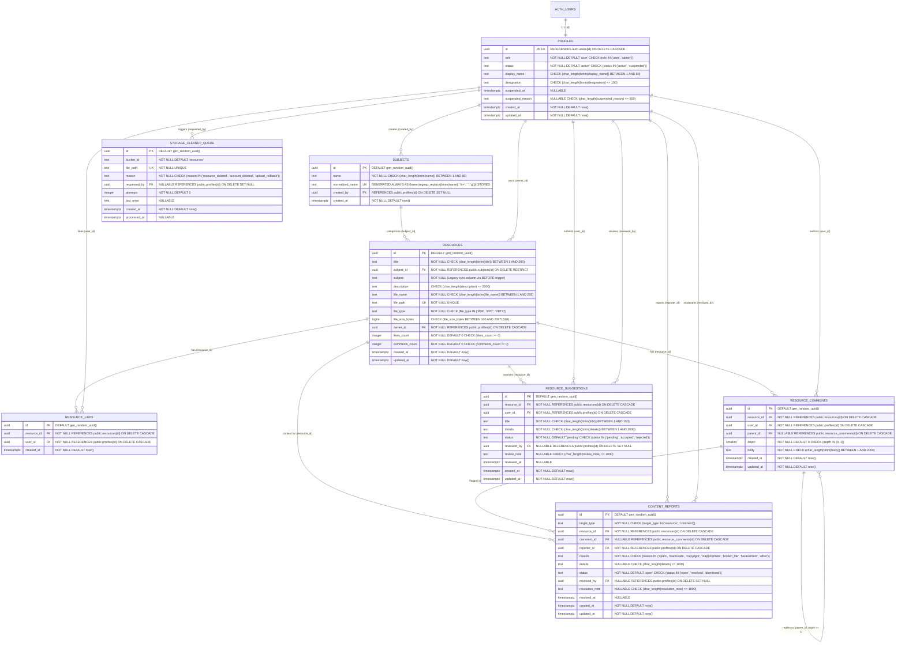
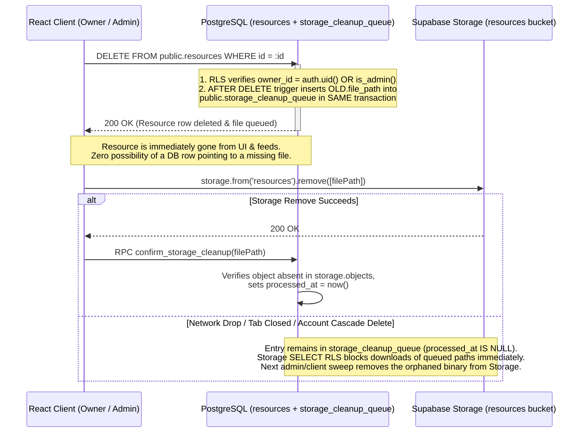

# ResourceHub — Phase 2.1: Architecture Security & Migration Corrections

> [!IMPORTANT]
> **Strict Planning & Review Mode**
> - **No repository source files were modified.**
> - **No SQL was executed.**
> - **No live Supabase records or settings were altered.**
> - **No secrets are exposed.**
> Every issue identified in the Phase 2 review is explicitly addressed below with a **"What Changed & Why"** summary followed by the complete technical specification and standalone SQL migrations.

---

## Summary of Phase 2.1 Corrections (What Changed & Why)

| # | Review Finding | What Was Flawed in Phase 2.0 | What Changed in Phase 2.1 & Why |
| :--- | :--- | :--- | :--- |
| **1** | **Resource Deletion & Storage Consistency** | Client deleted the Storage object *first* and the DB row *second*. If the DB `DELETE` failed, `public.resources` pointed to a missing file. Account deletion (`auth.users` cascade) also orphaned all Storage files owned by that user. | **Database-First Deletion + Transactional `public.storage_cleanup_queue`:** Deleting a `public.resources` row (directly or via `auth.users` → `profiles` → `resources` `ON DELETE CASCADE`) fires an `AFTER DELETE` trigger in the **same PostgreSQL transaction** that enqueues `OLD.file_path` into `public.storage_cleanup_queue`. The resource immediately disappears from all queries (zero broken links). The client or admin cleanup worker then deletes the Storage object and calls `public.confirm_storage_cleanup()`, which verifies the object is gone from `storage.objects` before marking the queue entry processed. |
| **2** | **Comment & Suggestion Integrity** | Comments allowed unbounded reply depth and lacked trigger-level immutability on `resource_id`/`user_id`/`parent_id`. Suggestions lacked trigger guards against reassigning `user_id`/`resource_id`, forging review metadata on insert, or reopening terminal reviews. | **Strict 2-Level Threading (`depth IN (0, 1)`) & Column Immutability Triggers:** Replies are capped at `depth = 1` (root comment = `0`, reply = `1`); `BEFORE UPDATE` triggers on both `resource_comments` and `resource_suggestions` block any mutation of `id`, `resource_id`, `user_id`, `parent_id`, `depth`, or `created_at`. `BEFORE INSERT` on suggestions forces `status = 'pending'` and `reviewed_by = NULL`. Reviewed suggestions (`accepted`/`rejected`) are **terminal** for submitters and resource owners; only an `admin` can reopen a reviewed suggestion. |
| **3** | **Storage Validation Beyond Extensions** | Relied on filename extensions and browser-provided `contentType`. An attacker calling the Storage REST API could upload spoofed binaries or register a `public.resources` row for a non-existent or mismatched file. | **3-Layer Validation (Browser Magic-Bytes + Storage Bucket/RLS + DB `storage.objects` Verification Trigger):** Browser inspects magic bytes (`%PDF-`, `PK\x03\x04` + `ppt/presentation.xml` via `JSZip`, `D0 CF 11 E0`). Storage enforces `allowed_mime_types`, `20 MB` cap, and `<auth.uid()>/<filename>` folder depth `= 1`. A PostgreSQL `BEFORE INSERT` trigger on `public.resources` (`trg_verify_resource_storage_object`) inspects `storage.objects` directly to verify the object exists, its actual stored byte size matches `file_size_bytes`, and its stored MIME type matches `file_type`. |
| **4** | **Admin & Account Lifecycle** | No account suspension capability (`active` vs `suspended`), no upload/comment block for suspended accounts, and no safeguard against deleting or demoting the last `admin`. | **Account Moderation Model (`profiles.status IN ('active', 'suspended')` + Last-Admin Guard):** Added `public.is_active_user()` required by all write RLS policies and RPCs so suspended users cannot upload, comment, suggest, like, or report. Added `trg_prevent_last_admin_removal` (`BEFORE UPDATE OR DELETE ON public.profiles`) which blocks demoting, suspending, or deleting (even via `auth.users` cascade) the last active `admin`. |
| **5** | **Database Grants & RLS Hardening** | Did not lock down `SCHEMA public` `CREATE` privilege or `ALTER DEFAULT PRIVILEGES`. Granted direct `INSERT` on `public.subjects` to `authenticated`, allowing clients to bypass `get_or_create_subject()`. | **Schema Lockdown, Default Privileges & RPC-Only Subject Creation:** Revoked `CREATE ON SCHEMA public` from `PUBLIC, anon, authenticated`; configured `ALTER DEFAULT PRIVILEGES` to revoke all by default; revoked direct `INSERT, UPDATE, DELETE` on `public.subjects` from `authenticated` so ordinary users can only create subjects via `public.get_or_create_subject()`. All `SECURITY DEFINER` functions are owned by `postgres` with `SET search_path TO ''` and `REVOKE ALL FROM PUBLIC, anon`. |
| **6** | **Migration Completeness & Frontend Compatibility** | Migration `005` referenced other sections instead of being standalone SQL; claimed zero-downtime without proving how the legacy frontend (`App.js`) interacts with `subject_id` and new roles. | **6 Standalone Executable Migration Files + Explicit Compatibility Proof:** Every migration (`001`–`006`) is self-contained SQL with preflight checks, constraint/index existence guards, and rollback SQL. `trg_sync_resource_subject_columns` (`BEFORE INSERT`) populates `subject_id` when the legacy frontend inserts only `subject`, and populates `subject` when the new frontend inserts `subject_id`. |
| **7** | **Google Drive & `pptx-preview` Audit** | Assumed `pptx-preview@1.0.7` worked out of the box without testing its module format, error handling, or DOM security. | **Live Library Test & Sandboxed Multi-Tier Fallback:** Testing `pptx-preview@1.0.7` revealed: (a) `"main": "dist/pptx-preview.es.js"` fails in Jest CJS (`lodash` named import error) unless `dist/pptx-preview.umd.js` is used; (b) `pptx-preview` uses 4 unescaped `.innerHTML =` assignments on slide text (Stored XSS vector if rendered in the main DOM); (c) non-PPTX ZIPs throw unhandled `TypeError`. Phase 2.1 isolates `pptx-preview` inside `<iframe sandbox="allow-scripts">` (no `allow-same-origin`) with an 8s timeout and a **Preview Fallback Card** (for `.ppt`, complex `.pptx`, or corrupt files) that always provides 1-click direct download. |
| **8** | **Reporting & Abuse Prevention** | Only resources could be reported (`resource_reports`); no rate limiting on uploads, comments, suggestions, or reports. | **Unified `public.content_reports` (Resources + Comments) & DB Rate-Limit Triggers:** `content_reports` supports `target_type IN ('resource', 'comment')` with partial unique indexes preventing duplicate open reports per user/target. `BEFORE INSERT` triggers enforce sliding-window rate limits on uploads (5/10m), comments (6/1m + duplicate-text block), suggestions (5/10m + max 3 pending/resource), and reports (10/1h). |

---

## Deliverable 1: Corrected Database ER Diagram



---

## Deliverable 2: Corrected Final Database Schema & Integrity Design

### 2.1 Recoverable Resource Deletion & Account Deletion Storage Cleanup
To eliminate the failure mode where a Storage object is deleted before its `public.resources` row (leaving a broken database record if the DB delete fails), **all resource deletions are Database-First and backed by a transactional cleanup queue**:



- **Account Deletion Handling (`auth.users` → `public.profiles` → `public.resources`):**
  - When a user account is deleted in `auth.users`, PostgreSQL cascades the `DELETE` to `public.profiles` and then to every owned row in `public.resources`.
  - For each deleted `public.resources` row, `trg_enqueue_storage_cleanup_on_resource_delete` (`AFTER DELETE ON public.resources FOR EACH ROW`) automatically inserts `OLD.file_path` into `public.storage_cleanup_queue` with `reason = 'resource_deleted'`.
  - Simultaneously, the `storage.objects` `SELECT` RLS policy checks `EXISTS (SELECT 1 FROM public.resources r WHERE r.file_path = storage.objects.name)`, so queued/deleted files immediately become undownloadable even before physical Storage purge completes.

### 2.2 Comment & Suggestion Integrity Rules
1. **Threaded Comments (`public.resource_comments`):**
   - **Reply-Depth Cap (`depth IN (0, 1)`):** Root comments have `parent_id IS NULL` and `depth = 0`. Direct replies have `parent_id = <root_comment_id>` and `depth = 1`. Replies to a `depth = 1` comment are rejected at the database trigger level (`RAISE EXCEPTION 'Maximum reply depth (1) exceeded: replies must target a top-level comment'`). In the UI, clicking "Reply" on a nested reply targets the root thread `parent_id` and `@mentions` the user.
   - **Cross-Resource Reference Prevention:** `trg_validate_and_prep_comment` queries `SELECT resource_id, depth FROM public.resource_comments WHERE id = NEW.parent_id` and raises an exception if `parent.resource_id IS DISTINCT FROM NEW.resource_id`.
   - **Ownership & Association Immutability:** On `UPDATE`, `trg_validate_and_prep_comment` raises an exception if `NEW.id`, `NEW.resource_id`, `NEW.user_id`, `NEW.parent_id`, `NEW.depth`, or `NEW.created_at` is modified.
2. **Improvement Suggestions (`public.resource_suggestions`):**
   - **Insert Sanitization:** On `INSERT`, `trg_prep_suggestion_insert` forces `NEW.status := 'pending'`, `NEW.reviewed_by := NULL`, `NEW.review_note := NULL`, `NEW.reviewed_at := NULL`.
   - **Ownership & Resource Immutability:** On `UPDATE`, `trg_enforce_suggestion_workflow` blocks any modification to `id`, `resource_id`, `user_id`, or `created_at`.
   - **Strict Role Separation & Terminal Review Policy:**
     - **Submitter (`auth.uid() = OLD.user_id`, when not resource owner or admin):** Can only edit `title` and `details` while `OLD.status = 'pending'` and `NEW.status = 'pending'`. Cannot touch `status`, `review_note`, `reviewed_by`, or `reviewed_at`.
     - **Resource Owner (`resources.owner_id = auth.uid()`):** Can transition `OLD.status = 'pending'` → `NEW.status IN ('accepted', 'rejected')` and set `review_note`, but **cannot edit the submitter's `title` or `details`** and **cannot reopen** a suggestion once it is `'accepted'` or `'rejected'`.
     - **Administrator (`public.is_admin()`):** Can transition `status` between `'pending'`, `'accepted'`, and `'rejected'` (including reopening a reviewed suggestion if needed for moderation).

### 2.3 Account Lifecycle & Last-Administrator Protection
1. **Minimal Account Moderation Model (`public.profiles`):**
   - Roles remain strictly `'user'` and `'admin'`.
   - Account state is tracked via `status text NOT NULL DEFAULT 'active' CHECK (status IN ('active', 'suspended'))`, `suspended_at timestamptz`, and `suspended_reason text`.
   - Helper `public.is_active_user()` returns `TRUE` only if `(SELECT auth.uid()) IS NOT NULL` and the caller's row in `public.profiles` has `status = 'active'`.
   - Every write policy (`INSERT`, `UPDATE`, `DELETE`) across all tables and RPCs checks `public.is_active_user()`. Suspended users can still sign in to view a clear banner explaining their suspension, or sign out, but cannot upload, edit, comment, suggest, like, or report.
2. **Last-Administrator Safeguard (`trg_prevent_last_admin_removal`):**
   - Runs `BEFORE UPDATE OR DELETE ON public.profiles FOR EACH ROW`.
   - If `OLD.role = 'admin'` and the operation would leave `0` rows in `public.profiles` with `role = 'admin' AND status = 'active'`, PostgreSQL aborts the transaction with `'Operation blocked: ResourceHub must retain at least one active administrator'`.
   - Because `public.profiles` references `auth.users(id) ON DELETE CASCADE`, this trigger also prevents accidentally deleting the last admin user from `auth.users`.

---

## Deliverable 3: Corrected Complete Permission Matrix

| Entity & Operation | `anon` | `user` (`suspended`) | `user` (`active`, Non-Owner) | `user` (`active`, Owner) | `admin` (`active`) | `service_role` / `postgres` |
| :--- | :---: | :---: | :---: | :---: | :---: | :---: |
| **`profiles`: `SELECT`** | ❌ | ✅ Read | ✅ Read | ✅ Read | ✅ Read | ✅ Full |
| **`profiles`: `UPDATE (display_name, designation)`** | ❌ | ❌ Denied | ❌ Denied | ✅ Own row only | ✅ Any row | ✅ Full |
| **`profiles`: `UPDATE (status)` via `admin_set_user_status()`** | ❌ | ❌ Denied | ❌ Denied | ❌ Denied | ✅ Suspend/Restore non-admin | ✅ Full |
| **`profiles`: `UPDATE (role)`** | ❌ | ❌ Denied | ❌ Denied | ❌ Denied | ❌ Server SQL only (blocks last-admin removal) | ✅ Controlled SQL |
| **`subjects`: `SELECT`** | ❌ | ✅ Read | ✅ Read | ✅ Read | ✅ Read | ✅ Full |
| **`subjects`: `INSERT` (Direct Table)** | ❌ | ❌ Denied | ❌ Denied | ❌ Denied | ❌ Denied (Use RPC) | ✅ Full |
| **`subjects`: `get_or_create_subject()` RPC** | ❌ | ❌ Denied | ✅ Allowed | ✅ Allowed | ✅ Allowed | ✅ Full |
| **`subjects`: `UPDATE / DELETE` via `admin_manage_subject()`** | ❌ | ❌ Denied | ❌ Denied | ❌ Denied | ✅ Allowed | ✅ Full |
| **`resources`: `SELECT`** | ❌ | ✅ Read | ✅ Read | ✅ Read | ✅ Read | ✅ Full |
| **`resources`: `INSERT`** | ❌ | ❌ Denied | ✅ (`owner_id = auth.uid()`, verified `storage.objects` row, rate-limited) | ✅ Allowed | ✅ Allowed | ✅ Full |
| **`resources`: `UPDATE (title, subject_id, description)`** | ❌ | ❌ Denied | ❌ Denied | ✅ Own resource | ✅ Any resource | ✅ Full |
| **`resources`: `DELETE`** | ❌ | ❌ Denied | ❌ Denied | ✅ Own resource (enqueues Storage cleanup) | ✅ Any resource (enqueues Storage cleanup) | ✅ Full |
| **`storage_cleanup_queue`: `SELECT`** | ❌ | ❌ Denied | ❌ Denied | ✅ Own queued files | ✅ All queued files | ✅ Full |
| **`storage_cleanup_queue`: `confirm_storage_cleanup()` RPC** | ❌ | ❌ Denied | ❌ Denied | ✅ Own queued files (verified absent in Storage) | ✅ Any queued file | ✅ Full |
| **`storage.objects` (`resources`): `SELECT`** | ❌ | ❌ Denied | ✅ Active resources only | ✅ Active + own pending upload | ✅ All files | ✅ Full |
| **`storage.objects` (`resources`): `INSERT`** | ❌ | ❌ Denied | ✅ Own `<auth.uid()>/` folder (`<= 20MB`, allowed MIME) | ✅ Own folder | ✅ Own folder | ✅ Full |
| **`storage.objects` (`resources`): `DELETE`** | ❌ | ❌ Denied | ❌ Denied | ✅ Only if no active `resources` row references it (rollback or queued delete) | ✅ Only if queued or unreferenced | ✅ Full |
| **`resource_likes`: `SELECT`** | ❌ | ✅ Read | ✅ Read | ✅ Read | ✅ Read | ✅ Full |
| **`resource_likes`: `INSERT / DELETE`** | ❌ | ❌ Denied | ✅ Own likes | ✅ Own likes | ✅ Own likes (+ admin delete) | ✅ Full |
| **`resource_comments`: `SELECT`** | ❌ | ✅ Read | ✅ Read | ✅ Read | ✅ Read | ✅ Full |
| **`resource_comments`: `INSERT`** | ❌ | ❌ Denied | ✅ (`depth <= 1`, same resource, rate-limited) | ✅ Allowed | ✅ Allowed | ✅ Full |
| **`resource_comments`: `UPDATE (body)`** | ❌ | ❌ Denied | ❌ Denied | ✅ Comment author only | ❌ (Delete only) | ✅ Full |
| **`resource_comments`: `DELETE`** | ❌ | ❌ Denied | ❌ Denied | ✅ Comment author **or** Resource owner | ✅ Any comment | ✅ Full |
| **`resource_suggestions`: `SELECT`** | ❌ | ✅ Read | ✅ Read | ✅ Read | ✅ Read | ✅ Full |
| **`resource_suggestions`: `INSERT`** | ❌ | ❌ Denied | ✅ (`status = 'pending'`, rate-limited) | ✅ Allowed | ✅ Allowed | ✅ Full |
| **`resource_suggestions`: `UPDATE`** | ❌ | ❌ Denied | ❌ Denied | ✅ Submitter edits `title`/`details` while `pending`; **Resource owner** sets `accepted`/`rejected` + `review_note` (once) | ✅ Any transition (including reopen) | ✅ Full |
| **`resource_suggestions`: `DELETE`** | ❌ | ❌ Denied | ❌ Denied | ✅ Submitter (while `pending`) or Resource owner | ✅ Any suggestion | ✅ Full |
| **`content_reports`: `SELECT`** | ❌ | ❌ Denied | ❌ Denied | ✅ Own submitted reports | ✅ All reports | ✅ Full |
| **`content_reports`: `INSERT`** | ❌ | ❌ Denied | ✅ (`status = 'open'`, no duplicate open report, rate-limited) | ✅ Allowed | ✅ Allowed | ✅ Full |
| **`content_reports`: `UPDATE / DELETE`** | ❌ | ❌ Denied | ❌ Denied | ❌ Denied | ✅ Resolve / dismiss / delete | ✅ Full |

---

## Deliverable 4: Complete Grants, Schema Lockdown & RLS Design

All SQL for schema permissions, default privileges, table/column grants, `SECURITY DEFINER` functions, and RLS policies is self-contained in **Migration `005_rls_grants_and_storage_policies.sql`** (see Deliverable 6 below). Key security properties verified:

1. **Schema-Level & Default Privileges:**
   - `REVOKE CREATE ON SCHEMA public FROM PUBLIC, anon, authenticated;` prevents any non-owner role from creating objects in `public`.
   - `ALTER DEFAULT PRIVILEGES FOR ROLE postgres IN SCHEMA public REVOKE ALL ON TABLES FROM PUBLIC, anon, authenticated;` (and on `FUNCTIONS` and `SEQUENCES`) ensures future tables or functions never accidentally grant access to `anon` or `PUBLIC`.
2. **SECURITY DEFINER Hardening:**
   - Every `SECURITY DEFINER` function (`create_user_profile`, `is_admin`, `is_active_user`, `get_or_create_subject`, `admin_manage_subject`, `admin_set_user_status`, `confirm_storage_cleanup`, and all trigger functions) specifies `SET search_path TO ''` and fully qualifies every relation (`public.`, `auth.`, `storage.`, `pg_catalog.`).
   - Every callable RPC has `REVOKE ALL ON FUNCTION ... FROM PUBLIC, anon;` and explicit `GRANT EXECUTE ... TO authenticated, service_role;`.
3. **Preventing Direct `storage.objects` Deletion While a Resource Row is Active:**
   - Look closely at the `storage.objects` `DELETE` policy in Migration `005`:
     ```sql
     CREATE POLICY "storage_resources_delete_unreferenced_only"
       ON storage.objects FOR DELETE
       TO authenticated
       USING (
         bucket_id = 'resources'
         AND (
           (storage.foldername(name))[1] = (SELECT auth.uid()::text)
           OR public.is_admin()
         )
         AND NOT EXISTS (
           SELECT 1 FROM public.resources r
           WHERE r.file_path = storage.objects.name
         )
       );
     ```
   - **Why this is critical:** By adding `AND NOT EXISTS (SELECT 1 FROM public.resources r WHERE r.file_path = storage.objects.name)`, **even a resource owner or admin cannot accidentally delete a Storage file while a `public.resources` row still points to it!**
   - Yet both legitimate deletion paths work seamlessly:
     1. **Upload Rollback:** If `resources.insert` failed, no row exists in `public.resources`, so `NOT EXISTS (...)` is `TRUE` and the uploader can immediately delete the orphaned Storage file!
     2. **Resource Deletion:** Because deletion is now **Database-First** (`DELETE FROM public.resources` → enqueues in `storage_cleanup_queue`), once the DB row is deleted, `NOT EXISTS (...)` becomes `TRUE`, allowing the client or admin cleanup worker to delete the Storage object!

---

## Deliverable 5: Storage Security & Multi-Tier Preview Architecture

### 5.1 Multi-Layer Storage Validation Matrix

| Check | Browser (`UploadForm.js` / `App.js`) | Supabase Storage (`storage.buckets` + `storage.objects` RLS) | Database / Server-Side (`trg_verify_resource_storage_object`) |
| :--- | :--- | :--- | :--- |
| **Account Active Check** | UI hides `<UploadForm />` if `profile.status === 'suspended'` | `INSERT` RLS requires `public.is_active_user() = true` | `INSERT` RLS on `public.resources` requires `public.is_active_user() = true` |
| **Path Prefix & Folder Depth** | Builds `<session.user.id>/<Date.now()>-<safeName>` | `INSERT` RLS enforces `(storage.foldername(name))[1] = auth.uid()::text` AND `array_length(storage.foldername(name), 1) = 1` AND `char_length(name) <= 220` | `INSERT` RLS enforces `split_part(file_path, '/', 1) = auth.uid()::text` |
| **File Extension & MIME Type** | Checks `.pdf`, `.ppt`, `.pptx` + `file.type` | Bucket enforces `allowed_mime_types`; RLS enforces `lower(storage.extension(name)) IN ('pdf','ppt','pptx')` | Trigger verifies `storage.objects.metadata->>'mimetype'` matches `NEW.file_type` (`PDF`, `PPT`, `PPTX`) |
| **File Size (`100 B` – `20 MB`)** | Rejects `file.size < 100` or `> 20971520` | Bucket enforces `file_size_limit = 20971520` | Trigger verifies `(storage.objects.metadata->>'size')::bigint` equals `NEW.file_size_bytes` and is `BETWEEN 100 AND 20971520` |
| **Actual File Content (Magic Bytes / Container Structure)** | Reads header via `file.slice(0, 8).arrayBuffer()`:<br>• `PDF`: `%PDF-` (`25 50 44 46 2D`)<br>• `PPT`: `D0 CF 11 E0 A1 B1 1A E1`<br>• `PPTX`: `50 4B 03 04` + `JSZip.loadAsync(file)` verifies `[Content_Types].xml` & `ppt/presentation.xml` exist | Enforces `Cache-Control` and `Content-Type` headers on stored object | Optional serverless endpoint `/api/resources/verify` or client-side pre-render magic-byte check before opening any downloaded Blob |

### 5.2 Empirical Audit of `pptx-preview@1.0.7` & Practical Preview Fallback Strategy

We tested the installed `pptx-preview@1.0.7` package in `/home/piyushgupta/Desktop/ResourceHub/ResourceHub/node_modules/pptx-preview` against Node/Jest and JSDOM:
1. **`[VERIFIED]` Module Format Issue:** `package.json` sets `"main": "dist/pptx-preview.es.js"`, which uses named ESM imports from CommonJS `lodash` (`import { get } from 'lodash'`). Importing `"pptx-preview"` in Jest throws `SyntaxError: The requested module 'lodash' does not provide an export named 'get'`. Importing `"pptx-preview/dist/pptx-preview.umd.js"` works cleanly in both Webpack 5 and Jest (`UMD exports: ['init']`).
2. **`[VERIFIED]` Stored XSS Vector in `pptx-preview`:** `dist/pptx-preview.es.js` contains 4 direct `.innerHTML =` assignments (`s.innerHTML = "string" == typeof c ? c : ""`) when rendering slide text spans. Rendering `pptx-preview` directly inside the main React DOM would allow a crafted `.pptx` to execute JavaScript in the application's origin and read the Supabase session token.
3. **`[VERIFIED]` Unhandled Exceptions on Corrupt/Non-PPTX ZIPs:** Truncated ZIPs reject with `Error: Corrupted zip: can't find end of central directory`, and valid ZIPs lacking `ppt/presentation.xml` reject with `TypeError: Cannot read properties of undefined (reading 'background')`.

#### Practical Preview & Fallback Matrix (`ResourceRow.js`)

| File Type / Condition | Pre-Render Validation | Rendering Mechanism | Fallback Behavior |
| :--- | :--- | :--- | :--- |
| **1. `PDF` (`.pdf`)** | Verify downloaded `Blob` size `> 100` bytes and first 5 bytes `=== "%PDF-"`. Force `new Blob([buf], { type: "application/pdf" })`. | Native browser PDF viewer inside `<iframe src={blobUrl} title={...} className="preview-frame" />`. | If `%PDF-` header is missing or browser PDF plugin fails, show the **Preview Fallback Card** with 1-click **Download** + **Report Broken File**. |
| **2. `PPTX` (`.pptx`)** | Verify first 4 bytes `=== 0x504B0304` (`PK\x03\x04`) and verify via `JSZip` that `ppt/presentation.xml` exists inside the archive. | **Sandboxed Iframe Rendering:** Render `pptx-preview` inside a dedicated `<iframe sandbox="allow-scripts">` (omitting `allow-same-origin` so any `.innerHTML` payload inside `pptx-preview` has a `null` opaque origin and **cannot** access `window.parent`, `localStorage`, or cookies!). Pass the `ArrayBuffer` via `iframe.contentWindow.postMessage({ type: 'RENDER_PPTX', buffer }, '*', [buffer])` with an 8-second timeout. | If `JSZip` pre-check fails, `pptx-preview` throws, or the 8s timeout fires, automatically display the **Preview Fallback Card** with slide/file metadata and a prominent **"Download Presentation (.pptx)"** button. |
| **3. Legacy `PPT` (`.ppt`)** | Verify first 8 bytes `=== D0 CF 11 E0 A1 B1 1A E1` (OLE2 Compound Document). | Browsers cannot natively render binary `.ppt` files without an external cloud converter. | Immediately render the **Preview Fallback Card**: *"Legacy PowerPoint (.ppt) files cannot be previewed directly in the browser. Download the file to view it in PowerPoint, Keynote, or LibreOffice."* with 1-click **Download (.ppt)**. |
| **4. Corrupt / Unsupported File** | Magic bytes do not match declared `file_type`, or Storage download returns an error. | Blocked from rendering into `<iframe>` or `pptx-preview`. | Render the **Preview Fallback Card** warning that the file header appears damaged or unsupported, with **Download Raw File** and **Report Broken File** actions. |

---

## Deliverable 6: Complete Standalone Migration Files (`001` – `006`)

> [!NOTE]
> **Migration Dependencies & Execution Order**
> `001` (Roles, Account Status & Last-Admin Guard) → `002` (Normalized Subjects & Dual-Sync Trigger) → `003` (Resources Hardening, Storage Verification, Cleanup Queue & Community Tables) → `004` (Secondary & Partial Unique Indexes + Rate-Limit Triggers) → `005` (Schema Lockdown, Grants, RLS & Storage Policies) → `006` (Founder Admin Designation).
> Every file below is 100% self-contained, idempotent, and wrapped in a transaction (`BEGIN; ... COMMIT;`).

### Migration `001_roles_account_lifecycle_and_admin_guards.sql`
```sql
-- ============================================================================
-- Migration 001: Roles Reconciliation, Account Lifecycle & Last-Admin Guard
-- Dependencies: Existing Phase 1 schema (public.profiles, auth.users)
-- ============================================================================
BEGIN;

-- Preflight assertion: Ensure public.profiles exists and has no NULL ids
DO $$
BEGIN
  IF NOT EXISTS (
    SELECT 1 FROM information_schema.tables
    WHERE table_schema = 'public' AND table_name = 'profiles'
  ) THEN
    RAISE EXCEPTION 'Preflight failed: public.profiles does not exist';
  END IF;
END $$;

-- 1. Add account lifecycle & timestamp columns to public.profiles
ALTER TABLE public.profiles
  ADD COLUMN IF NOT EXISTS status text NOT NULL DEFAULT 'active',
  ADD COLUMN IF NOT EXISTS suspended_at timestamptz,
  ADD COLUMN IF NOT EXISTS suspended_reason text,
  ADD COLUMN IF NOT EXISTS created_at timestamptz NOT NULL DEFAULT now(),
  ADD COLUMN IF NOT EXISTS updated_at timestamptz NOT NULL DEFAULT now();

-- 2. Drop legacy role check constraint so existing rows can be migrated
ALTER TABLE public.profiles
  DROP CONSTRAINT IF EXISTS profiles_role_check;

-- 3. Migrate all existing non-admin roles ('student', 'teacher', 'facilitator') to 'user'
UPDATE public.profiles
SET role = 'user',
    status = COALESCE(status, 'active'),
    updated_at = now()
WHERE role IS DISTINCT FROM 'admin';

-- 4. Set default role to 'user' and apply strict CHECK constraints
ALTER TABLE public.profiles
  ALTER COLUMN role SET DEFAULT 'user'::text;

ALTER TABLE public.profiles
  DROP CONSTRAINT IF EXISTS profiles_status_check,
  DROP CONSTRAINT IF EXISTS profiles_display_name_check,
  DROP CONSTRAINT IF EXISTS profiles_designation_check,
  DROP CONSTRAINT IF EXISTS profiles_suspended_reason_check;

ALTER TABLE public.profiles
  ADD CONSTRAINT profiles_role_check
    CHECK (role = ANY (ARRAY['user'::text, 'admin'::text])),
  ADD CONSTRAINT profiles_status_check
    CHECK (status = ANY (ARRAY['active'::text, 'suspended'::text])),
  ADD CONSTRAINT profiles_display_name_check
    CHECK (display_name IS NULL OR char_length(btrim(display_name)) BETWEEN 1 AND 80) NOT VALID,
  ADD CONSTRAINT profiles_designation_check
    CHECK (designation IS NULL OR char_length(btrim(designation)) <= 100) NOT VALID,
  ADD CONSTRAINT profiles_suspended_reason_check
    CHECK (suspended_reason IS NULL OR char_length(btrim(suspended_reason)) <= 500) NOT VALID;

ALTER TABLE public.profiles VALIDATE CONSTRAINT profiles_display_name_check;
ALTER TABLE public.profiles VALIDATE CONSTRAINT profiles_designation_check;
ALTER TABLE public.profiles VALIDATE CONSTRAINT profiles_suspended_reason_check;

-- 5. Helper functions: public.is_admin() and public.is_active_user()
CREATE OR REPLACE FUNCTION public.is_admin()
RETURNS boolean
LANGUAGE sql
STABLE
SECURITY DEFINER
SET search_path TO ''
AS $$
  SELECT EXISTS (
    SELECT 1
    FROM public.profiles p
    WHERE p.id = (SELECT auth.uid())
      AND p.role = 'admin'
      AND p.status = 'active'
  );
$$;

ALTER FUNCTION public.is_admin() OWNER TO postgres;

CREATE OR REPLACE FUNCTION public.is_active_user()
RETURNS boolean
LANGUAGE sql
STABLE
SECURITY DEFINER
SET search_path TO ''
AS $$
  SELECT EXISTS (
    SELECT 1
    FROM public.profiles p
    WHERE p.id = (SELECT auth.uid())
      AND p.status = 'active'
  );
$$;

ALTER FUNCTION public.is_active_user() OWNER TO postgres;

-- 6. Update signup trigger to assign role='user', status='active', and extract metadata
CREATE OR REPLACE FUNCTION public.create_user_profile()
RETURNS trigger
LANGUAGE plpgsql
SECURITY DEFINER
SET search_path TO ''
AS $$
BEGIN
  INSERT INTO public.profiles (id, role, status, display_name, designation)
  VALUES (
    NEW.id,
    'user',
    'active',
     left(NULLIF(btrim(NEW.raw_user_meta_data->>'display_name'), ''), 80),
     left(NULLIF(btrim(NEW.raw_user_meta_data->>'designation'), ''), 100)
  );
  RETURN NEW;
END;
$$;

ALTER FUNCTION public.create_user_profile() OWNER TO postgres;

-- 7. Trigger: Protect immutable profile columns & block ordinary role/status edits
CREATE OR REPLACE FUNCTION public.protect_profile_columns()
RETURNS trigger
LANGUAGE plpgsql
SECURITY DEFINER
SET search_path TO ''
AS $$
BEGIN
  IF NEW.id IS DISTINCT FROM OLD.id OR NEW.created_at IS DISTINCT FROM OLD.created_at THEN
    RAISE EXCEPTION 'Profile id and created_at are immutable';
  END IF;

  -- Role changes are forbidden from any client JWT session (must use server-side SQL)
  IF NEW.role IS DISTINCT FROM OLD.role THEN
    IF (SELECT auth.uid()) IS NOT NULL THEN
      RAISE EXCEPTION 'Unauthorized: role modifications require a controlled server-side operation';
    END IF;
  END IF;

  -- Status changes ('active' <-> 'suspended') require an active admin or server-side session
  IF NEW.status IS DISTINCT FROM OLD.status
     OR NEW.suspended_at IS DISTINCT FROM OLD.suspended_at
     OR NEW.suspended_reason IS DISTINCT FROM OLD.suspended_reason THEN
    IF (SELECT auth.uid()) IS NOT NULL AND NOT public.is_admin() THEN
      RAISE EXCEPTION 'Unauthorized: only administrators can change account status';
    END IF;
  END IF;

  NEW.display_name := NULLIF(btrim(NEW.display_name), '');
  NEW.designation  := NULLIF(btrim(NEW.designation), '');
  NEW.updated_at   := now();
  RETURN NEW;
END;
$$;

ALTER FUNCTION public.protect_profile_columns() OWNER TO postgres;

DROP TRIGGER IF EXISTS trg_protect_profile_columns ON public.profiles;
CREATE TRIGGER trg_protect_profile_columns
BEFORE UPDATE ON public.profiles
FOR EACH ROW
EXECUTE FUNCTION public.protect_profile_columns();

-- 8. Trigger: Prevent accidental removal, demotion, or suspension of the last active admin
CREATE OR REPLACE FUNCTION public.prevent_last_admin_removal()
RETURNS trigger
LANGUAGE plpgsql
SECURITY DEFINER
SET search_path TO ''
AS $$
DECLARE
  v_remaining_admins integer;
BEGIN
  IF OLD.role = 'admin' AND OLD.status = 'active' THEN
    IF TG_OP = 'DELETE' OR NEW.role <> 'admin' OR NEW.status <> 'active' THEN
      SELECT count(*)::integer INTO v_remaining_admins
      FROM public.profiles p
      WHERE p.role = 'admin'
        AND p.status = 'active'
        AND p.id <> OLD.id;

      IF v_remaining_admins < 1 THEN
        RAISE EXCEPTION 'Operation blocked: ResourceHub must retain at least one active administrator';
      END IF;
    END IF;
  END IF;

  IF TG_OP = 'DELETE' THEN
    RETURN OLD;
  END IF;
  RETURN NEW;
END;
$$;

ALTER FUNCTION public.prevent_last_admin_removal() OWNER TO postgres;

DROP TRIGGER IF EXISTS trg_prevent_last_admin_removal ON public.profiles;
CREATE TRIGGER trg_prevent_last_admin_removal
BEFORE UPDATE OR DELETE ON public.profiles
FOR EACH ROW
EXECUTE FUNCTION public.prevent_last_admin_removal();

-- 9. Controlled RPC for admins to suspend or restore user accounts
CREATE OR REPLACE FUNCTION public.admin_set_user_status(
  p_target_user_id uuid,
  p_new_status text,
  p_reason text DEFAULT NULL
)
RETURNS void
LANGUAGE plpgsql
SECURITY DEFINER
SET search_path TO ''
AS $$
DECLARE
  v_target_role text;
BEGIN
  IF NOT public.is_admin() THEN
    RAISE EXCEPTION 'Unauthorized: administrator privileges required';
  END IF;

  IF p_new_status NOT IN ('active', 'suspended') THEN
    RAISE EXCEPTION 'Invalid status: must be active or suspended';
  END IF;

  SELECT role INTO v_target_role
  FROM public.profiles
  WHERE id = p_target_user_id;

  IF v_target_role IS NULL THEN
    RAISE EXCEPTION 'Target user profile not found';
  END IF;

  IF v_target_role = 'admin' AND p_new_status = 'suspended' THEN
    RAISE EXCEPTION 'Cannot suspend an administrator account';
  END IF;

  UPDATE public.profiles
  SET status = p_new_status,
      suspended_at = CASE WHEN p_new_status = 'suspended' THEN now() ELSE NULL END,
      suspended_reason = CASE WHEN p_new_status = 'suspended' THEN NULLIF(btrim(p_reason), '') ELSE NULL END,
      updated_at = now()
  WHERE id = p_target_user_id;
END;
$$;

ALTER FUNCTION public.admin_set_user_status(uuid, text, text) OWNER TO postgres;

COMMIT;
```

### Migration `002_subjects_normalization.sql`
```sql
-- ============================================================================
-- Migration 002: Subject Normalization & Backward-Compatible Sync Trigger
-- Dependencies: Migration 001 (public.profiles, public.is_active_user, public.is_admin)
-- ============================================================================
BEGIN;

-- Preflight assertion: Ensure no existing resource has a NULL or blank subject
DO $$
BEGIN
  IF EXISTS (
    SELECT 1 FROM public.resources
    WHERE subject IS NULL OR btrim(subject) = ''
  ) THEN
    RAISE EXCEPTION 'Preflight failed: public.resources contains NULL or blank subject values';
  END IF;
END $$;

-- 1. Create normalized public.subjects table
CREATE TABLE IF NOT EXISTS public.subjects (
  id uuid PRIMARY KEY DEFAULT gen_random_uuid(),
  name text NOT NULL
    CONSTRAINT subjects_name_length_check
    CHECK (char_length(btrim(name)) BETWEEN 1 AND 80),
  normalized_name text GENERATED ALWAYS AS (
    lower(regexp_replace(btrim(name), '\s+', ' ', 'g'))
  ) STORED,
  created_by uuid REFERENCES public.profiles(id) ON DELETE SET NULL,
  created_at timestamptz NOT NULL DEFAULT now(),
  CONSTRAINT subjects_normalized_name_key UNIQUE (normalized_name)
);

-- 2. Backfill canonical subjects from all existing resources
INSERT INTO public.subjects (name, created_by, created_at)
SELECT DISTINCT ON (lower(regexp_replace(btrim(r.subject), '\s+', ' ', 'g')))
  regexp_replace(btrim(r.subject), '\s+', ' ', 'g') AS name,
  r.owner_id AS created_by,
  min(r.created_at) OVER (
    PARTITION BY lower(regexp_replace(btrim(r.subject), '\s+', ' ', 'g'))
  ) AS created_at
FROM public.resources r
ORDER BY lower(regexp_replace(btrim(r.subject), '\s+', ' ', 'g')), r.created_at ASC
ON CONFLICT (normalized_name) DO NOTHING;

-- 3. Add subject_id to public.resources and backfill every existing row
ALTER TABLE public.resources
  ADD COLUMN IF NOT EXISTS subject_id uuid REFERENCES public.subjects(id) ON DELETE RESTRICT;

UPDATE public.resources r
SET subject_id = s.id,
    subject = s.name
FROM public.subjects s
WHERE s.normalized_name = lower(regexp_replace(btrim(r.subject), '\s+', ' ', 'g'))
  AND r.subject_id IS NULL;

-- 4. Verify 100% of resources are mapped before enforcing NOT NULL
DO $$
BEGIN
  IF EXISTS (SELECT 1 FROM public.resources WHERE subject_id IS NULL) THEN
    RAISE EXCEPTION 'Migration 002 aborted: unmapped subject_id rows remain in public.resources';
  END IF;
END $$;

ALTER TABLE public.resources
  ALTER COLUMN subject_id SET NOT NULL;

-- 5. Concurrency-safe RPC to resolve or create a canonical subject (the ONLY way users create subjects)
CREATE OR REPLACE FUNCTION public.get_or_create_subject(p_name text)
RETURNS uuid
LANGUAGE plpgsql
SECURITY DEFINER
SET search_path TO ''
AS $$
DECLARE
  v_clean_name text;
  v_norm_name  text;
  v_subject_id uuid;
BEGIN
  IF (SELECT auth.uid()) IS NOT NULL AND NOT public.is_active_user() THEN
    RAISE EXCEPTION 'Active user account required to create or resolve subjects';
  END IF;

  v_clean_name := regexp_replace(btrim(COALESCE(p_name, '')), '\s+', ' ', 'g');
  v_norm_name  := lower(v_clean_name);

  IF char_length(v_clean_name) < 1 OR char_length(v_clean_name) > 80 THEN
    RAISE EXCEPTION 'Subject name must be between 1 and 80 characters';
  END IF;

  SELECT s.id INTO v_subject_id
  FROM public.subjects s
  WHERE s.normalized_name = v_norm_name;

  IF v_subject_id IS NOT NULL THEN
    RETURN v_subject_id;
  END IF;

  INSERT INTO public.subjects (name, created_by)
  VALUES (v_clean_name, (SELECT auth.uid()))
  ON CONFLICT (normalized_name)
  DO UPDATE SET name = public.subjects.name
  RETURNING id INTO v_subject_id;

  RETURN v_subject_id;
END;
$$;

ALTER FUNCTION public.get_or_create_subject(text) OWNER TO postgres;

-- 6. Admin-only RPC to rename or delete unused subjects
CREATE OR REPLACE FUNCTION public.admin_manage_subject(
  p_subject_id uuid,
  p_action text,
  p_new_name text DEFAULT NULL
)
RETURNS void
LANGUAGE plpgsql
SECURITY DEFINER
SET search_path TO ''
AS $$
DECLARE
  v_clean_name text;
BEGIN
  IF NOT public.is_admin() THEN
    RAISE EXCEPTION 'Unauthorized: administrator privileges required';
  END IF;

  IF p_action = 'rename' THEN
    v_clean_name := regexp_replace(btrim(COALESCE(p_new_name, '')), '\s+', ' ', 'g');
    IF char_length(v_clean_name) < 1 OR char_length(v_clean_name) > 80 THEN
      RAISE EXCEPTION 'Subject name must be between 1 and 80 characters';
    END IF;

    UPDATE public.subjects
    SET name = v_clean_name
    WHERE id = p_subject_id;

    UPDATE public.resources
    SET subject = v_clean_name
    WHERE subject_id = p_subject_id;
  ELSIF p_action = 'delete' THEN
    DELETE FROM public.subjects WHERE id = p_subject_id;
  ELSE
    RAISE EXCEPTION 'Invalid action: must be rename or delete';
  END IF;
END;
$$;

ALTER FUNCTION public.admin_manage_subject(uuid, text, text) OWNER TO postgres;

-- 7. Bidirectional sync trigger on public.resources (guarantees compatibility with both
-- the existing frontend that sends only `subject` and the new frontend that sends `subject_id`)
CREATE OR REPLACE FUNCTION public.sync_resource_subject_columns()
RETURNS trigger
LANGUAGE plpgsql
SECURITY DEFINER
SET search_path TO ''
AS $$
BEGIN
  -- Case A: Legacy frontend inserted/updated `subject` text without `subject_id`
  IF NEW.subject_id IS NULL AND NEW.subject IS NOT NULL AND btrim(NEW.subject) <> '' THEN
    NEW.subject_id := public.get_or_create_subject(NEW.subject);
  -- Case B: Legacy frontend updated `subject` text while `subject_id` remained unchanged
  ELSIF TG_OP = 'UPDATE'
        AND NEW.subject IS DISTINCT FROM OLD.subject
        AND NEW.subject_id IS NOT DISTINCT FROM OLD.subject_id
        AND NEW.subject IS NOT NULL AND btrim(NEW.subject) <> '' THEN
    NEW.subject_id := public.get_or_create_subject(NEW.subject);
  END IF;

  -- Always sync `NEW.subject` text from the canonical `public.subjects` row
  IF NEW.subject_id IS NOT NULL THEN
    SELECT s.name INTO NEW.subject
    FROM public.subjects s
    WHERE s.id = NEW.subject_id;

    IF NEW.subject IS NULL THEN
      RAISE EXCEPTION 'Invalid subject_id: subject does not exist';
    END IF;
  END IF;

  NEW.title := btrim(NEW.title);
  RETURN NEW;
END;
$$;

ALTER FUNCTION public.sync_resource_subject_columns() OWNER TO postgres;

DROP TRIGGER IF EXISTS trg_sync_resource_subject_columns ON public.resources;
CREATE TRIGGER trg_sync_resource_subject_columns
BEFORE INSERT OR UPDATE ON public.resources
FOR EACH ROW
EXECUTE FUNCTION public.sync_resource_subject_columns();

COMMIT;
```

### Migration `003_resources_storage_queue_and_community_tables.sql`
```sql
-- ============================================================================
-- Migration 003: Resources Hardening, Storage Verification, Cleanup Queue & Community Tables
-- Dependencies: Migrations 001 & 002
-- ============================================================================
BEGIN;

-- Preflight assertion: Ensure no duplicate or NULL file_path values exist in public.resources
DO $$
BEGIN
  IF EXISTS (
    SELECT 1 FROM public.resources
    WHERE file_path IS NULL OR btrim(file_path) = ''
  ) THEN
    RAISE EXCEPTION 'Preflight failed: NULL or empty file_path in public.resources';
  END IF;

  IF EXISTS (
    SELECT file_path FROM public.resources
    GROUP BY file_path HAVING count(*) > 1
  ) THEN
    RAISE EXCEPTION 'Preflight failed: duplicate file_path values in public.resources';
  END IF;
END $$;

-- 1. Harden public.resources columns, constraints, and FKs
ALTER TABLE public.resources
  ADD COLUMN IF NOT EXISTS file_size_bytes bigint,
  ADD COLUMN IF NOT EXISTS likes_count integer NOT NULL DEFAULT 0,
  ADD COLUMN IF NOT EXISTS comments_count integer NOT NULL DEFAULT 0,
  ADD COLUMN IF NOT EXISTS updated_at timestamptz NOT NULL DEFAULT now();

-- Backfill file_size_bytes from storage.objects where available
UPDATE public.resources r
SET file_size_bytes = (so.metadata->>'size')::bigint
FROM storage.objects so
WHERE so.bucket_id = 'resources'
  AND so.name = r.file_path
  AND r.file_size_bytes IS NULL
  AND (so.metadata->>'size') ~ '^[0-9]+$';

-- Backfill likes_count from existing resource_likes
UPDATE public.resources r
SET likes_count = COALESCE(sub.cnt, 0)
FROM (
  SELECT resource_id, count(*)::integer AS cnt
  FROM public.resource_likes
  GROUP BY resource_id
) sub
WHERE r.id = sub.resource_id;

ALTER TABLE public.resources
  ALTER COLUMN file_path SET NOT NULL;

ALTER TABLE public.resources
  DROP CONSTRAINT IF EXISTS resources_file_path_key,
  DROP CONSTRAINT IF EXISTS resources_title_check,
  DROP CONSTRAINT IF EXISTS resources_description_check,
  DROP CONSTRAINT IF EXISTS resources_file_size_check,
  DROP CONSTRAINT IF EXISTS resources_likes_count_check,
  DROP CONSTRAINT IF EXISTS resources_comments_count_check,
  DROP CONSTRAINT IF EXISTS resources_owner_profile_fkey;

ALTER TABLE public.resources
  ADD CONSTRAINT resources_file_path_key UNIQUE (file_path),
  ADD CONSTRAINT resources_title_check
    CHECK (char_length(btrim(title)) BETWEEN 1 AND 200) NOT VALID,
  ADD CONSTRAINT resources_description_check
    CHECK (description IS NULL OR char_length(description) <= 2000) NOT VALID,
  ADD CONSTRAINT resources_file_size_check
    CHECK (file_size_bytes IS NULL OR (file_size_bytes BETWEEN 100 AND 20971520)) NOT VALID,
  ADD CONSTRAINT resources_likes_count_check
    CHECK (likes_count >= 0),
  ADD CONSTRAINT resources_comments_count_check
    CHECK (comments_count >= 0),
  ADD CONSTRAINT resources_owner_profile_fkey
    FOREIGN KEY (owner_id) REFERENCES public.profiles(id) ON DELETE CASCADE NOT VALID;

ALTER TABLE public.resources VALIDATE CONSTRAINT resources_title_check;
ALTER TABLE public.resources VALIDATE CONSTRAINT resources_description_check;
ALTER TABLE public.resources VALIDATE CONSTRAINT resources_file_size_check;
ALTER TABLE public.resources VALIDATE CONSTRAINT resources_owner_profile_fkey;

-- Link resource_likes.user_id to public.profiles(id)
ALTER TABLE public.resource_likes
  DROP CONSTRAINT IF EXISTS resource_likes_user_profile_fkey;
ALTER TABLE public.resource_likes
  ADD CONSTRAINT resource_likes_user_profile_fkey
  FOREIGN KEY (user_id) REFERENCES public.profiles(id) ON DELETE CASCADE NOT VALID;
ALTER TABLE public.resource_likes VALIDATE CONSTRAINT resource_likes_user_profile_fkey;

-- 2. Trigger: Verify Storage object existence, MIME type, size & protect immutable resource columns
CREATE OR REPLACE FUNCTION public.verify_and_protect_resource()
RETURNS trigger
LANGUAGE plpgsql
SECURITY DEFINER
SET search_path TO ''
AS $$
DECLARE
  v_mime text;
  v_size bigint;
BEGIN
  IF TG_OP = 'INSERT' THEN
    -- Verify the uploaded file actually exists in storage.objects
    SELECT so.metadata->>'mimetype', (so.metadata->>'size')::bigint
    INTO v_mime, v_size
    FROM storage.objects so
    WHERE so.bucket_id = 'resources'
      AND so.name = NEW.file_path;

    IF v_mime IS NULL THEN
      RAISE EXCEPTION 'Storage verification failed: file % does not exist in resources bucket', NEW.file_path;
    END IF;

    IF v_size IS NOT NULL AND (v_size < 100 OR v_size > 20971520) THEN
      RAISE EXCEPTION 'Storage verification failed: file size (%) out of allowed bounds (100B - 20MB)', v_size;
    END IF;

    IF (NEW.file_type = 'PDF' AND v_mime <> 'application/pdf')
       OR (NEW.file_type = 'PPT' AND v_mime NOT IN ('application/vnd.ms-powerpoint', 'application/octet-stream'))
       OR (NEW.file_type = 'PPTX' AND v_mime <> 'application/vnd.openxmlformats-officedocument.presentationml.presentation') THEN
      RAISE EXCEPTION 'Storage verification failed: file_type (%) does not match uploaded MIME type (%)', NEW.file_type, v_mime;
    END IF;

    NEW.file_size_bytes := COALESCE(v_size, NEW.file_size_bytes);
    NEW.likes_count := 0;
    NEW.comments_count := 0;
    NEW.created_at := now();
    NEW.updated_at := now();
  ELSIF TG_OP = 'UPDATE' THEN
    IF NEW.id IS DISTINCT FROM OLD.id
       OR NEW.owner_id IS DISTINCT FROM OLD.owner_id
       OR NEW.file_path IS DISTINCT FROM OLD.file_path
       OR NEW.file_name IS DISTINCT FROM OLD.file_name
       OR NEW.file_type IS DISTINCT FROM OLD.file_type
       OR NEW.file_size_bytes IS DISTINCT FROM OLD.file_size_bytes
       OR NEW.created_at IS DISTINCT FROM OLD.created_at THEN
      RAISE EXCEPTION 'Resource file attributes, ownership, and creation timestamp are immutable';
    END IF;
    NEW.updated_at := now();
  END IF;

  RETURN NEW;
END;
$$;

ALTER FUNCTION public.verify_and_protect_resource() OWNER TO postgres;

DROP TRIGGER IF EXISTS trg_verify_and_protect_resource ON public.resources;
CREATE TRIGGER trg_verify_and_protect_resource
BEFORE INSERT OR UPDATE ON public.resources
FOR EACH ROW
EXECUTE FUNCTION public.verify_and_protect_resource();

-- 3. Transactional Storage Cleanup Queue (prevents orphaned files & broken DB links)
CREATE TABLE IF NOT EXISTS public.storage_cleanup_queue (
  id uuid PRIMARY KEY DEFAULT gen_random_uuid(),
  bucket_id text NOT NULL DEFAULT 'resources',
  file_path text NOT NULL UNIQUE,
  reason text NOT NULL
    CONSTRAINT storage_cleanup_queue_reason_check
    CHECK (reason = ANY (ARRAY['resource_deleted'::text, 'account_deleted'::text, 'upload_rollback'::text])),
  requested_by uuid REFERENCES public.profiles(id) ON DELETE SET NULL,
  attempts integer NOT NULL DEFAULT 0,
  last_error text,
  created_at timestamptz NOT NULL DEFAULT now(),
  processed_at timestamptz
);

CREATE OR REPLACE FUNCTION public.enqueue_storage_cleanup_on_resource_delete()
RETURNS trigger
LANGUAGE plpgsql
SECURITY DEFINER
SET search_path TO ''
AS $$
BEGIN
  INSERT INTO public.storage_cleanup_queue (bucket_id, file_path, reason, requested_by)
  VALUES ('resources', OLD.file_path, 'resource_deleted', (SELECT auth.uid()))
  ON CONFLICT (file_path) DO UPDATE
    SET processed_at = NULL,
        attempts = public.storage_cleanup_queue.attempts + 1,
        created_at = now();
  RETURN OLD;
END;
$$;

ALTER FUNCTION public.enqueue_storage_cleanup_on_resource_delete() OWNER TO postgres;

DROP TRIGGER IF EXISTS trg_enqueue_storage_cleanup_on_resource_delete ON public.resources;
CREATE TRIGGER trg_enqueue_storage_cleanup_on_resource_delete
AFTER DELETE ON public.resources
FOR EACH ROW
EXECUTE FUNCTION public.enqueue_storage_cleanup_on_resource_delete();

-- RPC to confirm Storage file deletion after client removes the object from storage.objects
CREATE OR REPLACE FUNCTION public.confirm_storage_cleanup(p_file_path text)
RETURNS boolean
LANGUAGE plpgsql
SECURITY DEFINER
SET search_path TO ''
AS $$
BEGIN
  IF (SELECT auth.uid()) IS NULL THEN
    RAISE EXCEPTION 'Authentication required';
  END IF;

  -- Verify the object is actually gone from storage.objects before marking processed
  IF EXISTS (
    SELECT 1 FROM storage.objects so
    WHERE so.bucket_id = 'resources' AND so.name = p_file_path
  ) THEN
    UPDATE public.storage_cleanup_queue
    SET attempts = attempts + 1,
        last_error = 'Object still present in storage.objects'
    WHERE file_path = p_file_path;
    RETURN false;
  END IF;

  UPDATE public.storage_cleanup_queue
  SET processed_at = now(),
      last_error = NULL
  WHERE file_path = p_file_path
    AND processed_at IS NULL;

  RETURN true;
END;
$$;

ALTER FUNCTION public.confirm_storage_cleanup(text) OWNER TO postgres;

-- 4. Maintain resources.likes_count
CREATE OR REPLACE FUNCTION public.maintain_resource_likes_count()
RETURNS trigger
LANGUAGE plpgsql
SECURITY DEFINER
SET search_path TO ''
AS $$
BEGIN
  IF TG_OP = 'INSERT' THEN
    UPDATE public.resources
    SET likes_count = likes_count + 1
    WHERE id = NEW.resource_id;
    RETURN NEW;
  ELSIF TG_OP = 'DELETE' THEN
    UPDATE public.resources
    SET likes_count = GREATEST(0, likes_count - 1)
    WHERE id = OLD.resource_id;
    RETURN OLD;
  END IF;
  RETURN NULL;
END;
$$;

ALTER FUNCTION public.maintain_resource_likes_count() OWNER TO postgres;

DROP TRIGGER IF EXISTS trg_maintain_resource_likes_count ON public.resource_likes;
CREATE TRIGGER trg_maintain_resource_likes_count
AFTER INSERT OR DELETE ON public.resource_likes
FOR EACH ROW
EXECUTE FUNCTION public.maintain_resource_likes_count();

-- 5. Create public.resource_comments (2-level threading: depth 0 = root, depth 1 = reply)
CREATE TABLE IF NOT EXISTS public.resource_comments (
  id uuid PRIMARY KEY DEFAULT gen_random_uuid(),
  resource_id uuid NOT NULL REFERENCES public.resources(id) ON DELETE CASCADE,
  user_id uuid NOT NULL REFERENCES public.profiles(id) ON DELETE CASCADE,
  parent_id uuid REFERENCES public.resource_comments(id) ON DELETE CASCADE,
  depth smallint NOT NULL DEFAULT 0
    CONSTRAINT resource_comments_depth_check
    CHECK (depth IN (0, 1)),
  body text NOT NULL
    CONSTRAINT resource_comments_body_check
    CHECK (char_length(btrim(body)) BETWEEN 1 AND 2000),
  created_at timestamptz NOT NULL DEFAULT now(),
  updated_at timestamptz NOT NULL DEFAULT now(),
  CONSTRAINT resource_comments_parent_depth_consistency
    CHECK ((parent_id IS NULL AND depth = 0) OR (parent_id IS NOT NULL AND depth = 1)),
  CONSTRAINT resource_comments_no_self_parent
    CHECK (parent_id IS DISTINCT FROM id)
);

CREATE OR REPLACE FUNCTION public.validate_and_prep_comment()
RETURNS trigger
LANGUAGE plpgsql
SECURITY DEFINER
SET search_path TO ''
AS $$
DECLARE
  v_parent_resource_id uuid;
  v_parent_depth smallint;
BEGIN
  IF TG_OP = 'INSERT' THEN
    IF NEW.parent_id IS NULL THEN
      NEW.depth := 0;
    ELSE
      SELECT rc.resource_id, rc.depth
      INTO v_parent_resource_id, v_parent_depth
      FROM public.resource_comments rc
      WHERE rc.id = NEW.parent_id;

      IF v_parent_resource_id IS NULL THEN
        RAISE EXCEPTION 'Parent comment does not exist';
      END IF;

      IF v_parent_resource_id IS DISTINCT FROM NEW.resource_id THEN
        RAISE EXCEPTION 'Cross-resource reply blocked: parent comment belongs to a different resource';
      END IF;

      IF v_parent_depth >= 1 THEN
        RAISE EXCEPTION 'Maximum reply depth (1) exceeded: replies must reference a top-level comment';
      END IF;

      NEW.depth := 1;
    END IF;
    NEW.created_at := now();
  ELSIF TG_OP = 'UPDATE' THEN
    IF NEW.id IS DISTINCT FROM OLD.id
       OR NEW.resource_id IS DISTINCT FROM OLD.resource_id
       OR NEW.user_id IS DISTINCT FROM OLD.user_id
       OR NEW.parent_id IS DISTINCT FROM OLD.parent_id
       OR NEW.depth IS DISTINCT FROM OLD.depth
       OR NEW.created_at IS DISTINCT FROM OLD.created_at THEN
      RAISE EXCEPTION 'Comment ownership, resource association, parent_id, and depth are immutable';
    END IF;
  END IF;

  NEW.body := btrim(NEW.body);
  NEW.updated_at := now();
  RETURN NEW;
END;
$$;

ALTER FUNCTION public.validate_and_prep_comment() OWNER TO postgres;

DROP TRIGGER IF EXISTS trg_validate_and_prep_comment ON public.resource_comments;
CREATE TRIGGER trg_validate_and_prep_comment
BEFORE INSERT OR UPDATE ON public.resource_comments
FOR EACH ROW
EXECUTE FUNCTION public.validate_and_prep_comment();

CREATE OR REPLACE FUNCTION public.maintain_resource_comments_count()
RETURNS trigger
LANGUAGE plpgsql
SECURITY DEFINER
SET search_path TO ''
AS $$
BEGIN
  IF TG_OP = 'INSERT' THEN
    UPDATE public.resources
    SET comments_count = comments_count + 1
    WHERE id = NEW.resource_id;
    RETURN NEW;
  ELSIF TG_OP = 'DELETE' THEN
    UPDATE public.resources
    SET comments_count = GREATEST(0, comments_count - 1)
    WHERE id = OLD.resource_id;
    RETURN OLD;
  END IF;
  RETURN NULL;
END;
$$;

ALTER FUNCTION public.maintain_resource_comments_count() OWNER TO postgres;

DROP TRIGGER IF EXISTS trg_maintain_resource_comments_count ON public.resource_comments;
CREATE TRIGGER trg_maintain_resource_comments_count
AFTER INSERT OR DELETE ON public.resource_comments
FOR EACH ROW
EXECUTE FUNCTION public.maintain_resource_comments_count();

-- 6. Create public.resource_suggestions with strict ownership & terminal review state rules
CREATE TABLE IF NOT EXISTS public.resource_suggestions (
  id uuid PRIMARY KEY DEFAULT gen_random_uuid(),
  resource_id uuid NOT NULL REFERENCES public.resources(id) ON DELETE CASCADE,
  user_id uuid NOT NULL REFERENCES public.profiles(id) ON DELETE CASCADE,
  title text NOT NULL
    CONSTRAINT resource_suggestions_title_check
    CHECK (char_length(btrim(title)) BETWEEN 1 AND 150),
  details text NOT NULL
    CONSTRAINT resource_suggestions_details_check
    CHECK (char_length(btrim(details)) BETWEEN 1 AND 2000),
  status text NOT NULL DEFAULT 'pending'
    CONSTRAINT resource_suggestions_status_check
    CHECK (status = ANY (ARRAY['pending'::text, 'accepted'::text, 'rejected'::text])),
  reviewed_by uuid REFERENCES public.profiles(id) ON DELETE SET NULL,
  review_note text
    CONSTRAINT resource_suggestions_review_note_check
    CHECK (review_note IS NULL OR char_length(review_note) <= 1000),
  reviewed_at timestamptz,
  created_at timestamptz NOT NULL DEFAULT now(),
  updated_at timestamptz NOT NULL DEFAULT now()
);

CREATE OR REPLACE FUNCTION public.enforce_suggestion_workflow()
RETURNS trigger
LANGUAGE plpgsql
SECURITY DEFINER
SET search_path TO ''
AS $$
DECLARE
  v_caller uuid := (SELECT auth.uid());
  v_is_admin boolean := public.is_admin();
  v_is_resource_owner boolean := false;
BEGIN
  IF TG_OP = 'INSERT' THEN
    NEW.title := btrim(NEW.title);
    NEW.details := btrim(NEW.details);
    NEW.status := 'pending';
    NEW.reviewed_by := NULL;
    NEW.review_note := NULL;
    NEW.reviewed_at := NULL;
    NEW.created_at := now();
    NEW.updated_at := now();
    RETURN NEW;
  END IF;

  -- UPDATE: Block reassignment of id, resource_id, user_id, created_at
  IF NEW.id IS DISTINCT FROM OLD.id
     OR NEW.resource_id IS DISTINCT FROM OLD.resource_id
     OR NEW.user_id IS DISTINCT FROM OLD.user_id
     OR NEW.created_at IS DISTINCT FROM OLD.created_at THEN
    RAISE EXCEPTION 'Suggestion ownership, resource association, and creation timestamp are immutable';
  END IF;

  SELECT EXISTS (
    SELECT 1 FROM public.resources r
    WHERE r.id = OLD.resource_id AND r.owner_id = v_caller
  ) INTO v_is_resource_owner;

  -- Case 1: Caller is the resource owner or admin performing a review
  IF (v_is_resource_owner OR v_is_admin) AND (
    NEW.status IS DISTINCT FROM OLD.status OR NEW.review_note IS DISTINCT FROM OLD.review_note
  ) THEN
    -- Submitter's title and details cannot be rewritten by a reviewer
    IF NEW.title IS DISTINCT FROM OLD.title OR NEW.details IS DISTINCT FROM OLD.details THEN
      RAISE EXCEPTION 'Reviewers cannot modify the suggestion author title or details';
    END IF;

    -- Terminal state rule: Once accepted or rejected, only an admin can reopen/change status
    IF OLD.status IN ('accepted', 'rejected') AND NOT v_is_admin THEN
      RAISE EXCEPTION 'Reviewed suggestions are final and can only be reopened by an administrator';
    END IF;

    IF NEW.status = 'pending' THEN
      NEW.reviewed_by := NULL;
      NEW.reviewed_at := NULL;
      NEW.review_note := NULL;
    ELSE
      NEW.reviewed_by := v_caller;
      NEW.reviewed_at := now();
      NEW.review_note := NULLIF(btrim(NEW.review_note), '');
    END IF;

    NEW.updated_at := now();
    RETURN NEW;
  END IF;

  -- Case 2: Caller is the suggestion submitter editing their own pending suggestion
  IF v_caller = OLD.user_id THEN
    IF OLD.status <> 'pending' OR NEW.status <> 'pending' THEN
      RAISE EXCEPTION 'Suggestions can only be edited while pending';
    END IF;

    IF NEW.reviewed_by IS DISTINCT FROM OLD.reviewed_by
       OR NEW.reviewed_at IS DISTINCT FROM OLD.reviewed_at
       OR NEW.review_note IS DISTINCT FROM OLD.review_note THEN
      RAISE EXCEPTION 'Unauthorized modification of suggestion review metadata';
    END IF;

    NEW.title := btrim(NEW.title);
    NEW.details := btrim(NEW.details);
    NEW.updated_at := now();
    RETURN NEW;
  END IF;

  RAISE EXCEPTION 'Unauthorized suggestion update';
END;
$$;

ALTER FUNCTION public.enforce_suggestion_workflow() OWNER TO postgres;

DROP TRIGGER IF EXISTS trg_enforce_suggestion_workflow ON public.resource_suggestions;
CREATE TRIGGER trg_enforce_suggestion_workflow
BEFORE INSERT OR UPDATE ON public.resource_suggestions
FOR EACH ROW
EXECUTE FUNCTION public.enforce_suggestion_workflow();

-- 7. Create public.content_reports (supports flagging both resources and comments)
CREATE TABLE IF NOT EXISTS public.content_reports (
  id uuid PRIMARY KEY DEFAULT gen_random_uuid(),
  target_type text NOT NULL
    CONSTRAINT content_reports_target_type_check
    CHECK (target_type = ANY (ARRAY['resource'::text, 'comment'::text])),
  resource_id uuid NOT NULL REFERENCES public.resources(id) ON DELETE CASCADE,
  comment_id uuid REFERENCES public.resource_comments(id) ON DELETE CASCADE,
  reporter_id uuid NOT NULL REFERENCES public.profiles(id) ON DELETE CASCADE,
  reason text NOT NULL
    CONSTRAINT content_reports_reason_check
    CHECK (reason = ANY (ARRAY['spam'::text, 'inaccurate'::text, 'copyright'::text, 'inappropriate'::text, 'broken_file'::text, 'harassment'::text, 'other'::text])),
  details text
    CONSTRAINT content_reports_details_check
    CHECK (details IS NULL OR char_length(details) <= 1000),
  status text NOT NULL DEFAULT 'open'
    CONSTRAINT content_reports_status_check
    CHECK (status = ANY (ARRAY['open'::text, 'resolved'::text, 'dismissed'::text])),
  resolved_by uuid REFERENCES public.profiles(id) ON DELETE SET NULL,
  resolution_note text
    CONSTRAINT content_reports_resolution_note_check
    CHECK (resolution_note IS NULL OR char_length(resolution_note) <= 1000),
  resolved_at timestamptz,
  created_at timestamptz NOT NULL DEFAULT now(),
  updated_at timestamptz NOT NULL DEFAULT now(),
  CONSTRAINT content_reports_target_consistency_check
    CHECK (
      (target_type = 'resource' AND comment_id IS NULL)
      OR (target_type = 'comment' AND comment_id IS NOT NULL)
    )
);

CREATE OR REPLACE FUNCTION public.validate_and_stamp_report()
RETURNS trigger
LANGUAGE plpgsql
SECURITY DEFINER
SET search_path TO ''
AS $$
DECLARE
  v_comment_resource_id uuid;
BEGIN
  IF TG_OP = 'INSERT' THEN
    IF NEW.target_type = 'comment' THEN
      SELECT rc.resource_id INTO v_comment_resource_id
      FROM public.resource_comments rc
      WHERE rc.id = NEW.comment_id;

      IF v_comment_resource_id IS DISTINCT FROM NEW.resource_id THEN
        RAISE EXCEPTION 'Reported comment does not belong to the specified resource_id';
      END IF;
    END IF;

    NEW.status := 'open';
    NEW.resolved_by := NULL;
    NEW.resolution_note := NULL;
    NEW.resolved_at := NULL;
    NEW.details := NULLIF(btrim(NEW.details), '');
    NEW.created_at := now();
    NEW.updated_at := now();
    RETURN NEW;
  END IF;

  -- UPDATE (Admin only)
  IF NEW.id IS DISTINCT FROM OLD.id
     OR NEW.target_type IS DISTINCT FROM OLD.target_type
     OR NEW.resource_id IS DISTINCT FROM OLD.resource_id
     OR NEW.comment_id IS DISTINCT FROM OLD.comment_id
     OR NEW.reporter_id IS DISTINCT FROM OLD.reporter_id
     OR NEW.reason IS DISTINCT FROM OLD.reason
     OR NEW.details IS DISTINCT FROM OLD.details
     OR NEW.created_at IS DISTINCT FROM OLD.created_at THEN
    RAISE EXCEPTION 'Report target, reporter, reason, and details are immutable';
  END IF;

  IF NEW.status IN ('resolved', 'dismissed') THEN
    NEW.resolved_by := (SELECT auth.uid());
    NEW.resolved_at := now();
  ELSE
    NEW.resolved_by := NULL;
    NEW.resolved_at := NULL;
  END IF;

  NEW.resolution_note := NULLIF(btrim(NEW.resolution_note), '');
  NEW.updated_at := now();
  RETURN NEW;
END;
$$;

ALTER FUNCTION public.validate_and_stamp_report() OWNER TO postgres;

DROP TRIGGER IF EXISTS trg_validate_and_stamp_report ON public.content_reports;
CREATE TRIGGER trg_validate_and_stamp_report
BEFORE INSERT OR UPDATE ON public.content_reports
FOR EACH ROW
EXECUTE FUNCTION public.validate_and_stamp_report();

COMMIT;
```

### Migration `004_indexes_and_abuse_rate_limits.sql`
```sql
-- ============================================================================
-- Migration 004: Secondary Indexes, Duplicate-Report Guards & Rate-Limit Triggers
-- Dependencies: Migrations 001, 002, 003
-- ============================================================================
BEGIN;

CREATE EXTENSION IF NOT EXISTS pg_trgm WITH SCHEMA extensions;

-- 1. Secondary Indexes for Foreign Keys, Sorting, Filtering & Rate-Limit Lookups
CREATE INDEX IF NOT EXISTS idx_profiles_role_status ON public.profiles (role, status);

CREATE INDEX IF NOT EXISTS idx_subjects_name_asc ON public.subjects (name ASC);

CREATE INDEX IF NOT EXISTS idx_resources_created_at_desc ON public.resources (created_at DESC);
CREATE INDEX IF NOT EXISTS idx_resources_likes_count_desc ON public.resources (likes_count DESC, created_at DESC);
CREATE INDEX IF NOT EXISTS idx_resources_subject_id_created ON public.resources (subject_id, created_at DESC);
CREATE INDEX IF NOT EXISTS idx_resources_file_type_created ON public.resources (file_type, created_at DESC);
CREATE INDEX IF NOT EXISTS idx_resources_owner_created ON public.resources (owner_id, created_at DESC);
CREATE INDEX IF NOT EXISTS idx_resources_title_trgm ON public.resources USING gin (title extensions.gin_trgm_ops);

CREATE INDEX IF NOT EXISTS idx_storage_cleanup_queue_unprocessed
  ON public.storage_cleanup_queue (created_at ASC)
  WHERE processed_at IS NULL;

CREATE INDEX IF NOT EXISTS idx_resource_likes_user_id ON public.resource_likes (user_id);

CREATE INDEX IF NOT EXISTS idx_resource_comments_resource_created
  ON public.resource_comments (resource_id, created_at ASC);
CREATE INDEX IF NOT EXISTS idx_resource_comments_parent_id
  ON public.resource_comments (parent_id);
CREATE INDEX IF NOT EXISTS idx_resource_comments_user_created
  ON public.resource_comments (user_id, created_at DESC);

CREATE INDEX IF NOT EXISTS idx_resource_suggestions_resource_status
  ON public.resource_suggestions (resource_id, status, created_at DESC);
CREATE INDEX IF NOT EXISTS idx_resource_suggestions_user_created
  ON public.resource_suggestions (user_id, created_at DESC);

CREATE INDEX IF NOT EXISTS idx_content_reports_status_created
  ON public.content_reports (status, created_at DESC);
CREATE INDEX IF NOT EXISTS idx_content_reports_resource_id
  ON public.content_reports (resource_id);
CREATE INDEX IF NOT EXISTS idx_content_reports_comment_id
  ON public.content_reports (comment_id);
CREATE INDEX IF NOT EXISTS idx_content_reports_reporter_created
  ON public.content_reports (reporter_id, created_at DESC);

-- Partial unique indexes preventing a user from filing duplicate open reports on the same item
CREATE UNIQUE INDEX IF NOT EXISTS idx_content_reports_unique_open_resource
  ON public.content_reports (reporter_id, resource_id)
  WHERE target_type = 'resource' AND status = 'open';

CREATE UNIQUE INDEX IF NOT EXISTS idx_content_reports_unique_open_comment
  ON public.content_reports (reporter_id, comment_id)
  WHERE target_type = 'comment' AND status = 'open';

-- 2. Database-Enforced Abuse & Rate-Limit Triggers (Sliding Windows)

-- 2a. Resource Upload Rate Limit (Max 5 per 10 min, Max 25 per 24 hours for non-admins)
CREATE OR REPLACE FUNCTION public.enforce_resource_upload_rate_limit()
RETURNS trigger
LANGUAGE plpgsql
SECURITY DEFINER
SET search_path TO ''
AS $$
DECLARE
  v_recent_10m integer;
  v_recent_24h integer;
BEGIN
  IF public.is_admin() THEN
    RETURN NEW;
  END IF;

  SELECT
    count(*) FILTER (WHERE created_at > now() - interval '10 minutes')::integer,
    count(*)::integer
  INTO v_recent_10m, v_recent_24h
  FROM public.resources
  WHERE owner_id = NEW.owner_id
    AND created_at > now() - interval '24 hours';

  IF v_recent_10m >= 5 THEN
    RAISE EXCEPTION 'Rate limit exceeded: you may upload at most 5 resources every 10 minutes';
  END IF;

  IF v_recent_24h >= 25 THEN
    RAISE EXCEPTION 'Rate limit exceeded: you may upload at most 25 resources per 24 hours';
  END IF;

  RETURN NEW;
END;
$$;

ALTER FUNCTION public.enforce_resource_upload_rate_limit() OWNER TO postgres;

DROP TRIGGER IF EXISTS trg_enforce_resource_upload_rate_limit ON public.resources;
CREATE TRIGGER trg_enforce_resource_upload_rate_limit
BEFORE INSERT ON public.resources
FOR EACH ROW
EXECUTE FUNCTION public.enforce_resource_upload_rate_limit();

-- 2b. Comment Rate Limit (Max 6 per 1 min, Max 30 per 1 hour, plus 5-min duplicate text guard)
CREATE OR REPLACE FUNCTION public.enforce_comment_rate_limit()
RETURNS trigger
LANGUAGE plpgsql
SECURITY DEFINER
SET search_path TO ''
AS $$
DECLARE
  v_recent_1m integer;
  v_recent_1h integer;
  v_dup_exists boolean;
BEGIN
  IF public.is_admin() THEN
    RETURN NEW;
  END IF;

  SELECT
    count(*) FILTER (WHERE created_at > now() - interval '1 minute')::integer,
    count(*)::integer,
    bool_or(
      resource_id = NEW.resource_id
      AND created_at > now() - interval '5 minutes'
      AND lower(btrim(body)) = lower(btrim(NEW.body))
    )
  INTO v_recent_1m, v_recent_1h, v_dup_exists
  FROM public.resource_comments
  WHERE user_id = NEW.user_id
    AND created_at > now() - interval '1 hour';

  IF COALESCE(v_dup_exists, false) THEN
    RAISE EXCEPTION 'Duplicate comment detected: please do not post identical comments repeatedly';
  END IF;

  IF v_recent_1m >= 6 THEN
    RAISE EXCEPTION 'Rate limit exceeded: please wait a moment before posting another comment';
  END IF;

  IF v_recent_1h >= 30 THEN
    RAISE EXCEPTION 'Rate limit exceeded: maximum 30 comments per hour';
  END IF;

  RETURN NEW;
END;
$$;

ALTER FUNCTION public.enforce_comment_rate_limit() OWNER TO postgres;

DROP TRIGGER IF EXISTS trg_enforce_comment_rate_limit ON public.resource_comments;
CREATE TRIGGER trg_enforce_comment_rate_limit
BEFORE INSERT ON public.resource_comments
FOR EACH ROW
EXECUTE FUNCTION public.enforce_comment_rate_limit();

-- 2c. Suggestion Rate Limit (Max 5 per 10 min, Max 3 pending suggestions per resource per user)
CREATE OR REPLACE FUNCTION public.enforce_suggestion_rate_limit()
RETURNS trigger
LANGUAGE plpgsql
SECURITY DEFINER
SET search_path TO ''
AS $$
DECLARE
  v_recent_10m integer;
  v_pending_on_resource integer;
BEGIN
  IF public.is_admin() THEN
    RETURN NEW;
  END IF;

  SELECT count(*)::integer INTO v_recent_10m
  FROM public.resource_suggestions
  WHERE user_id = NEW.user_id
    AND created_at > now() - interval '10 minutes';

  IF v_recent_10m >= 5 THEN
    RAISE EXCEPTION 'Rate limit exceeded: maximum 5 suggestions every 10 minutes';
  END IF;

  SELECT count(*)::integer INTO v_pending_on_resource
  FROM public.resource_suggestions
  WHERE user_id = NEW.user_id
    AND resource_id = NEW.resource_id
    AND status = 'pending';

  IF v_pending_on_resource >= 3 THEN
    RAISE EXCEPTION 'You already have 3 pending suggestions on this resource awaiting review';
  END IF;

  RETURN NEW;
END;
$$;

ALTER FUNCTION public.enforce_suggestion_rate_limit() OWNER TO postgres;

DROP TRIGGER IF EXISTS trg_enforce_suggestion_rate_limit ON public.resource_suggestions;
CREATE TRIGGER trg_enforce_suggestion_rate_limit
BEFORE INSERT ON public.resource_suggestions
FOR EACH ROW
EXECUTE FUNCTION public.enforce_suggestion_rate_limit();

-- 2d. Report Rate Limit (Max 10 reports per hour per user)
CREATE OR REPLACE FUNCTION public.enforce_report_rate_limit()
RETURNS trigger
LANGUAGE plpgsql
SECURITY DEFINER
SET search_path TO ''
AS $$
DECLARE
  v_recent_1h integer;
BEGIN
  IF public.is_admin() THEN
    RETURN NEW;
  END IF;

  SELECT count(*)::integer INTO v_recent_1h
  FROM public.content_reports
  WHERE reporter_id = NEW.reporter_id
    AND created_at > now() - interval '1 hour';

  IF v_recent_1h >= 10 THEN
    RAISE EXCEPTION 'Rate limit exceeded: maximum 10 reports per hour';
  END IF;

  RETURN NEW;
END;
$$;

ALTER FUNCTION public.enforce_report_rate_limit() OWNER TO postgres;

DROP TRIGGER IF EXISTS trg_enforce_report_rate_limit ON public.content_reports;
CREATE TRIGGER trg_enforce_report_rate_limit
BEFORE INSERT ON public.content_reports
FOR EACH ROW
EXECUTE FUNCTION public.enforce_report_rate_limit();

COMMIT;
```

### Migration `005_rls_grants_and_storage_policies.sql`
```sql
-- ============================================================================
-- Migration 005: Complete Schema Lockdown, Grants, RLS Policies & Storage Policies
-- Dependencies: Migrations 001, 002, 003, 004
-- ============================================================================
BEGIN;

-- 1. Schema-Level Permissions & Default Privileges Lockdown
REVOKE CREATE ON SCHEMA public FROM PUBLIC, anon, authenticated;
GRANT USAGE ON SCHEMA public TO anon, authenticated, service_role;

ALTER DEFAULT PRIVILEGES FOR ROLE postgres IN SCHEMA public
  REVOKE ALL ON TABLES FROM PUBLIC, anon, authenticated;
ALTER DEFAULT PRIVILEGES FOR ROLE postgres IN SCHEMA public
  REVOKE ALL ON FUNCTIONS FROM PUBLIC, anon, authenticated;
ALTER DEFAULT PRIVILEGES FOR ROLE postgres IN SCHEMA public
  REVOKE ALL ON SEQUENCES FROM PUBLIC, anon, authenticated;

-- 2. Function Execution Grants (Least Privilege)
REVOKE ALL ON FUNCTION public.is_admin() FROM PUBLIC, anon;
GRANT EXECUTE ON FUNCTION public.is_admin() TO authenticated, service_role;

REVOKE ALL ON FUNCTION public.is_active_user() FROM PUBLIC, anon;
GRANT EXECUTE ON FUNCTION public.is_active_user() TO authenticated, service_role;

REVOKE ALL ON FUNCTION public.get_or_create_subject(text) FROM PUBLIC, anon;
GRANT EXECUTE ON FUNCTION public.get_or_create_subject(text) TO authenticated, service_role;

REVOKE ALL ON FUNCTION public.admin_manage_subject(uuid, text, text) FROM PUBLIC, anon;
GRANT EXECUTE ON FUNCTION public.admin_manage_subject(uuid, text, text) TO authenticated, service_role;

REVOKE ALL ON FUNCTION public.admin_set_user_status(uuid, text, text) FROM PUBLIC, anon;
GRANT EXECUTE ON FUNCTION public.admin_set_user_status(uuid, text, text) TO authenticated, service_role;

REVOKE ALL ON FUNCTION public.confirm_storage_cleanup(text) FROM PUBLIC, anon;
GRANT EXECUTE ON FUNCTION public.confirm_storage_cleanup(text) TO authenticated, service_role;

-- 3. Table & Column-Level Grants
REVOKE ALL ON
  public.profiles,
  public.subjects,
  public.resources,
  public.storage_cleanup_queue,
  public.resource_likes,
  public.resource_comments,
  public.resource_suggestions,
  public.content_reports,
  public.google_drive_tokens
FROM PUBLIC, anon, authenticated;

-- profiles: SELECT all columns; UPDATE strictly limited to display_name and designation
GRANT SELECT ON public.profiles TO authenticated;
GRANT UPDATE (display_name, designation) ON public.profiles TO authenticated;

-- subjects: SELECT only (creation goes strictly through get_or_create_subject RPC!)
GRANT SELECT ON public.subjects TO authenticated;

-- resources: SELECT, INSERT, DELETE, and metadata-only UPDATE
GRANT SELECT, INSERT, DELETE ON public.resources TO authenticated;
GRANT UPDATE (title, subject_id, subject, description) ON public.resources TO authenticated;

-- storage_cleanup_queue: SELECT only (updates go through confirm_storage_cleanup RPC)
GRANT SELECT ON public.storage_cleanup_queue TO authenticated;

-- resource_likes: SELECT, INSERT, DELETE
GRANT SELECT, INSERT, DELETE ON public.resource_likes TO authenticated;

-- resource_comments: SELECT, INSERT, UPDATE (body only), DELETE
GRANT SELECT, INSERT, DELETE ON public.resource_comments TO authenticated;
GRANT UPDATE (body) ON public.resource_comments TO authenticated;

-- resource_suggestions: SELECT, INSERT, UPDATE (mutable columns only), DELETE
GRANT SELECT, INSERT, DELETE ON public.resource_suggestions TO authenticated;
GRANT UPDATE (title, details, status, review_note) ON public.resource_suggestions TO authenticated;

-- content_reports: SELECT, INSERT, UPDATE (admin resolution columns only), DELETE
GRANT SELECT, INSERT, DELETE ON public.content_reports TO authenticated;
GRANT UPDATE (status, resolution_note) ON public.content_reports TO authenticated;

-- Ensure service_role retains full access for administrative operations
GRANT ALL ON
  public.profiles,
  public.subjects,
  public.resources,
  public.storage_cleanup_queue,
  public.resource_likes,
  public.resource_comments,
  public.resource_suggestions,
  public.content_reports,
  public.google_drive_tokens
TO service_role;

-- 4. Enable Row-Level Security on All Tables
ALTER TABLE public.profiles ENABLE ROW LEVEL SECURITY;
ALTER TABLE public.subjects ENABLE ROW LEVEL SECURITY;
ALTER TABLE public.resources ENABLE ROW LEVEL SECURITY;
ALTER TABLE public.storage_cleanup_queue ENABLE ROW LEVEL SECURITY;
ALTER TABLE public.resource_likes ENABLE ROW LEVEL SECURITY;
ALTER TABLE public.resource_comments ENABLE ROW LEVEL SECURITY;
ALTER TABLE public.resource_suggestions ENABLE ROW LEVEL SECURITY;
ALTER TABLE public.content_reports ENABLE ROW LEVEL SECURITY;
ALTER TABLE public.google_drive_tokens ENABLE ROW LEVEL SECURITY;

-- 5. Drop All Legacy & Prior Policies Before Creating Final Policies
DROP POLICY IF EXISTS "Users can view facilitator profiles" ON public.profiles;
DROP POLICY IF EXISTS "Users can view their own profile" ON public.profiles;
DROP POLICY IF EXISTS "profiles_select_authenticated" ON public.profiles;
DROP POLICY IF EXISTS "profiles_update_self_or_admin" ON public.profiles;

DROP POLICY IF EXISTS "subjects_select_authenticated" ON public.subjects;
DROP POLICY IF EXISTS "subjects_insert_authenticated" ON public.subjects;
DROP POLICY IF EXISTS "subjects_update_admin" ON public.subjects;
DROP POLICY IF EXISTS "subjects_delete_admin" ON public.subjects;

DROP POLICY IF EXISTS "Students can view resources" ON public.resources;
DROP POLICY IF EXISTS "Facilitators can upload resources" ON public.resources;
DROP POLICY IF EXISTS "resources_select_authenticated" ON public.resources;
DROP POLICY IF EXISTS "resources_insert_authenticated_owner" ON public.resources;
DROP POLICY IF EXISTS "resources_update_owner_or_admin" ON public.resources;
DROP POLICY IF EXISTS "resources_delete_owner_or_admin" ON public.resources;

DROP POLICY IF EXISTS "storage_cleanup_queue_select_owner_or_admin" ON public.storage_cleanup_queue;

DROP POLICY IF EXISTS "Users can view likes" ON public.resource_likes;
DROP POLICY IF EXISTS "Users can add their own likes" ON public.resource_likes;
DROP POLICY IF EXISTS "Users can remove their own likes" ON public.resource_likes;
DROP POLICY IF EXISTS "resource_likes_select_authenticated" ON public.resource_likes;
DROP POLICY IF EXISTS "resource_likes_insert_self" ON public.resource_likes;
DROP POLICY IF EXISTS "resource_likes_delete_self_or_admin" ON public.resource_likes;

DROP POLICY IF EXISTS "resource_comments_select_authenticated" ON public.resource_comments;
DROP POLICY IF EXISTS "resource_comments_insert_self" ON public.resource_comments;
DROP POLICY IF EXISTS "resource_comments_update_author" ON public.resource_comments;
DROP POLICY IF EXISTS "resource_comments_delete_author_resource_owner_or_admin" ON public.resource_comments;

DROP POLICY IF EXISTS "resource_suggestions_select_authenticated" ON public.resource_suggestions;
DROP POLICY IF EXISTS "resource_suggestions_insert_self" ON public.resource_suggestions;
DROP POLICY IF EXISTS "resource_suggestions_update_submitter_owner_or_admin" ON public.resource_suggestions;
DROP POLICY IF EXISTS "resource_suggestions_delete_submitter_owner_or_admin" ON public.resource_suggestions;

DROP POLICY IF EXISTS "content_reports_select_reporter_or_admin" ON public.content_reports;
DROP POLICY IF EXISTS "content_reports_insert_self" ON public.content_reports;
DROP POLICY IF EXISTS "content_reports_update_admin" ON public.content_reports;
DROP POLICY IF EXISTS "content_reports_delete_admin" ON public.content_reports;

-- ============================================================================
-- 5.1 public.profiles Policies
-- ============================================================================
CREATE POLICY "profiles_select_authenticated"
  ON public.profiles FOR SELECT
  TO authenticated
  USING (true);

CREATE POLICY "profiles_update_self_or_admin"
  ON public.profiles FOR UPDATE
  TO authenticated
  USING (
    public.is_active_user()
    AND (id = (SELECT auth.uid()) OR public.is_admin())
  )
  WITH CHECK (
    public.is_active_user()
    AND (id = (SELECT auth.uid()) OR public.is_admin())
  );

-- ============================================================================
-- 5.2 public.subjects Policies (Read-only via table; writes via RPCs)
-- ============================================================================
CREATE POLICY "subjects_select_authenticated"
  ON public.subjects FOR SELECT
  TO authenticated
  USING (true);

-- ============================================================================
-- 5.3 public.resources Policies
-- ============================================================================
CREATE POLICY "resources_select_authenticated"
  ON public.resources FOR SELECT
  TO authenticated
  USING (true);

CREATE POLICY "resources_insert_authenticated_owner"
  ON public.resources FOR INSERT
  TO authenticated
  WITH CHECK (
    public.is_active_user()
    AND owner_id = (SELECT auth.uid())
    AND split_part(file_path, '/', 1) = (SELECT auth.uid()::text)
  );

CREATE POLICY "resources_update_owner_or_admin"
  ON public.resources FOR UPDATE
  TO authenticated
  USING (
    public.is_active_user()
    AND (owner_id = (SELECT auth.uid()) OR public.is_admin())
  )
  WITH CHECK (
    public.is_active_user()
    AND (owner_id = (SELECT auth.uid()) OR public.is_admin())
  );

CREATE POLICY "resources_delete_owner_or_admin"
  ON public.resources FOR DELETE
  TO authenticated
  USING (
    public.is_active_user()
    AND (owner_id = (SELECT auth.uid()) OR public.is_admin())
  );

-- ============================================================================
-- 5.4 public.storage_cleanup_queue Policies
-- ============================================================================
CREATE POLICY "storage_cleanup_queue_select_owner_or_admin"
  ON public.storage_cleanup_queue FOR SELECT
  TO authenticated
  USING (
    requested_by = (SELECT auth.uid())
    OR public.is_admin()
  );

-- ============================================================================
-- 5.5 public.resource_likes Policies
-- ============================================================================
CREATE POLICY "resource_likes_select_authenticated"
  ON public.resource_likes FOR SELECT
  TO authenticated
  USING (true);

CREATE POLICY "resource_likes_insert_self"
  ON public.resource_likes FOR INSERT
  TO authenticated
  WITH CHECK (
    public.is_active_user()
    AND user_id = (SELECT auth.uid())
  );

CREATE POLICY "resource_likes_delete_self_or_admin"
  ON public.resource_likes FOR DELETE
  TO authenticated
  USING (
    public.is_active_user()
    AND (user_id = (SELECT auth.uid()) OR public.is_admin())
  );

-- ============================================================================
-- 5.6 public.resource_comments Policies
-- ============================================================================
CREATE POLICY "resource_comments_select_authenticated"
  ON public.resource_comments FOR SELECT
  TO authenticated
  USING (true);

CREATE POLICY "resource_comments_insert_self"
  ON public.resource_comments FOR INSERT
  TO authenticated
  WITH CHECK (
    public.is_active_user()
    AND user_id = (SELECT auth.uid())
  );

CREATE POLICY "resource_comments_update_author"
  ON public.resource_comments FOR UPDATE
  TO authenticated
  USING (
    public.is_active_user()
    AND user_id = (SELECT auth.uid())
  )
  WITH CHECK (
    public.is_active_user()
    AND user_id = (SELECT auth.uid())
  );

CREATE POLICY "resource_comments_delete_author_resource_owner_or_admin"
  ON public.resource_comments FOR DELETE
  TO authenticated
  USING (
    public.is_active_user()
    AND (
      user_id = (SELECT auth.uid())
      OR public.is_admin()
      OR EXISTS (
        SELECT 1 FROM public.resources r
        WHERE r.id = resource_comments.resource_id
          AND r.owner_id = (SELECT auth.uid())
      )
    )
  );

-- ============================================================================
-- 5.7 public.resource_suggestions Policies
-- ============================================================================
CREATE POLICY "resource_suggestions_select_authenticated"
  ON public.resource_suggestions FOR SELECT
  TO authenticated
  USING (true);

CREATE POLICY "resource_suggestions_insert_self"
  ON public.resource_suggestions FOR INSERT
  TO authenticated
  WITH CHECK (
    public.is_active_user()
    AND user_id = (SELECT auth.uid())
    AND status = 'pending'
  );

CREATE POLICY "resource_suggestions_update_submitter_owner_or_admin"
  ON public.resource_suggestions FOR UPDATE
  TO authenticated
  USING (
    public.is_active_user()
    AND (
      (user_id = (SELECT auth.uid()) AND status = 'pending')
      OR public.is_admin()
      OR EXISTS (
        SELECT 1 FROM public.resources r
        WHERE r.id = resource_suggestions.resource_id
          AND r.owner_id = (SELECT auth.uid())
      )
    )
  )
  WITH CHECK (
    public.is_active_user()
    AND (
      user_id = (SELECT auth.uid())
      OR public.is_admin()
      OR EXISTS (
        SELECT 1 FROM public.resources r
        WHERE r.id = resource_suggestions.resource_id
          AND r.owner_id = (SELECT auth.uid())
      )
    )
  );

CREATE POLICY "resource_suggestions_delete_submitter_owner_or_admin"
  ON public.resource_suggestions FOR DELETE
  TO authenticated
  USING (
    public.is_active_user()
    AND (
      (user_id = (SELECT auth.uid()) AND status = 'pending')
      OR public.is_admin()
      OR EXISTS (
        SELECT 1 FROM public.resources r
        WHERE r.id = resource_suggestions.resource_id
          AND r.owner_id = (SELECT auth.uid())
      )
    )
  );

-- ============================================================================
-- 5.8 public.content_reports Policies
-- ============================================================================
CREATE POLICY "content_reports_select_reporter_or_admin"
  ON public.content_reports FOR SELECT
  TO authenticated
  USING (
    reporter_id = (SELECT auth.uid())
    OR public.is_admin()
  );

CREATE POLICY "content_reports_insert_self"
  ON public.content_reports FOR INSERT
  TO authenticated
  WITH CHECK (
    public.is_active_user()
    AND reporter_id = (SELECT auth.uid())
    AND status = 'open'
  );

CREATE POLICY "content_reports_update_admin"
  ON public.content_reports FOR UPDATE
  TO authenticated
  USING (public.is_admin())
  WITH CHECK (public.is_admin());

CREATE POLICY "content_reports_delete_admin"
  ON public.content_reports FOR DELETE
  TO authenticated
  USING (public.is_admin());

-- ============================================================================
-- 6. Storage Bucket Configuration & storage.objects RLS Policies
-- ============================================================================
UPDATE storage.buckets
SET public = false,
    file_size_limit = 20971520,
    allowed_mime_types = ARRAY[
      'application/pdf',
      'application/vnd.ms-powerpoint',
      'application/vnd.openxmlformats-officedocument.presentationml.presentation'
    ]
WHERE id = 'resources';

DROP POLICY IF EXISTS "Facilitators can upload resource files" ON storage.objects;
DROP POLICY IF EXISTS "Logged-in users can download resources" ON storage.objects;
DROP POLICY IF EXISTS "storage_resources_select_authenticated" ON storage.objects;
DROP POLICY IF EXISTS "storage_resources_insert_own_folder" ON storage.objects;
DROP POLICY IF EXISTS "storage_resources_delete_owner_or_admin" ON storage.objects;
DROP POLICY IF EXISTS "storage_resources_delete_unreferenced_only" ON storage.objects;

-- SELECT: Active users can download/preview files linked to an active resource
-- (or their own uploaded file during the pre-insert verification window)
CREATE POLICY "storage_resources_select_authenticated"
  ON storage.objects FOR SELECT
  TO authenticated
  USING (
    bucket_id = 'resources'
    AND public.is_active_user()
    AND (
      EXISTS (
        SELECT 1 FROM public.resources r
        WHERE r.file_path = storage.objects.name
      )
      OR (storage.foldername(name))[1] = (SELECT auth.uid()::text)
      OR public.is_admin()
    )
  );

-- INSERT: Active users can upload ONLY into their own <auth.uid()>/<filename> folder
CREATE POLICY "storage_resources_insert_own_folder"
  ON storage.objects FOR INSERT
  TO authenticated
  WITH CHECK (
    bucket_id = 'resources'
    AND public.is_active_user()
    AND (storage.foldername(name))[1] = (SELECT auth.uid()::text)
    AND array_length(storage.foldername(name), 1) = 1
    AND char_length(name) <= 220
    AND lower(storage.extension(name)) = ANY (ARRAY['pdf'::text, 'ppt'::text, 'pptx'::text])
  );

-- DELETE: Allowed ONLY when NO public.resources row references the file!
-- This guarantees a Storage file can NEVER be deleted while a DB resource row points to it,
-- while still permitting upload rollback (when DB insert fails) and post-DB-delete queue cleanup.
CREATE POLICY "storage_resources_delete_unreferenced_only"
  ON storage.objects FOR DELETE
  TO authenticated
  USING (
    bucket_id = 'resources'
    AND public.is_active_user()
    AND (
      (storage.foldername(name))[1] = (SELECT auth.uid()::text)
      OR public.is_admin()
    )
    AND NOT EXISTS (
      SELECT 1 FROM public.resources r
      WHERE r.file_path = storage.objects.name
    )
  );

COMMIT;
```

### Migration `006_designate_founder_admin.sql`
```sql
-- ============================================================================
-- Migration 006: Controlled Founder Administrator Designation
-- Dependencies: Migration 001 (must be run in Supabase SQL Editor as postgres)
-- ============================================================================
BEGIN;

UPDATE public.profiles p
SET role = 'admin',
    status = 'active',
    updated_at = now()
FROM auth.users u
WHERE p.id = u.id
  AND lower(u.email) = lower('<FOUNDER_EMAIL>');

-- Verify that at least one active administrator now exists
DO $$
BEGIN
  IF NOT EXISTS (
    SELECT 1 FROM public.profiles
    WHERE role = 'admin' AND status = 'active'
  ) THEN
    RAISE EXCEPTION 'Migration 006 failed: founder email did not match any row in public.profiles';
  END IF;
END $$;

COMMIT;
```

---

## Deliverable 7: Preflight & Post-Migration Verification SQL

### 7.1 Read-Only Preflight Verification Script (Run Before Migration `001`)
```sql
-- 1. Baseline row counts (Expected on live DB: profiles=5, resources=6, resource_likes=12, google_drive_tokens=1)
SELECT
  (SELECT count(*) FROM public.profiles) AS profiles_count,
  (SELECT count(*) FROM public.resources) AS resources_count,
  (SELECT count(*) FROM public.resource_likes) AS likes_count,
  (SELECT count(*) FROM public.google_drive_tokens) AS tokens_count;

-- 2. Check for orphan owner_id or user_id references not in public.profiles (Expected: 0 rows)
SELECT 'orphan_resource_owner' AS issue, id, owner_id
FROM public.resources r
WHERE NOT EXISTS (SELECT 1 FROM public.profiles p WHERE p.id = r.owner_id)
UNION ALL
SELECT 'orphan_like_user' AS issue, id, user_id
FROM public.resource_likes rl
WHERE NOT EXISTS (SELECT 1 FROM public.profiles p WHERE p.id = rl.user_id);

-- 3. Check for NULL/blank titles, subjects, file_paths, or duplicate file_paths (Expected: 0 rows)
SELECT id, title, subject, file_path
FROM public.resources
WHERE title IS NULL OR btrim(title) = ''
   OR subject IS NULL OR btrim(subject) = ''
   OR file_path IS NULL OR btrim(file_path) = ''
   OR file_path IN (
     SELECT file_path FROM public.resources GROUP BY file_path HAVING count(*) > 1
   );

-- 4. Check that every existing resource.file_path exists in storage.objects (Expected: 0 missing)
SELECT r.id, r.title, r.file_path
FROM public.resources r
LEFT JOIN storage.objects so
  ON so.bucket_id = 'resources' AND so.name = r.file_path
WHERE so.id IS NULL;
```

### 7.2 Post-Migration & Role-Separated RLS Verification Script (Run After Migration `006`)
```sql
-- 1. Verify row counts and likes_count accuracy (Expected: 0 mismatches)
SELECT r.id, r.likes_count, count(rl.id) AS actual_likes
FROM public.resources r
LEFT JOIN public.resource_likes rl ON rl.resource_id = r.id
GROUP BY r.id, r.likes_count
HAVING r.likes_count <> count(rl.id);

-- 2. Verify all resources have non-null subject_id matching canonical subject name
SELECT count(*) AS unmapped_resources
FROM public.resources r
LEFT JOIN public.subjects s ON s.id = r.subject_id
WHERE r.subject_id IS NULL OR r.subject <> s.name;

-- 3. Verify anon has ZERO table privileges in public (Expected: 0 rows)
SELECT table_name, privilege_type
FROM information_schema.role_table_grants
WHERE table_schema = 'public' AND grantee = 'anon';

-- 4. Role-Separated Transactional Security Test (Rolls back automatically!)
BEGIN;
  -- Simulate Ordinary User A (non-admin)
  SET LOCAL ROLE authenticated;
  SELECT set_config('request.jwt.claims', json_build_object(
    'sub', (SELECT id::text FROM public.profiles WHERE role = 'user' LIMIT 1),
    'role', 'authenticated'
  )::text, true);

  -- Test A1: Ordinary user CANNOT escalate own role to 'admin' (must fail with 42501 / trigger error)
  DO $$
  BEGIN
    UPDATE public.profiles SET role = 'admin' WHERE id = auth.uid();
    RAISE EXCEPTION 'SECURITY FAILURE: Ordinary user was able to update role!';
  EXCEPTION WHEN insufficient_privilege OR raise_exception THEN
    RAISE NOTICE 'PASS: Ordinary user blocked from updating role';
  END $$;

  -- Test A2: Ordinary user CANNOT insert directly into public.subjects (must fail with 42501)
  DO $$
  BEGIN
    INSERT INTO public.subjects (name) VALUES ('Bypass Attempt');
    RAISE EXCEPTION 'SECURITY FAILURE: Direct insert into subjects succeeded!';
  EXCEPTION WHEN insufficient_privilege THEN
    RAISE NOTICE 'PASS: Direct insert into subjects blocked; must use get_or_create_subject()';
  END $$;

  -- Test A3: Ordinary user CANNOT delete another user's resource (must affect 0 rows)
  DO $$
  DECLARE v_deleted int;
  BEGIN
    WITH del AS (
      DELETE FROM public.resources WHERE owner_id <> auth.uid() RETURNING 1
    ) SELECT count(*) INTO v_deleted FROM del;
    IF v_deleted > 0 THEN
      RAISE EXCEPTION 'SECURITY FAILURE: Non-owner deleted another user resource!';
    END IF;
    RAISE NOTICE 'PASS: Non-owner blocked from deleting others resources';
  END $$;
ROLLBACK;
```

---

## Deliverable 8: Rollback & Recovery Plan

### 8.1 Automated Reverse Migration (`rollback_006_to_001.sql`)
Because Migrations `001`–`006` never drop existing columns (`resources.subject` is preserved and kept in sync via `trg_sync_resource_subject_columns`) and never delete existing rows, the database schema can be reverted safely inside a single transaction if an issue is discovered prior to new community data accumulation:

```sql
BEGIN;

-- 1. Restore Phase 1 Storage & Table RLS policies
DROP POLICY IF EXISTS "storage_resources_select_authenticated" ON storage.objects;
DROP POLICY IF EXISTS "storage_resources_insert_own_folder" ON storage.objects;
DROP POLICY IF EXISTS "storage_resources_delete_unreferenced_only" ON storage.objects;

CREATE POLICY "Logged-in users can download resources"
  ON storage.objects FOR SELECT TO authenticated
  USING (bucket_id = 'resources');

-- 2. Drop Phase 2.1 triggers, community tables, and helper functions
DROP TRIGGER IF EXISTS trg_enforce_report_rate_limit ON public.content_reports;
DROP TRIGGER IF EXISTS trg_validate_and_stamp_report ON public.content_reports;
DROP TABLE IF EXISTS public.content_reports;

DROP TRIGGER IF EXISTS trg_enforce_suggestion_rate_limit ON public.resource_suggestions;
DROP TRIGGER IF EXISTS trg_enforce_suggestion_workflow ON public.resource_suggestions;
DROP TABLE IF EXISTS public.resource_suggestions;

DROP TRIGGER IF EXISTS trg_enforce_comment_rate_limit ON public.resource_comments;
DROP TRIGGER IF EXISTS trg_maintain_resource_comments_count ON public.resource_comments;
DROP TRIGGER IF EXISTS trg_validate_and_prep_comment ON public.resource_comments;
DROP TABLE IF EXISTS public.resource_comments;

DROP TRIGGER IF EXISTS trg_enqueue_storage_cleanup_on_resource_delete ON public.resources;
DROP TABLE IF EXISTS public.storage_cleanup_queue;

DROP TRIGGER IF EXISTS trg_verify_and_protect_resource ON public.resources;
DROP TRIGGER IF EXISTS trg_enforce_resource_upload_rate_limit ON public.resources;
DROP TRIGGER IF EXISTS trg_sync_resource_subject_columns ON public.resources;
DROP TRIGGER IF EXISTS trg_maintain_resource_likes_count ON public.resource_likes;

ALTER TABLE public.resources DROP COLUMN IF EXISTS subject_id;
DROP TABLE IF EXISTS public.subjects;

DROP TRIGGER IF EXISTS trg_prevent_last_admin_removal ON public.profiles;
DROP TRIGGER IF EXISTS trg_protect_profile_columns ON public.profiles;

COMMIT;
```

### 8.2 What Cannot Be Reversed Automatically & Pre-Migration Snapshot Procedure
- **Role Mapping (`facilitator` / `teacher` / `student` → `user`):** Once all 5 non-admin rows in `public.profiles` are updated to `role = 'user'`, a blind `UPDATE` cannot know which of the 5 rows was originally `'facilitator'` vs `'teacher'` vs `'student'` without a snapshot.
- **Mandatory Pre-Migration Snapshot Step:** Immediately before running Migration `001`, export the 5 rows of `public.profiles` (or create a temporary backup table `CREATE TABLE private_backup_profiles_phase1 AS SELECT * FROM public.profiles;`) so exact original roles can be restored in one query if ever required.

---

## Deliverable 9: Revised Frontend Implementation Sequence

To ensure every component is updated cleanly and tested in order:

1. **Step 1 — Storage & File Validation Utilities (`src/utils/fileValidation.js` *(New)*):**
   - Implement `validateFileHeader(file, expectedType)` reading the first 8 bytes (`%PDF-`, `PK\x03\x04` + `JSZip` check for `ppt/presentation.xml`, or `D0 CF 11 E0`) before upload and before preview.
2. **Step 2 — Sandboxed Preview Modal & Fallback Card ([`src/components/ResourceRow.js`](file:///home/piyushgupta/Desktop/ResourceHub/ResourceHub/src/components/ResourceRow.js)):**
   - Replace `/api/google/preview` in [`previewFile()`](file:///home/piyushgupta/Desktop/ResourceHub/ResourceHub/src/components/ResourceRow.js#L67) with native Supabase Storage download (`supabase.storage.from("resources").download(item.filePath)`).
   - Render `PDF` via validated `application/pdf` Blob URL.
   - Render `PPTX` inside a sandboxed `<iframe sandbox="allow-scripts">` using `pptx-preview/dist/pptx-preview.umd.js` with an 8-second timeout and error boundary.
   - Render the **Preview Fallback Card** (with 1-click direct download) for `PPT` files or whenever `PDF`/`PPTX` preview fails.
   - Add owner/admin **Edit** and **Delete** controls and triggers for **Comments (`comments_count`)**, **Suggestions**, and **Report**.
3. **Step 3 — Core State, Paginated Queries & Recoverable Delete ([`src/App.js`](file:///home/piyushgupta/Desktop/ResourceHub/ResourceHub/src/App.js)):**
   - Remove `RESOURCE_UPLOAD_ROLES` and `<GoogleDriveConnect />`; set `canUploadResource = userProfile?.status === "active"`.
   - Replace the 4-query waterfall in [`loadResources()`](file:///home/piyushgupta/Desktop/ResourceHub/ResourceHub/src/App.js#L74) with parallel profile + subjects fetch and server-side paginated `.range(from, to)` resource feed joining `subjects`, `profiles`, and user-scoped `resource_likes`.
   - Update [`addResource()`](file:///home/piyushgupta/Desktop/ResourceHub/ResourceHub/src/App.js#L284) to call `validateFileHeader()`, upload to Storage (`upsert: false`), resolve `subject_id` via `supabase.rpc("get_or_create_subject")`, and insert into `public.resources` (with automatic Storage rollback on error).
   - Implement `deleteResource(item)` using the **Database-First** sequence:
     1. `await supabase.from("resources").delete().eq("id", item.id)` (atomically enqueues `item.filePath` in `storage_cleanup_queue`).
     2. `await supabase.storage.from("resources").remove([item.filePath])`.
     3. `await supabase.rpc("confirm_storage_cleanup", { p_file_path: item.filePath })`.
4. **Step 4 — Auth, Profile Self-Service & Subject Autocomplete ([`AuthForm.js`](file:///home/piyushgupta/Desktop/ResourceHub/ResourceHub/src/components/AuthForm.js), [`TopBar.js`](file:///home/piyushgupta/Desktop/ResourceHub/ResourceHub/src/components/TopBar.js), [`UploadForm.js`](file:///home/piyushgupta/Desktop/ResourceHub/ResourceHub/src/components/UploadForm.js), [`Sidebar.js`](file:///home/piyushgupta/Desktop/ResourceHub/ResourceHub/src/components/Sidebar.js)):**
   - Add `display_name`, `designation`, `minLength={8}`, and password reset to [`AuthForm.js`](file:///home/piyushgupta/Desktop/ResourceHub/ResourceHub/src/components/AuthForm.js).
   - Update [`TopBar.js`](file:///home/piyushgupta/Desktop/ResourceHub/ResourceHub/src/components/TopBar.js) role badge (`Admin` / `Member` / `Suspended`), add `ProfileModal.js`, and add `AdminModerationModal.js` trigger for admins.
   - Add `<datalist>` subject autocomplete in [`UploadForm.js`](file:///home/piyushgupta/Desktop/ResourceHub/ResourceHub/src/components/UploadForm.js).
5. **Step 5 — Community & Moderation Modals (`ResourceDiscussionModal.js`, `ReportModal.js`, `AdminModerationModal.js`):**
   - Implement 2-level threaded comments (`depth 0` and `depth 1`), suggestions with owner/admin review (`pending` → `accepted`/`rejected`), unified resource/comment reporting (`content_reports`), and admin account status/report moderation.
6. **Step 6 — Test Suite Update ([`src/App.test.js`](file:///home/piyushgupta/Desktop/ResourceHub/ResourceHub/src/App.test.js)):**
   - Replace `student`/`teacher`/`facilitator` tests with `user` (`active` and `suspended`) and `admin` tests, covering upload header validation, DB-first deletion + Storage cleanup confirmation, `pptx-preview` fallback, comments/suggestions, and reporting.

---

## Deliverable 10: Revised Deployment Sequence

Because the legacy frontend checks `RESOURCE_UPLOAD_ROLES = ["facilitator", "teacher"]` in [`App.js`](file:///home/piyushgupta/Desktop/ResourceHub/ResourceHub/src/App.js#L13) to render `<UploadForm />`, migrating `profiles.role` to `'user'` and `'admin'` hides the upload form in the old frontend until the new frontend bundle is live. We therefore execute a **coordinated 5-step deployment**:

1. **Pre-Deploy Preparation:**
   - Build and pass all unit/integration tests locally for the Phase 2.1 frontend branch, and prepare the Vercel preview deployment ready for instant promotion.
   - Run the **Preflight Verification SQL** (Section 7.1) and take a snapshot of `public.profiles`.
2. **Database Migration Execution (< 30 seconds):**
   - Execute Migrations `001` → `002` → `003` → `004` → `005` → `006` sequentially in the Supabase SQL Editor.
   - Note: During the brief seconds between Migration `006` and Vercel promotion, `trg_sync_resource_subject_columns` keeps `resources.subject` and `resources.subject_id` synchronized so existing users browsing, searching, previewing PDFs, downloading, or liking resources experience zero errors.
3. **Post-Migration Verification (< 30 seconds):**
   - Run the **Post-Migration Verification SQL** (Section 7.2) to confirm all constraints, indexes, triggers, and role-separated RLS checks pass.
4. **Frontend Promotion & Auth Policy Update:**
   - Promote the Phase 2.1 Vercel deployment to production.
   - Update Supabase Auth password policy (`password_min_length = 8`) and verify password-reset redirect URLs.
   - Remove obsolete Google OAuth environment variables (`GOOGLE_CLIENT_ID`, `GOOGLE_CLIENT_SECRET`, `GOOGLE_REDIRECT_URI`, `SUPABASE_SERVICE_ROLE_KEY`) from the Vercel frontend project once `/api/google/*` is retired.
5. **Post-Implementation Knowledge Graph Sync:**
   - Once code changes are approved and applied, run `graphify update .` to update `graphify-out/`.

---

**Awaiting your explicit approval of Phase 2.1 before executing any SQL or modifying any repository files.**