# ResourceHub — Phase 2 Architecture Reconciliation Plan

> [!IMPORTANT]
> **Strict Planning Mode**
> This document reconciles all verified Phase 1 audit findings with the finalized **Universal Community-Driven Educational Resource Platform** architecture.
> - **No existing repository source files were modified.**
> - **No SQL was executed.**
> - **No live Supabase records were altered or deleted.**
> - **No secrets are exposed.**

---

## Executive Reconciliation Summary

| Architectural Area | Phase 1 State (`[VERIFIED]`) | Final Reconciled Phase 2 Architecture |
| :--- | :--- | :--- |
| **User Roles** | `'student'`, `'teacher'`, `'facilitator'` in `public.profiles` (no `'admin'`) | **`'user'`** (standard role for every registered member) and **`'admin'`** (founder / platform moderator). All 5 existing profiles migrate to `'user'` first, followed by a controlled server-side promotion of the founder to `'admin'`. |
| **Resource Permissions** | Only `facilitator` and `teacher` could upload ([`RESOURCE_UPLOAD_ROLES`](file:///home/piyushgupta/Desktop/ResourceHub/ResourceHub/src/App.js#L13)); no user could edit or delete resources | **Every authenticated user (`user` and `admin`)** can upload, browse, preview, download, like/unlike, comment, reply, suggest improvements, report issues, and edit/delete their own resources. **`admin`** can moderate all resources, comments, suggestions, reports, subjects, and users. |
| **Subject Architecture** | Free-text `resources.subject` column (`text`, unindexed, case-sensitive duplicates possible) | Normalized **`public.subjects`** table (`id`, `name`, `normalized_name`, `created_by`, `created_at`) with `UNIQUE (normalized_name)` (`lower(regexp_replace(btrim(name), '\s+', ' ', 'g'))`) and atomic concurrency-safe upsert RPC `public.get_or_create_subject()`. `public.resources` links via `subject_id UUID NOT NULL REFERENCES public.subjects(id)`. |
| **Community Features** | Likes only (`public.resource_likes`); no comments, suggestions, or reports | New RLS-protected tables: **`public.resource_comments`** (threaded via `parent_id`), **`public.resource_suggestions`** (`pending`, `accepted`, `rejected` workflow for owners & admins), and **`public.resource_reports`** (`open`, `resolved`, `dismissed` moderation queue for admins). |
| **Google Drive Integration** | Facilitator-only OAuth flow ([`GoogleDriveConnect.js`](file:///home/piyushgupta/Desktop/ResourceHub/ResourceHub/src/components/GoogleDriveConnect.js), [`auth.js`](file:///home/piyushgupta/Desktop/ResourceHub/ResourceHub/api/google/auth.js), [`callback.js`](file:///home/piyushgupta/Desktop/ResourceHub/ResourceHub/api/google/callback.js), [`preview.js`](file:///home/piyushgupta/Desktop/ResourceHub/ResourceHub/api/google/preview.js)) with broken `updated_at` fallback and plaintext token storage | **Recommend Decommissioning / Disabling OAuth UI & Endpoints:** Because `facilitator` is obsolete and every `user` uploads resources, per-facilitator Google OAuth no longer fits the architecture. Native Supabase Storage + client-side `.pptx` rendering (via [`pptx-preview`](file:///home/piyushgupta/Desktop/ResourceHub/ResourceHub/package.json#L12), already installed in `package.json`) and native PDF Blob preview eliminates external Google Drive dependencies, latency, and plaintext OAuth token risks. |
| **Phase 1 Security & Performance Fixes** | Unconstrained Storage paths/MIME types, excessive `anon` grants, broken upload rollback, full-table `resource_likes` scan, 4-query waterfall in [`loadResources()`](file:///home/piyushgupta/Desktop/ResourceHub/ResourceHub/src/App.js#L74), zero secondary indexes | Path-scoped Storage RLS (`<auth.uid()>/<filename>`), strict bucket MIME whitelist, `REVOKE ALL FROM anon`, trigger-maintained `likes_count` + `comments_count` on `resources`, server-side pagination (`.range()`), single-roundtrip joined fetches, and complete secondary + trigram indexes. |

---

## Deliverable 1: Revised Database ER Diagram

```mermaid
erDiagram
    AUTH_USERS ||--|| PROFILES : "1:1 (id)"
    PROFILES ||--o{ SUBJECTS : "creates (created_by)"
    SUBJECTS ||--o{ RESOURCES : "categorizes (subject_id)"
    PROFILES ||--o{ RESOURCES : "owns (owner_id)"
    RESOURCES ||--o{ RESOURCE_LIKES : "has (resource_id)"
    PROFILES ||--o{ RESOURCE_LIKES : "likes (user_id)"
    RESOURCES ||--o{ RESOURCE_COMMENTS : "has (resource_id)"
    PROFILES ||--o{ RESOURCE_COMMENTS : "authors (user_id)"
    RESOURCE_COMMENTS ||--o{ RESOURCE_COMMENTS : "replies to (parent_id)"
    RESOURCES ||--o{ RESOURCE_SUGGESTIONS : "receives (resource_id)"
    PROFILES ||--o{ RESOURCE_SUGGESTIONS : "submits (user_id)"
    PROFILES ||--o{ RESOURCE_SUGGESTIONS : "reviews (reviewed_by)"
    RESOURCES ||--o{ RESOURCE_REPORTS : "flagged in (resource_id)"
    PROFILES ||--o{ RESOURCE_REPORTS : "reports (reporter_id)"
    PROFILES ||--o{ RESOURCE_REPORTS : "moderates (resolved_by)"

    PROFILES {
        uuid id PK, FK "REFERENCES auth.users(id) ON DELETE CASCADE"
        text role "NOT NULL DEFAULT 'user' CHECK (role IN ('user', 'admin'))"
        text display_name "CHECK (char_length(btrim(display_name)) BETWEEN 1 AND 80)"
        text designation "CHECK (char_length(btrim(designation)) <= 100)"
        timestamptz created_at "NOT NULL DEFAULT now()"
        timestamptz updated_at "NOT NULL DEFAULT now()"
    }

    SUBJECTS {
        uuid id PK "DEFAULT gen_random_uuid()"
        text name "NOT NULL CHECK (char_length(btrim(name)) BETWEEN 1 AND 80)"
        text normalized_name UK "GENERATED ALWAYS AS (lower(regexp_replace(btrim(name), '\s+', ' ', 'g'))) STORED"
        uuid created_by FK "REFERENCES public.profiles(id) ON DELETE SET NULL"
        timestamptz created_at "NOT NULL DEFAULT now()"
    }

    RESOURCES {
        uuid id PK "DEFAULT gen_random_uuid()"
        text title "NOT NULL CHECK (char_length(btrim(title)) BETWEEN 1 AND 200)"
        uuid subject_id FK "NOT NULL REFERENCES public.subjects(id) ON DELETE RESTRICT"
        text subject "DEPRECATED legacy column (kept in sync via trigger)"
        text description "CHECK (char_length(description) <= 2000)"
        text file_name "NOT NULL CHECK (char_length(btrim(file_name)) BETWEEN 1 AND 255)"
        text file_path UK "NOT NULL UNIQUE"
        text file_type "NOT NULL CHECK (file_type IN ('PDF', 'PPT', 'PPTX'))"
        bigint file_size_bytes "CHECK (file_size_bytes > 0 AND file_size_bytes <= 20971520)"
        uuid owner_id FK "NOT NULL REFERENCES public.profiles(id) ON DELETE CASCADE"
        integer likes_count "NOT NULL DEFAULT 0 CHECK (likes_count >= 0)"
        integer comments_count "NOT NULL DEFAULT 0 CHECK (comments_count >= 0)"
        timestamptz created_at "NOT NULL DEFAULT now()"
        timestamptz updated_at "NOT NULL DEFAULT now()"
    }

    RESOURCE_LIKES {
        uuid id PK "DEFAULT gen_random_uuid()"
        uuid resource_id FK "NOT NULL REFERENCES public.resources(id) ON DELETE CASCADE"
        uuid user_id FK "NOT NULL REFERENCES public.profiles(id) ON DELETE CASCADE"
        timestamptz created_at "NOT NULL DEFAULT now()"
    }

    RESOURCE_COMMENTS {
        uuid id PK "DEFAULT gen_random_uuid()"
        uuid resource_id FK "NOT NULL REFERENCES public.resources(id) ON DELETE CASCADE"
        uuid user_id FK "NOT NULL REFERENCES public.profiles(id) ON DELETE CASCADE"
        uuid parent_id FK "NULLABLE REFERENCES public.resource_comments(id) ON DELETE CASCADE"
        text body "NOT NULL CHECK (char_length(btrim(body)) BETWEEN 1 AND 2000)"
        timestamptz created_at "NOT NULL DEFAULT now()"
        timestamptz updated_at "NOT NULL DEFAULT now()"
    }

    RESOURCE_SUGGESTIONS {
        uuid id PK "DEFAULT gen_random_uuid()"
        uuid resource_id FK "NOT NULL REFERENCES public.resources(id) ON DELETE CASCADE"
        uuid user_id FK "NOT NULL REFERENCES public.profiles(id) ON DELETE CASCADE"
        text title "NOT NULL CHECK (char_length(btrim(title)) BETWEEN 1 AND 150)"
        text details "NOT NULL CHECK (char_length(btrim(details)) BETWEEN 1 AND 2000)"
        text status "NOT NULL DEFAULT 'pending' CHECK (status IN ('pending', 'accepted', 'rejected'))"
        uuid reviewed_by FK "NULLABLE REFERENCES public.profiles(id) ON DELETE SET NULL"
        text review_note "NULLABLE CHECK (char_length(review_note) <= 1000)"
        timestamptz reviewed_at "NULLABLE"
        timestamptz created_at "NOT NULL DEFAULT now()"
        timestamptz updated_at "NOT NULL DEFAULT now()"
    }

    RESOURCE_REPORTS {
        uuid id PK "DEFAULT gen_random_uuid()"
        uuid resource_id FK "NOT NULL REFERENCES public.resources(id) ON DELETE CASCADE"
        uuid reporter_id FK "NOT NULL REFERENCES public.profiles(id) ON DELETE CASCADE"
        text reason "NOT NULL CHECK (reason IN ('spam', 'inaccurate', 'copyright', 'inappropriate', 'broken_file', 'other'))"
        text details "NULLABLE CHECK (char_length(details) <= 1000)"
        text status "NOT NULL DEFAULT 'open' CHECK (status IN ('open', 'resolved', 'dismissed'))"
        uuid resolved_by FK "NULLABLE REFERENCES public.profiles(id) ON DELETE SET NULL"
        text resolution_note "NULLABLE CHECK (char_length(resolution_note) <= 1000)"
        timestamptz resolved_at "NULLABLE"
        timestamptz created_at "NOT NULL DEFAULT now()"
        timestamptz updated_at "NOT NULL DEFAULT now()"
    }
```



---

## Deliverable 2: Final Database Schema & Core Evaluations

### 2.1 User Role System & Controlled Administrator Designation
1. **Role Consolidation:**
   - Replace `ARRAY['student', 'facilitator', 'teacher']` with `ARRAY['user', 'admin']`.
   - Default value on `public.profiles.role` becomes `'user'`.
   - The signup trigger `public.create_user_profile()` inserts `'user'` for all new accounts and extracts optional `display_name` and `designation` from `NEW.raw_user_meta_data`.
2. **Existing User Preservation:**
   - All 5 existing rows in `public.profiles` (`1 facilitator`, `1 teacher`, `3 students`) are updated in-place (`UPDATE public.profiles SET role = 'user' WHERE role IN ('student', 'teacher', 'facilitator')`) before tightening the `CHECK` constraint. Their UUIDs, `display_name`, `designation`, owned `resources` (6 rows), and `resource_likes` (12 rows) remain untouched.
3. **Controlled Founder Designation:**
   - Ordinary users **cannot** modify `profiles.role`:
     - Column-level `UPDATE` privilege on `public.profiles` for `authenticated` is restricted strictly to `(display_name, designation)` via PostgreSQL `GRANT UPDATE (display_name, designation) ON public.profiles TO authenticated`.
     - As defense-in-depth, a `BEFORE UPDATE` trigger `trg_protect_profile_columns` blocks any role change when `(SELECT auth.uid()) IS NOT NULL`.
   - Initial designation of the founder is performed via a controlled one-time SQL statement executed in the Supabase SQL Editor (where `auth.uid()` is `NULL` and role is `postgres`):
     ```sql
     UPDATE public.profiles p
     SET role = 'admin', updated_at = now()
     FROM auth.users u
     WHERE p.id = u.id
       AND lower(u.email) = lower('<FOUNDER_EMAIL>');
     ```

### 2.2 Subject Architecture Evaluation & Normalization Design
Migrating `resources.subject` from an unvalidated text column to a normalized `public.subjects` table is **strongly recommended** because free-text subjects fragment the sidebar filter (e.g., `"mathematics"`, `"Mathematics "`, `"MATHEMATICS"` appear as separate categories).

- **Canonical Normalization Rule:**
  - Display `name`: Trimmed, single-spaced canonical label (`regexp_replace(btrim(name), '\s+', ' ', 'g')`), e.g., `"Computer Science"`.
  - `normalized_name`: Generated stored column `lower(regexp_replace(btrim(name), '\s+', ' ', 'g'))` with a `UNIQUE` index/constraint `subjects_normalized_name_key`.
- **Safe Concurrent Subject Creation (`public.get_or_create_subject`):**
  - If two users simultaneously upload resources under a brand-new subject `"Operating Systems"`, a naive `SELECT` then `INSERT` causes a race condition (`23505 unique_violation`).
  - We solve this with an atomic `SECURITY DEFINER` RPC function using `INSERT ... ON CONFLICT (normalized_name) DO UPDATE`:
    ```sql
    CREATE OR REPLACE FUNCTION public.get_or_create_subject(p_name text)
    RETURNS uuid
    LANGUAGE plpgsql
    SECURITY DEFINER
    SET search_path TO ''
    AS $$
    DECLARE
      v_clean_name text;
      v_norm_name  text;
      v_subject_id uuid;
    BEGIN
      IF (SELECT auth.uid()) IS NULL THEN
        RAISE EXCEPTION 'Authentication required';
      END IF;

      v_clean_name := regexp_replace(btrim(COALESCE(p_name, '')), '\s+', ' ', 'g');
      v_norm_name  := lower(v_clean_name);

      IF char_length(v_clean_name) < 1 OR char_length(v_clean_name) > 80 THEN
        RAISE EXCEPTION 'Subject name must be between 1 and 80 characters';
      END IF;

      -- Fast path: check existing canonical subject first (avoids sequence burn)
      SELECT id INTO v_subject_id
      FROM public.subjects
      WHERE normalized_name = v_norm_name;

      IF v_subject_id IS NOT NULL THEN
        RETURN v_subject_id;
      END IF;

      -- Concurrency-safe upsert
      INSERT INTO public.subjects (name, created_by)
      VALUES (v_clean_name, (SELECT auth.uid()))
      ON CONFLICT (normalized_name)
      DO UPDATE SET name = public.subjects.name
      RETURNING id INTO v_subject_id;

      RETURN v_subject_id;
    END;
    $$;
    ```
- **Preserving Existing Relationships & Backward Compatibility:**
  - During migration, we seed `public.subjects` from `SELECT DISTINCT ON (lower(regexp_replace(btrim(subject), '\s+', ' ', 'g'))) ... FROM public.resources`, add `resources.subject_id`, backfill every existing row in `public.resources` by matching `normalized_name`, and add a `BEFORE INSERT OR UPDATE` trigger on `public.resources` that keeps `resources.subject` synchronized with `subjects.name` during the transition window.

### 2.3 Google Drive Integration Evaluation
In Phase 1, Google Drive OAuth ([`GoogleDriveConnect.js`](file:///home/piyushgupta/Desktop/ResourceHub/ResourceHub/src/components/GoogleDriveConnect.js), [`api/google/auth.js`](file:///home/piyushgupta/Desktop/ResourceHub/ResourceHub/api/google/auth.js), [`api/google/callback.js`](file:///home/piyushgupta/Desktop/ResourceHub/ResourceHub/api/google/callback.js), [`api/google/preview.js`](file:///home/piyushgupta/Desktop/ResourceHub/ResourceHub/api/google/preview.js)) existed solely so `facilitator` users could connect their Google account to convert `.ppt`/`.pptx` files into PDFs on the fly.

| Evaluation Criterion | Retain Google Drive OAuth | Temporarily Disable / Remove OAuth & Use Native Storage + Client Preview |
| :--- | :--- | :--- |
| **Fit with Universal `user` Role** | **Poor:** Ordinary community users should never be asked to grant Google Drive OAuth scopes, and routing every user's PPT preview through a single admin's personal Google Drive account creates a single point of failure and API quota bottleneck. | **Excellent:** Every user uploads directly to Supabase Storage (`resources` bucket) and previews/downloads directly from Supabase Storage with zero external OAuth dependencies. |
| **Security Posture** | **High Risk:** Requires storing plaintext long-lived Google OAuth `refresh_token` rows in `public.google_drive_tokens` and `SUPABASE_SERVICE_ROLE_KEY` in serverless functions. | **Minimal Attack Surface:** Eliminates OAuth CSRF state cookies, plaintext refresh tokens in PostgreSQL, and third-party file round-trips. |
| **Preview Capability** | Converts `.ppt`/`.pptx` via Google Slides export (slow: 3–8s per view, fails on Vercel timeout or expired token). | **PDFs:** Native browser `<iframe src={blobUrl}>` from Supabase Storage (already working). **PPTX:** Client-side rendering using `pptx-preview` (already installed in [`ResourceHub/package.json`](file:///home/piyushgupta/Desktop/ResourceHub/ResourceHub/package.json#L12)!) directly from the Supabase Storage Blob. **Legacy binary `.ppt`:** Clean fallback card in the preview modal offering direct 1-click download from Supabase Storage. |

> [!TIP]
> **Recommendation on Google Drive Integration**
> **Disable and remove the Google Drive OAuth flow from the active application path** (`<GoogleDriveConnect />` in [`App.js`](file:///home/piyushgupta/Desktop/ResourceHub/ResourceHub/src/App.js#L417-L422) and the `/api/google/*` calls in [`ResourceRow.js`](file:///home/piyushgupta/Desktop/ResourceHub/ResourceHub/src/components/ResourceRow.js#L91-L110)), and use **native Supabase Storage download + client-side `pptx-preview`** for `.pptx` presentations alongside native PDF Blob previews.
> - To respect the non-destructive data rule during migration, keep `public.google_drive_tokens` completely locked down (`REVOKE ALL FROM anon, authenticated`, RLS enabled with zero policies) until you explicitly approve dropping the table in a later cleanup phase.

### 2.4 Complete Target DDL Specification

```sql
-- Extensions (pg_trgm for fast case-insensitive title/description search)
CREATE EXTENSION IF NOT EXISTS pg_trgm WITH SCHEMA extensions;

-- 1. public.profiles
-- Existing columns: id, role, display_name, designation
-- Target additions & constraints:
ALTER TABLE public.profiles
  ALTER COLUMN role SET DEFAULT 'user'::text,
  ADD COLUMN IF NOT EXISTS created_at timestamptz NOT NULL DEFAULT now(),
  ADD COLUMN IF NOT EXISTS updated_at timestamptz NOT NULL DEFAULT now();
-- Constraints:
-- PRIMARY KEY (id), FOREIGN KEY (id) REFERENCES auth.users(id) ON DELETE CASCADE
-- CHECK (role = ANY (ARRAY['user'::text, 'admin'::text]))
-- CHECK (display_name IS NULL OR char_length(btrim(display_name)) BETWEEN 1 AND 80)
-- CHECK (designation IS NULL OR char_length(btrim(designation)) <= 100)

-- 2. public.subjects (New Table)
CREATE TABLE IF NOT EXISTS public.subjects (
  id uuid PRIMARY KEY DEFAULT gen_random_uuid(),
  name text NOT NULL
    CONSTRAINT subjects_name_length_check
    CHECK (char_length(btrim(name)) BETWEEN 1 AND 80),
  normalized_name text GENERATED ALWAYS AS (
    lower(regexp_replace(btrim(name), '\s+', ' ', 'g'))
  ) STORED,
  created_by uuid REFERENCES public.profiles(id) ON DELETE SET NULL,
  created_at timestamptz NOT NULL DEFAULT now(),
  CONSTRAINT subjects_normalized_name_key UNIQUE (normalized_name)
);

-- 3. public.resources
-- Existing columns: id, title, subject, description, file_name, file_path, file_type, owner_id, created_at
-- Target additions & constraints:
-- subject_id uuid NOT NULL REFERENCES public.subjects(id) ON DELETE RESTRICT
-- file_size_bytes bigint CHECK (file_size_bytes IS NULL OR (file_size_bytes > 0 AND file_size_bytes <= 20971520))
-- likes_count integer NOT NULL DEFAULT 0 CHECK (likes_count >= 0)
-- comments_count integer NOT NULL DEFAULT 0 CHECK (comments_count >= 0)
-- updated_at timestamptz NOT NULL DEFAULT now()
-- file_path text NOT NULL UNIQUE
-- owner_id uuid NOT NULL REFERENCES public.profiles(id) ON DELETE CASCADE

-- 4. public.resource_likes
-- Existing columns: id, resource_id, user_id, created_at
-- Target FK alignment:
-- resource_id uuid NOT NULL REFERENCES public.resources(id) ON DELETE CASCADE
-- user_id uuid NOT NULL REFERENCES public.profiles(id) ON DELETE CASCADE
-- UNIQUE (resource_id, user_id)

-- 5. public.resource_comments (New Table)
CREATE TABLE IF NOT EXISTS public.resource_comments (
  id uuid PRIMARY KEY DEFAULT gen_random_uuid(),
  resource_id uuid NOT NULL REFERENCES public.resources(id) ON DELETE CASCADE,
  user_id uuid NOT NULL REFERENCES public.profiles(id) ON DELETE CASCADE,
  parent_id uuid REFERENCES public.resource_comments(id) ON DELETE CASCADE,
  body text NOT NULL
    CONSTRAINT resource_comments_body_check
    CHECK (char_length(btrim(body)) BETWEEN 1 AND 2000),
  created_at timestamptz NOT NULL DEFAULT now(),
  updated_at timestamptz NOT NULL DEFAULT now(),
  CONSTRAINT resource_comments_no_self_parent CHECK (parent_id IS DISTINCT FROM id)
);

-- 6. public.resource_suggestions (New Table)
CREATE TABLE IF NOT EXISTS public.resource_suggestions (
  id uuid PRIMARY KEY DEFAULT gen_random_uuid(),
  resource_id uuid NOT NULL REFERENCES public.resources(id) ON DELETE CASCADE,
  user_id uuid NOT NULL REFERENCES public.profiles(id) ON DELETE CASCADE,
  title text NOT NULL
    CONSTRAINT resource_suggestions_title_check
    CHECK (char_length(btrim(title)) BETWEEN 1 AND 150),
  details text NOT NULL
    CONSTRAINT resource_suggestions_details_check
    CHECK (char_length(btrim(details)) BETWEEN 1 AND 2000),
  status text NOT NULL DEFAULT 'pending'
    CONSTRAINT resource_suggestions_status_check
    CHECK (status = ANY (ARRAY['pending'::text, 'accepted'::text, 'rejected'::text])),
  reviewed_by uuid REFERENCES public.profiles(id) ON DELETE SET NULL,
  review_note text
    CONSTRAINT resource_suggestions_review_note_check
    CHECK (review_note IS NULL OR char_length(review_note) <= 1000),
  reviewed_at timestamptz,
  created_at timestamptz NOT NULL DEFAULT now(),
  updated_at timestamptz NOT NULL DEFAULT now()
);

-- 7. public.resource_reports (New Table)
CREATE TABLE IF NOT EXISTS public.resource_reports (
  id uuid PRIMARY KEY DEFAULT gen_random_uuid(),
  resource_id uuid NOT NULL REFERENCES public.resources(id) ON DELETE CASCADE,
  reporter_id uuid NOT NULL REFERENCES public.profiles(id) ON DELETE CASCADE,
  reason text NOT NULL
    CONSTRAINT resource_reports_reason_check
    CHECK (reason = ANY (ARRAY['spam'::text, 'inaccurate'::text, 'copyright'::text, 'inappropriate'::text, 'broken_file'::text, 'other'::text])),
  details text
    CONSTRAINT resource_reports_details_check
    CHECK (details IS NULL OR char_length(details) <= 1000),
  status text NOT NULL DEFAULT 'open'
    CONSTRAINT resource_reports_status_check
    CHECK (status = ANY (ARRAY['open'::text, 'resolved'::text, 'dismissed'::text])),
  resolved_by uuid REFERENCES public.profiles(id) ON DELETE SET NULL,
  resolution_note text
    CONSTRAINT resource_reports_resolution_note_check
    CHECK (resolution_note IS NULL OR char_length(resolution_note) <= 1000),
  resolved_at timestamptz,
  created_at timestamptz NOT NULL DEFAULT now(),
  updated_at timestamptz NOT NULL DEFAULT now()
);
```

### 2.5 Integrity Triggers & Denormalized Counter Maintenance
To address the Phase 1 unbounded `resource_likes` scan and ensure threaded comments cannot link across different resources:
1. **`trg_validate_and_prep_comment` (`BEFORE INSERT OR UPDATE ON public.resource_comments`):**
   - Verifies that when `NEW.parent_id IS NOT NULL`, the parent comment belongs to the **exact same `resource_id`** (`SELECT resource_id FROM public.resource_comments WHERE id = NEW.parent_id`). Raises an exception if mismatched.
2. **`trg_maintain_resource_likes_count` (`AFTER INSERT OR DELETE ON public.resource_likes`):**
   - Atomically increments/decrements `public.resources.likes_count` so sorting by popularity (`ORDER BY likes_count DESC, created_at DESC`) is indexed and requires zero client-side counting.
3. **`trg_maintain_resource_comments_count` (`AFTER INSERT OR DELETE ON public.resource_comments`):**
   - Atomically increments/decrements `public.resources.comments_count`.
4. **`trg_enforce_suggestion_workflow` (`BEFORE UPDATE ON public.resource_suggestions`):**
   - If the caller is the **suggestion author** (`auth.uid() = OLD.user_id`) and not the resource owner or admin, they may only edit `title` and `details` while `OLD.status = 'pending'`, and cannot alter `status`, `reviewed_by`, `review_note`, or `reviewed_at`.
   - If the caller is the **resource owner** or **`admin`**, they may transition `status` (`pending` → `accepted` / `rejected`) and set `review_note`, while `reviewed_by` and `reviewed_at` are automatically stamped (`auth.uid()`, `now()`).

---

## Deliverable 3: Complete Permission Matrix

| Entity & Operation | `anon` (Unauthenticated) | `user` (Authenticated Non-Owner) | `user` (Row / Resource Owner) | `admin` (Administrator) | `service_role` / DB Owner |
| :--- | :---: | :---: | :---: | :---: | :---: |
| **`profiles`: `SELECT`** | ❌ Denied | ✅ All profiles (`id, display_name, designation, role`) | ✅ Own profile | ✅ All profiles | ✅ Full |
| **`profiles`: `INSERT`** | ❌ Denied | ❌ Trigger-only (`on_auth_user_created`) | ❌ Trigger-only | ❌ Trigger-only | ✅ Trigger / Admin SQL |
| **`profiles`: `UPDATE (display_name, designation)`** | ❌ Denied | ❌ Denied | ✅ Own profile only | ✅ Any profile | ✅ Full |
| **`profiles`: `UPDATE (role)`** | ❌ Denied | ❌ Denied (Column grant + Trigger) | ❌ Denied (Column grant + Trigger) | ❌ Controlled SQL / RPC only | ✅ Controlled SQL / RPC |
| **`profiles`: `DELETE`** | ❌ Denied | ❌ Denied | ❌ Denied | ❌ Via `auth.users` admin API | ✅ Cascade from `auth.users` |
| **`subjects`: `SELECT`** | ❌ Denied | ✅ All subjects | ✅ All subjects | ✅ All subjects | ✅ Full |
| **`subjects`: `INSERT`** | ❌ Denied | ✅ Via `get_or_create_subject()` or direct insert | ✅ Via RPC / direct insert | ✅ Allowed | ✅ Full |
| **`subjects`: `UPDATE / DELETE`** | ❌ Denied | ❌ Denied | ❌ Denied | ✅ Rename / merge unused subjects | ✅ Full |
| **`resources`: `SELECT`** | ❌ Denied | ✅ All resources | ✅ All resources | ✅ All resources | ✅ Full |
| **`resources`: `INSERT`** | ❌ Denied | ✅ Authenticated (`owner_id = auth.uid()` & path prefix match) | ✅ Authenticated | ✅ Authenticated | ✅ Full |
| **`resources`: `UPDATE (title, subject_id, description)`** | ❌ Denied | ❌ Denied | ✅ Own resources (`owner_id = auth.uid()`) | ✅ Any resource | ✅ Full |
| **`resources`: `DELETE`** | ❌ Denied | ❌ Denied | ✅ Own resources (`owner_id = auth.uid()`) | ✅ Any resource | ✅ Full |
| **`storage.objects` (`resources`): `SELECT`** | ❌ Denied | ✅ Download / preview any resource file | ✅ Download / preview | ✅ Download / preview | ✅ Full |
| **`storage.objects` (`resources`): `INSERT`** | ❌ Denied | ✅ Only under `<auth.uid()>/<filename>` (`<= 20MB`, allowed MIME) | ✅ Own folder only | ✅ Own folder only | ✅ Full |
| **`storage.objects` (`resources`): `UPDATE`** | ❌ Denied | ❌ Denied (immutable binaries) | ❌ Denied | ❌ Denied | ✅ Full |
| **`storage.objects` (`resources`): `DELETE`** | ❌ Denied | ❌ Denied | ✅ Only files in `<auth.uid()>/*` (enables upload rollback & resource delete) | ✅ Any file in `resources` bucket | ✅ Full |
| **`resource_likes`: `SELECT`** | ❌ Denied | ✅ All likes | ✅ All likes | ✅ All likes | ✅ Full |
| **`resource_likes`: `INSERT / DELETE`** | ❌ Denied | ✅ Own likes (`user_id = auth.uid()`) | ✅ Own likes (`user_id = auth.uid()`) | ✅ Own likes (+ admin cleanup) | ✅ Full |
| **`resource_comments`: `SELECT`** | ❌ Denied | ✅ All comments | ✅ All comments | ✅ All comments | ✅ Full |
| **`resource_comments`: `INSERT`** | ❌ Denied | ✅ Any resource (`user_id = auth.uid()`) | ✅ Any resource | ✅ Any resource | ✅ Full |
| **`resource_comments`: `UPDATE (body)`** | ❌ Denied | ❌ Denied | ✅ Own comment (`user_id = auth.uid()`) | ❌ (Admins delete, not rewrite) | ✅ Full |
| **`resource_comments`: `DELETE`** | ❌ Denied | ❌ Denied | ✅ Own comment **or** comment on own resource | ✅ Any comment | ✅ Full |
| **`resource_suggestions`: `SELECT`** | ❌ Denied | ✅ All suggestions on resources | ✅ All suggestions | ✅ All suggestions | ✅ Full |
| **`resource_suggestions`: `INSERT`** | ❌ Denied | ✅ Any resource (`user_id = auth.uid()`, `status = 'pending'`) | ✅ Any resource | ✅ Any resource | ✅ Full |
| **`resource_suggestions`: `UPDATE`** | ❌ Denied | ❌ Denied | ✅ Submitter edits `title`/`details` while `pending`; **Resource Owner** updates `status`/`review_note` | ✅ Moderate `status`/`review_note` on any suggestion | ✅ Full |
| **`resource_suggestions`: `DELETE`** | ❌ Denied | ❌ Denied | ✅ Submitter (while `pending`) or Resource Owner | ✅ Any suggestion | ✅ Full |
| **`resource_reports`: `SELECT`** | ❌ Denied | ❌ Denied | ✅ Own submitted reports (`reporter_id = auth.uid()`) | ✅ All reports | ✅ Full |
| **`resource_reports`: `INSERT`** | ❌ Denied | ✅ Any resource (`reporter_id = auth.uid()`, `status = 'open'`) | ✅ Any resource | ✅ Any resource | ✅ Full |
| **`resource_reports`: `UPDATE / DELETE`** | ❌ Denied | ❌ Denied | ❌ Denied | ✅ Resolve / dismiss / delete reports | ✅ Full |
| **`google_drive_tokens`: `ALL`** | ❌ Denied | ❌ Denied | ❌ Denied | ❌ Denied | ✅ Service Role only |

---

## Deliverable 4: Proposed RLS Policies & Least-Privilege Grants

### 4.1 Helper Function (`public.is_admin()`)
Using a `STABLE SECURITY DEFINER` helper function avoids infinite recursion when querying `public.profiles` inside RLS policies and allows PostgreSQL to cache the check per statement:

```sql
CREATE OR REPLACE FUNCTION public.is_admin()
RETURNS boolean
LANGUAGE sql
STABLE
SECURITY DEFINER
SET search_path TO ''
AS $$
  SELECT EXISTS (
    SELECT 1
    FROM public.profiles
    WHERE id = (SELECT auth.uid())
      AND role = 'admin'
  );
$$;

REVOKE ALL ON FUNCTION public.is_admin() FROM PUBLIC, anon;
GRANT EXECUTE ON FUNCTION public.is_admin() TO authenticated, service_role;
```

### 4.2 Least-Privilege Table & Column Grants
Fixes the Phase 1 finding where `anon` held `DELETE`, `INSERT`, `TRUNCATE`, and `UPDATE` privileges across public tables:

```sql
-- 1. Strip all privileges from anonymous users on all application tables
REVOKE ALL ON
  public.profiles,
  public.subjects,
  public.resources,
  public.resource_likes,
  public.resource_comments,
  public.resource_suggestions,
  public.resource_reports,
  public.google_drive_tokens
FROM anon;

-- 2. Strip all default privileges from authenticated first, then grant least-privilege
REVOKE ALL ON
  public.profiles,
  public.subjects,
  public.resources,
  public.resource_likes,
  public.resource_comments,
  public.resource_suggestions,
  public.resource_reports,
  public.google_drive_tokens
FROM authenticated;

-- profiles: authenticated users can read all columns, but can ONLY update display_name & designation (never id or role)
GRANT SELECT ON public.profiles TO authenticated;
GRANT UPDATE (display_name, designation) ON public.profiles TO authenticated;

-- subjects: read, insert, and admin update/delete
GRANT SELECT, INSERT, UPDATE (name), DELETE ON public.subjects TO authenticated;

-- resources: read, insert, update metadata columns only, delete
GRANT SELECT, INSERT, DELETE ON public.resources TO authenticated;
GRANT UPDATE (title, subject_id, description) ON public.resources TO authenticated;

-- resource_likes: read, insert, delete (no update)
GRANT SELECT, INSERT, DELETE ON public.resource_likes TO authenticated;

-- resource_comments: read, insert, update body only, delete
GRANT SELECT, INSERT, DELETE ON public.resource_comments TO authenticated;
GRANT UPDATE (body) ON public.resource_comments TO authenticated;

-- resource_suggestions: read, insert, update mutable columns, delete
GRANT SELECT, INSERT, DELETE ON public.resource_suggestions TO authenticated;
GRANT UPDATE (title, details, status, review_note) ON public.resource_suggestions TO authenticated;

-- resource_reports: read, insert, admin update/delete
GRANT SELECT, INSERT, DELETE ON public.resource_reports TO authenticated;
GRANT UPDATE (status, resolution_note) ON public.resource_reports TO authenticated;
```

### 4.3 Complete Row-Level Security (RLS) Policies

```sql
-- Enable RLS on all tables
ALTER TABLE public.profiles ENABLE ROW LEVEL SECURITY;
ALTER TABLE public.subjects ENABLE ROW LEVEL SECURITY;
ALTER TABLE public.resources ENABLE ROW LEVEL SECURITY;
ALTER TABLE public.resource_likes ENABLE ROW LEVEL SECURITY;
ALTER TABLE public.resource_comments ENABLE ROW LEVEL SECURITY;
ALTER TABLE public.resource_suggestions ENABLE ROW LEVEL SECURITY;
ALTER TABLE public.resource_reports ENABLE ROW LEVEL SECURITY;
ALTER TABLE public.google_drive_tokens ENABLE ROW LEVEL SECURITY;

-- ============================================================================
-- 1. public.profiles
-- ============================================================================
-- Why changed from Phase 1: Every user can now upload, comment, and suggest, so
-- all authenticated users must be able to read uploader/commenter profile names.
CREATE POLICY "profiles_select_authenticated"
  ON public.profiles FOR SELECT
  TO authenticated
  USING (true);

CREATE POLICY "profiles_update_self_or_admin"
  ON public.profiles FOR UPDATE
  TO authenticated
  USING (id = (SELECT auth.uid()) OR public.is_admin())
  WITH CHECK (id = (SELECT auth.uid()) OR public.is_admin());

-- ============================================================================
-- 2. public.subjects
-- ============================================================================
CREATE POLICY "subjects_select_authenticated"
  ON public.subjects FOR SELECT
  TO authenticated
  USING (true);

CREATE POLICY "subjects_insert_authenticated"
  ON public.subjects FOR INSERT
  TO authenticated
  WITH CHECK (created_by = (SELECT auth.uid()));

CREATE POLICY "subjects_update_admin"
  ON public.subjects FOR UPDATE
  TO authenticated
  USING (public.is_admin())
  WITH CHECK (public.is_admin());

CREATE POLICY "subjects_delete_admin"
  ON public.subjects FOR DELETE
  TO authenticated
  USING (public.is_admin());

-- ============================================================================
-- 3. public.resources
-- ============================================================================
CREATE POLICY "resources_select_authenticated"
  ON public.resources FOR SELECT
  TO authenticated
  USING (true);

-- Universal upload: any authenticated user ('user' or 'admin') can insert their own resource
-- provided file_path starts with '<auth.uid()>/'
CREATE POLICY "resources_insert_authenticated_owner"
  ON public.resources FOR INSERT
  TO authenticated
  WITH CHECK (
    owner_id = (SELECT auth.uid())
    AND split_part(file_path, '/', 1) = (SELECT auth.uid()::text)
  );

CREATE POLICY "resources_update_owner_or_admin"
  ON public.resources FOR UPDATE
  TO authenticated
  USING (
    owner_id = (SELECT auth.uid())
    OR public.is_admin()
  )
  WITH CHECK (
    owner_id = (SELECT auth.uid())
    OR public.is_admin()
  );

CREATE POLICY "resources_delete_owner_or_admin"
  ON public.resources FOR DELETE
  TO authenticated
  USING (
    owner_id = (SELECT auth.uid())
    OR public.is_admin()
  );

-- ============================================================================
-- 4. public.resource_likes
-- ============================================================================
CREATE POLICY "resource_likes_select_authenticated"
  ON public.resource_likes FOR SELECT
  TO authenticated
  USING (true);

CREATE POLICY "resource_likes_insert_self"
  ON public.resource_likes FOR INSERT
  TO authenticated
  WITH CHECK (user_id = (SELECT auth.uid()));

CREATE POLICY "resource_likes_delete_self_or_admin"
  ON public.resource_likes FOR DELETE
  TO authenticated
  USING (
    user_id = (SELECT auth.uid())
    OR public.is_admin()
  );

-- ============================================================================
-- 5. public.resource_comments
-- ============================================================================
CREATE POLICY "resource_comments_select_authenticated"
  ON public.resource_comments FOR SELECT
  TO authenticated
  USING (true);

CREATE POLICY "resource_comments_insert_self"
  ON public.resource_comments FOR INSERT
  TO authenticated
  WITH CHECK (user_id = (SELECT auth.uid()));

CREATE POLICY "resource_comments_update_author"
  ON public.resource_comments FOR UPDATE
  TO authenticated
  USING (user_id = (SELECT auth.uid()))
  WITH CHECK (user_id = (SELECT auth.uid()));

-- Comment author, resource owner, or platform admin can delete a comment
CREATE POLICY "resource_comments_delete_author_resource_owner_or_admin"
  ON public.resource_comments FOR DELETE
  TO authenticated
  USING (
    user_id = (SELECT auth.uid())
    OR public.is_admin()
    OR EXISTS (
      SELECT 1 FROM public.resources r
      WHERE r.id = resource_comments.resource_id
        AND r.owner_id = (SELECT auth.uid())
    )
  );

-- ============================================================================
-- 6. public.resource_suggestions
-- ============================================================================
CREATE POLICY "resource_suggestions_select_authenticated"
  ON public.resource_suggestions FOR SELECT
  TO authenticated
  USING (true);

CREATE POLICY "resource_suggestions_insert_self"
  ON public.resource_suggestions FOR INSERT
  TO authenticated
  WITH CHECK (
    user_id = (SELECT auth.uid())
    AND status = 'pending'
    AND reviewed_by IS NULL
    AND reviewed_at IS NULL
  );

-- Submitter (while pending), resource owner, or admin can update (column transitions guarded by trigger)
CREATE POLICY "resource_suggestions_update_submitter_owner_or_admin"
  ON public.resource_suggestions FOR UPDATE
  TO authenticated
  USING (
    (user_id = (SELECT auth.uid()) AND status = 'pending')
    OR public.is_admin()
    OR EXISTS (
      SELECT 1 FROM public.resources r
      WHERE r.id = resource_suggestions.resource_id
        AND r.owner_id = (SELECT auth.uid())
    )
  )
  WITH CHECK (
    user_id = (SELECT auth.uid())
    OR public.is_admin()
    OR EXISTS (
      SELECT 1 FROM public.resources r
      WHERE r.id = resource_suggestions.resource_id
        AND r.owner_id = (SELECT auth.uid())
    )
  );

CREATE POLICY "resource_suggestions_delete_submitter_owner_or_admin"
  ON public.resource_suggestions FOR DELETE
  TO authenticated
  USING (
    (user_id = (SELECT auth.uid()) AND status = 'pending')
    OR public.is_admin()
    OR EXISTS (
      SELECT 1 FROM public.resources r
      WHERE r.id = resource_suggestions.resource_id
        AND r.owner_id = (SELECT auth.uid())
    )
  );

-- ============================================================================
-- 7. public.resource_reports
-- ============================================================================
-- Reports are private between the reporter and admins
CREATE POLICY "resource_reports_select_reporter_or_admin"
  ON public.resource_reports FOR SELECT
  TO authenticated
  USING (
    reporter_id = (SELECT auth.uid())
    OR public.is_admin()
  );

CREATE POLICY "resource_reports_insert_self"
  ON public.resource_reports FOR INSERT
  TO authenticated
  WITH CHECK (
    reporter_id = (SELECT auth.uid())
    AND status = 'open'
    AND resolved_by IS NULL
    AND resolved_at IS NULL
  );

CREATE POLICY "resource_reports_update_admin"
  ON public.resource_reports FOR UPDATE
  TO authenticated
  USING (public.is_admin())
  WITH CHECK (public.is_admin());

CREATE POLICY "resource_reports_delete_admin"
  ON public.resource_reports FOR DELETE
  TO authenticated
  USING (public.is_admin());
```

---

## Deliverable 5: Storage Security Architecture

### 5.1 Bucket Hardening (`storage.buckets`)
Fixes the Phase 1 finding where `allowed_mime_types` was `null`:
- **Bucket ID:** `resources`
- **Public:** `false` (Strictly private; all downloads require an authenticated JWT)
- **File Size Limit:** `20971520` bytes (20 MB)
- **Allowed MIME Types:**
  - `'application/pdf'` (`.pdf`)
  - `'application/vnd.ms-powerpoint'` (`.ppt`)
  - `'application/vnd.openxmlformats-officedocument.presentationml.presentation'` (`.pptx`)

### 5.2 Path Isolation & Naming Convention
- Every uploaded object must follow:
  `<auth.uid()>/<timestamp>-<sanitized_filename>.<ext>`
- Enforced at **three layers**:
  1. **Frontend ([`App.js`](file:///home/piyushgupta/Desktop/ResourceHub/ResourceHub/src/App.js#L293-L295)):** Sanitizes filename (`replace(/[^a-zA-Z0-9._-]/g, "_")`) and prefixes `session.user.id + "/"`.
  2. **`storage.objects` RLS Policy:** Requires `(storage.foldername(name))[1] = (SELECT auth.uid()::text)` and a single-level folder (`array_length(storage.foldername(name), 1) = 1`) with an allowed extension (`lower(storage.extension(name)) IN ('pdf', 'ppt', 'pptx')`).
  3. **`public.resources` RLS Policy:** Requires `split_part(file_path, '/', 1) = (SELECT auth.uid()::text)`.

### 5.3 Storage RLS Policies (`storage.objects`)
```sql
DROP POLICY IF EXISTS "Facilitators can upload resource files" ON storage.objects;
DROP POLICY IF EXISTS "Logged-in users can download resources" ON storage.objects;

-- 1. SELECT: Any authenticated user can download/preview files in the 'resources' bucket
CREATE POLICY "storage_resources_select_authenticated"
  ON storage.objects FOR SELECT
  TO authenticated
  USING (bucket_id = 'resources');

-- 2. INSERT: Any authenticated user can upload ONLY into their own <auth.uid()>/ folder
-- with a valid extension and no nested subfolders
CREATE POLICY "storage_resources_insert_own_folder"
  ON storage.objects FOR INSERT
  TO authenticated
  WITH CHECK (
    bucket_id = 'resources'
    AND (storage.foldername(name))[1] = (SELECT auth.uid()::text)
    AND array_length(storage.foldername(name), 1) = 1
    AND lower(storage.extension(name)) = ANY (ARRAY['pdf'::text, 'ppt'::text, 'pptx'::text])
  );

-- 3. DELETE: Users can delete files in their own <auth.uid()>/ folder (fixes upload rollback
-- and owner deletion); admins can delete any file in 'resources'
CREATE POLICY "storage_resources_delete_owner_or_admin"
  ON storage.objects FOR DELETE
  TO authenticated
  USING (
    bucket_id = 'resources'
    AND (
      (storage.foldername(name))[1] = (SELECT auth.uid()::text)
      OR public.is_admin()
    )
  );
```
*(Note: No `UPDATE` policy is created on `storage.objects` and `upsert: false` is used on upload so existing binaries cannot be silently overwritten in place.)*

### 5.4 Fixing Broken Upload Rollback & Preventing Orphaned Storage Files
1. **Upload Rollback Fix:**
   - In [`App.js`](file:///home/piyushgupta/Desktop/ResourceHub/ResourceHub/src/App.js#L319-L323), when `supabase.from("resources").insert(...)` fails, the compensating call `await supabase.storage.from("resources").remove([filePath])` previously failed because no `DELETE` policy existed on `storage.objects`. With `"storage_resources_delete_owner_or_admin"` active, the client rollback now succeeds deterministically.
2. **Preventing Orphaned Files on Resource Deletion:**
   - When an owner or admin deletes a resource in the UI, `deleteResource(resource)` executes **Storage deletion first, then Database row deletion**:
     1. `const { error: storageError } = await supabase.storage.from("resources").remove([resource.filePath]);`
     2. `const { error: dbError } = await supabase.from("resources").delete().eq("id", resource.id);`
   - **Audit / Reconciliation Helper for Admins:** Provide a read-only SQL helper function `public.find_orphaned_storage_objects()` (callable by `admin`) that returns any `storage.objects.name` in bucket `'resources'` with no matching `public.resources.file_path` and `created_at < now() - interval '1 hour'` so interrupted browser uploads can be purged safely.

---

## Deliverable 6: Ordered Migration Plan & Scripts

### 6.1 Existing Row Compatibility Analysis (`[VERIFIED]`)
| Table | Current Row Count | Compatibility Check with Target Schema |
| :--- | :---: | :--- |
| `public.profiles` | **5 rows** (`1 facilitator`, `1 teacher`, `3 students`) | All 5 rows have valid UUIDs referencing `auth.users(id)`. Updating `role = 'user'` makes 100% of rows pass the new `CHECK (role IN ('user', 'admin'))` constraint without deleting or recreating any profile. |
| `public.resources` | **6 rows** | All 6 rows have non-empty `title`, `subject`, `file_name`, `file_path`, `file_type IN ('PDF','PPT','PPTX')`, and `owner_id` present in `public.profiles`. Backfilling `subjects` from `DISTINCT subject` and setting `subject_id` preserves 100% of resource-to-subject relationships. |
| `public.resource_likes` | **12 rows** | All 12 rows have valid `(resource_id, user_id)` pairs where `user_id` exists in `public.profiles`. Backfilling `resources.likes_count` from `COUNT(*)` preserves exact popularity counts. |
| `public.google_drive_tokens` | **1 row** | Preserved untouched with RLS enabled and `anon`/`authenticated` privileges revoked. |

### 6.2 Ordered SQL Migration Scripts (Do Not Execute Until Approved)

#### Migration `001_roles_and_profiles_reconciliation.sql`
```sql
BEGIN;

-- 1. Add timestamps to profiles
ALTER TABLE public.profiles
  ADD COLUMN IF NOT EXISTS created_at timestamptz NOT NULL DEFAULT now(),
  ADD COLUMN IF NOT EXISTS updated_at timestamptz NOT NULL DEFAULT now();

-- 2. Drop legacy role check constraint first so we can migrate existing rows
ALTER TABLE public.profiles
  DROP CONSTRAINT IF EXISTS profiles_role_check;

-- 3. Migrate all existing non-admin users ('student', 'teacher', 'facilitator') to 'user'
UPDATE public.profiles
SET role = 'user',
    updated_at = now()
WHERE role IS DISTINCT FROM 'admin';

-- 4. Set default role to 'user' and enforce new CHECK constraint ('user', 'admin')
ALTER TABLE public.profiles
  ALTER COLUMN role SET DEFAULT 'user'::text;

ALTER TABLE public.profiles
  ADD CONSTRAINT profiles_role_check
  CHECK (role = ANY (ARRAY['user'::text, 'admin'::text]));

-- 5. Add non-blank length checks on display_name and designation (NOT VALID first, then VALIDATE)
ALTER TABLE public.profiles
  ADD CONSTRAINT profiles_display_name_check
  CHECK (display_name IS NULL OR char_length(btrim(display_name)) BETWEEN 1 AND 80) NOT VALID,
  ADD CONSTRAINT profiles_designation_check
  CHECK (designation IS NULL OR char_length(btrim(designation)) <= 100) NOT VALID;

ALTER TABLE public.profiles VALIDATE CONSTRAINT profiles_display_name_check;
ALTER TABLE public.profiles VALIDATE CONSTRAINT profiles_designation_check;

-- 6. Update signup trigger to assign 'user' and capture optional signup metadata
CREATE OR REPLACE FUNCTION public.create_user_profile()
RETURNS trigger
LANGUAGE plpgsql
SECURITY DEFINER
SET search_path TO ''
AS $$
BEGIN
  INSERT INTO public.profiles (id, role, display_name, designation)
  VALUES (
    NEW.id,
    'user',
    NULLIF(btrim(NEW.raw_user_meta_data->>'display_name'), ''),
    NULLIF(btrim(NEW.raw_user_meta_data->>'designation'), '')
  );
  RETURN NEW;
END;
$$;

-- 7. Create role-immutability & updated_at trigger on profiles
CREATE OR REPLACE FUNCTION public.protect_profile_columns()
RETURNS trigger
LANGUAGE plpgsql
SECURITY DEFINER
SET search_path TO ''
AS $$
BEGIN
  IF NEW.id IS DISTINCT FROM OLD.id THEN
    RAISE EXCEPTION 'Profile ID is immutable';
  END IF;

  IF NEW.role IS DISTINCT FROM OLD.role THEN
    -- Block role changes from any direct client JWT session
    IF (SELECT auth.uid()) IS NOT NULL THEN
      RAISE EXCEPTION 'Unauthorized: role modifications require a controlled server-side operation';
    END IF;
  END IF;

  NEW.display_name := NULLIF(btrim(NEW.display_name), '');
  NEW.designation  := NULLIF(btrim(NEW.designation), '');
  NEW.updated_at   := now();
  RETURN NEW;
END;
$$;

DROP TRIGGER IF EXISTS trg_protect_profile_columns ON public.profiles;
CREATE TRIGGER trg_protect_profile_columns
BEFORE UPDATE ON public.profiles
FOR EACH ROW
EXECUTE FUNCTION public.protect_profile_columns();

COMMIT;
```

#### Migration `002_subjects_normalization.sql`
```sql
BEGIN;

-- 1. Create normalized subjects table
CREATE TABLE IF NOT EXISTS public.subjects (
  id uuid PRIMARY KEY DEFAULT gen_random_uuid(),
  name text NOT NULL
    CONSTRAINT subjects_name_length_check
    CHECK (char_length(btrim(name)) BETWEEN 1 AND 80),
  normalized_name text GENERATED ALWAYS AS (
    lower(regexp_replace(btrim(name), '\s+', ' ', 'g'))
  ) STORED,
  created_by uuid REFERENCES public.profiles(id) ON DELETE SET NULL,
  created_at timestamptz NOT NULL DEFAULT now(),
  CONSTRAINT subjects_normalized_name_key UNIQUE (normalized_name)
);

-- 2. Backfill canonical subjects from existing resources
INSERT INTO public.subjects (name, created_by, created_at)
SELECT DISTINCT ON (lower(regexp_replace(btrim(r.subject), '\s+', ' ', 'g')))
  regexp_replace(btrim(r.subject), '\s+', ' ', 'g') AS name,
  r.owner_id AS created_by,
  min(r.created_at) OVER (PARTITION BY lower(regexp_replace(btrim(r.subject), '\s+', ' ', 'g'))) AS created_at
FROM public.resources r
WHERE r.subject IS NOT NULL AND btrim(r.subject) <> ''
ORDER BY lower(regexp_replace(btrim(r.subject), '\s+', ' ', 'g')), r.created_at ASC
ON CONFLICT (normalized_name) DO NOTHING;

-- 3. Add subject_id to resources and backfill every row
ALTER TABLE public.resources
  ADD COLUMN IF NOT EXISTS subject_id uuid REFERENCES public.subjects(id) ON DELETE RESTRICT;

UPDATE public.resources r
SET subject_id = s.id
FROM public.subjects s
WHERE s.normalized_name = lower(regexp_replace(btrim(r.subject), '\s+', ' ', 'g'))
  AND r.subject_id IS NULL;

-- 4. Verify zero unmapped rows before setting NOT NULL
DO $$
BEGIN
  IF EXISTS (SELECT 1 FROM public.resources WHERE subject_id IS NULL) THEN
    RAISE EXCEPTION 'Migration aborted: some resources could not be mapped to a subject_id';
  END IF;
END $$;

ALTER TABLE public.resources
  ALTER COLUMN subject_id SET NOT NULL;

-- 5. Atomic concurrency-safe RPC to resolve or create a subject
CREATE OR REPLACE FUNCTION public.get_or_create_subject(p_name text)
RETURNS uuid
LANGUAGE plpgsql
SECURITY DEFINER
SET search_path TO ''
AS $$
DECLARE
  v_clean_name text;
  v_norm_name  text;
  v_subject_id uuid;
BEGIN
  IF (SELECT auth.uid()) IS NULL THEN
    RAISE EXCEPTION 'Authentication required';
  END IF;

  v_clean_name := regexp_replace(btrim(COALESCE(p_name, '')), '\s+', ' ', 'g');
  v_norm_name  := lower(v_clean_name);

  IF char_length(v_clean_name) < 1 OR char_length(v_clean_name) > 80 THEN
    RAISE EXCEPTION 'Subject name must be between 1 and 80 characters';
  END IF;

  SELECT id INTO v_subject_id
  FROM public.subjects
  WHERE normalized_name = v_norm_name;

  IF v_subject_id IS NOT NULL THEN
    RETURN v_subject_id;
  END IF;

  INSERT INTO public.subjects (name, created_by)
  VALUES (v_clean_name, (SELECT auth.uid()))
  ON CONFLICT (normalized_name)
  DO UPDATE SET name = public.subjects.name
  RETURNING id INTO v_subject_id;

  RETURN v_subject_id;
END;
$$;

REVOKE ALL ON FUNCTION public.get_or_create_subject(text) FROM PUBLIC, anon;
GRANT EXECUTE ON FUNCTION public.get_or_create_subject(text) TO authenticated, service_role;

-- 6. Transition compatibility trigger: auto-sync legacy resources.subject text & subject_id
CREATE OR REPLACE FUNCTION public.sync_resource_subject_columns()
RETURNS trigger
LANGUAGE plpgsql
SECURITY DEFINER
SET search_path TO ''
AS $$
BEGIN
  IF NEW.subject_id IS NULL AND NEW.subject IS NOT NULL THEN
    NEW.subject_id := public.get_or_create_subject(NEW.subject);
  END IF;

  IF NEW.subject_id IS NOT NULL THEN
    SELECT s.name INTO NEW.subject
    FROM public.subjects s
    WHERE s.id = NEW.subject_id;
  END IF;

  NEW.title := btrim(NEW.title);
  NEW.updated_at := now();
  RETURN NEW;
END;
$$;

DROP TRIGGER IF EXISTS trg_sync_resource_subject_columns ON public.resources;
CREATE TRIGGER trg_sync_resource_subject_columns
BEFORE INSERT OR UPDATE ON public.resources
FOR EACH ROW
EXECUTE FUNCTION public.sync_resource_subject_columns();

COMMIT;
```

#### Migration `003_resources_hardening_and_community_tables.sql`
```sql
BEGIN;

-- 1. Harden public.resources columns, FKs, and counters
ALTER TABLE public.resources
  ADD COLUMN IF NOT EXISTS file_size_bytes bigint,
  ADD COLUMN IF NOT EXISTS likes_count integer NOT NULL DEFAULT 0,
  ADD COLUMN IF NOT EXISTS comments_count integer NOT NULL DEFAULT 0,
  ADD COLUMN IF NOT EXISTS updated_at timestamptz NOT NULL DEFAULT now();

-- Backfill likes_count from existing resource_likes
UPDATE public.resources r
SET likes_count = COALESCE(sub.cnt, 0)
FROM (
  SELECT resource_id, count(*)::integer AS cnt
  FROM public.resource_likes
  GROUP BY resource_id
) sub
WHERE r.id = sub.resource_id;

ALTER TABLE public.resources
  ALTER COLUMN file_path SET NOT NULL;

ALTER TABLE public.resources
  ADD CONSTRAINT resources_file_path_key UNIQUE (file_path),
  ADD CONSTRAINT resources_title_check CHECK (char_length(btrim(title)) BETWEEN 1 AND 200) NOT VALID,
  ADD CONSTRAINT resources_file_size_check CHECK (file_size_bytes IS NULL OR (file_size_bytes > 0 AND file_size_bytes <= 20971520)) NOT VALID,
  ADD CONSTRAINT resources_owner_profile_fkey FOREIGN KEY (owner_id) REFERENCES public.profiles(id) ON DELETE CASCADE NOT VALID;

ALTER TABLE public.resources VALIDATE CONSTRAINT resources_title_check;
ALTER TABLE public.resources VALIDATE CONSTRAINT resources_file_size_check;
ALTER TABLE public.resources VALIDATE CONSTRAINT resources_owner_profile_fkey;

-- Also link resource_likes.user_id to public.profiles(id) for PostgREST embedding
ALTER TABLE public.resource_likes
  ADD CONSTRAINT resource_likes_user_profile_fkey
  FOREIGN KEY (user_id) REFERENCES public.profiles(id) ON DELETE CASCADE NOT VALID;
ALTER TABLE public.resource_likes VALIDATE CONSTRAINT resource_likes_user_profile_fkey;

-- 2. Trigger to keep resources.likes_count accurate
CREATE OR REPLACE FUNCTION public.maintain_resource_likes_count()
RETURNS trigger
LANGUAGE plpgsql
SECURITY DEFINER
SET search_path TO ''
AS $$
BEGIN
  IF TG_OP = 'INSERT' THEN
    UPDATE public.resources
    SET likes_count = likes_count + 1
    WHERE id = NEW.resource_id;
    RETURN NEW;
  ELSIF TG_OP = 'DELETE' THEN
    UPDATE public.resources
    SET likes_count = GREATEST(0, likes_count - 1)
    WHERE id = OLD.resource_id;
    RETURN OLD;
  END IF;
  RETURN NULL;
END;
$$;

DROP TRIGGER IF EXISTS trg_maintain_resource_likes_count ON public.resource_likes;
CREATE TRIGGER trg_maintain_resource_likes_count
AFTER INSERT OR DELETE ON public.resource_likes
FOR EACH ROW
EXECUTE FUNCTION public.maintain_resource_likes_count();

-- 3. Create public.resource_comments (threaded via parent_id)
CREATE TABLE IF NOT EXISTS public.resource_comments (
  id uuid PRIMARY KEY DEFAULT gen_random_uuid(),
  resource_id uuid NOT NULL REFERENCES public.resources(id) ON DELETE CASCADE,
  user_id uuid NOT NULL REFERENCES public.profiles(id) ON DELETE CASCADE,
  parent_id uuid REFERENCES public.resource_comments(id) ON DELETE CASCADE,
  body text NOT NULL
    CONSTRAINT resource_comments_body_check
    CHECK (char_length(btrim(body)) BETWEEN 1 AND 2000),
  created_at timestamptz NOT NULL DEFAULT now(),
  updated_at timestamptz NOT NULL DEFAULT now(),
  CONSTRAINT resource_comments_no_self_parent CHECK (parent_id IS DISTINCT FROM id)
);

-- Validate parent comment belongs to same resource & maintain comments_count
CREATE OR REPLACE FUNCTION public.validate_and_prep_comment()
RETURNS trigger
LANGUAGE plpgsql
SECURITY DEFINER
SET search_path TO ''
AS $$
DECLARE
  v_parent_resource_id uuid;
BEGIN
  IF NEW.parent_id IS NOT NULL THEN
    SELECT resource_id INTO v_parent_resource_id
    FROM public.resource_comments
    WHERE id = NEW.parent_id;

    IF v_parent_resource_id IS DISTINCT FROM NEW.resource_id THEN
      RAISE EXCEPTION 'Parent comment must belong to the same resource';
    END IF;
  END IF;

  NEW.body := btrim(NEW.body);
  NEW.updated_at := now();
  RETURN NEW;
END;
$$;

DROP TRIGGER IF EXISTS trg_validate_and_prep_comment ON public.resource_comments;
CREATE TRIGGER trg_validate_and_prep_comment
BEFORE INSERT OR UPDATE ON public.resource_comments
FOR EACH ROW
EXECUTE FUNCTION public.validate_and_prep_comment();

CREATE OR REPLACE FUNCTION public.maintain_resource_comments_count()
RETURNS trigger
LANGUAGE plpgsql
SECURITY DEFINER
SET search_path TO ''
AS $$
BEGIN
  IF TG_OP = 'INSERT' THEN
    UPDATE public.resources
    SET comments_count = comments_count + 1
    WHERE id = NEW.resource_id;
    RETURN NEW;
  ELSIF TG_OP = 'DELETE' THEN
    UPDATE public.resources
    SET comments_count = GREATEST(0, comments_count - 1)
    WHERE id = OLD.resource_id;
    RETURN OLD;
  END IF;
  RETURN NULL;
END;
$$;

DROP TRIGGER IF EXISTS trg_maintain_resource_comments_count ON public.resource_comments;
CREATE TRIGGER trg_maintain_resource_comments_count
AFTER INSERT OR DELETE ON public.resource_comments
FOR EACH ROW
EXECUTE FUNCTION public.maintain_resource_comments_count();

-- 4. Create public.resource_suggestions
CREATE TABLE IF NOT EXISTS public.resource_suggestions (
  id uuid PRIMARY KEY DEFAULT gen_random_uuid(),
  resource_id uuid NOT NULL REFERENCES public.resources(id) ON DELETE CASCADE,
  user_id uuid NOT NULL REFERENCES public.profiles(id) ON DELETE CASCADE,
  title text NOT NULL
    CONSTRAINT resource_suggestions_title_check
    CHECK (char_length(btrim(title)) BETWEEN 1 AND 150),
  details text NOT NULL
    CONSTRAINT resource_suggestions_details_check
    CHECK (char_length(btrim(details)) BETWEEN 1 AND 2000),
  status text NOT NULL DEFAULT 'pending'
    CONSTRAINT resource_suggestions_status_check
    CHECK (status = ANY (ARRAY['pending'::text, 'accepted'::text, 'rejected'::text])),
  reviewed_by uuid REFERENCES public.profiles(id) ON DELETE SET NULL,
  review_note text
    CONSTRAINT resource_suggestions_review_note_check
    CHECK (review_note IS NULL OR char_length(review_note) <= 1000),
  reviewed_at timestamptz,
  created_at timestamptz NOT NULL DEFAULT now(),
  updated_at timestamptz NOT NULL DEFAULT now()
);

CREATE OR REPLACE FUNCTION public.enforce_suggestion_workflow()
RETURNS trigger
LANGUAGE plpgsql
SECURITY DEFINER
SET search_path TO ''
AS $$
DECLARE
  v_caller uuid := (SELECT auth.uid());
  v_is_moderator boolean;
BEGIN
  SELECT (public.is_admin() OR EXISTS (
    SELECT 1 FROM public.resources r
    WHERE r.id = OLD.resource_id AND r.owner_id = v_caller
  )) INTO v_is_moderator;

  IF NOT v_is_moderator THEN
    -- Ordinary submitter can only edit title/details while pending
    IF OLD.status <> 'pending' OR NEW.status <> 'pending' OR NEW.review_note IS DISTINCT FROM OLD.review_note THEN
      RAISE EXCEPTION 'Only the resource owner or an administrator can change suggestion status or review notes';
    END IF;
  ELSE
    -- Moderator reviewing the suggestion
    IF NEW.status IS DISTINCT FROM OLD.status OR NEW.review_note IS DISTINCT FROM OLD.review_note THEN
      NEW.reviewed_by := v_caller;
      NEW.reviewed_at := now();
    END IF;
  END IF;

  NEW.title := btrim(NEW.title);
  NEW.details := btrim(NEW.details);
  NEW.updated_at := now();
  RETURN NEW;
END;
$$;

DROP TRIGGER IF EXISTS trg_enforce_suggestion_workflow ON public.resource_suggestions;
CREATE TRIGGER trg_enforce_suggestion_workflow
BEFORE UPDATE ON public.resource_suggestions
FOR EACH ROW
EXECUTE FUNCTION public.enforce_suggestion_workflow();

-- 5. Create public.resource_reports
CREATE TABLE IF NOT EXISTS public.resource_reports (
  id uuid PRIMARY KEY DEFAULT gen_random_uuid(),
  resource_id uuid NOT NULL REFERENCES public.resources(id) ON DELETE CASCADE,
  reporter_id uuid NOT NULL REFERENCES public.profiles(id) ON DELETE CASCADE,
  reason text NOT NULL
    CONSTRAINT resource_reports_reason_check
    CHECK (reason = ANY (ARRAY['spam'::text, 'inaccurate'::text, 'copyright'::text, 'inappropriate'::text, 'broken_file'::text, 'other'::text])),
  details text
    CONSTRAINT resource_reports_details_check
    CHECK (details IS NULL OR char_length(details) <= 1000),
  status text NOT NULL DEFAULT 'open'
    CONSTRAINT resource_reports_status_check
    CHECK (status = ANY (ARRAY['open'::text, 'resolved'::text, 'dismissed'::text])),
  resolved_by uuid REFERENCES public.profiles(id) ON DELETE SET NULL,
  resolution_note text
    CONSTRAINT resource_reports_resolution_note_check
    CHECK (resolution_note IS NULL OR char_length(resolution_note) <= 1000),
  resolved_at timestamptz,
  created_at timestamptz NOT NULL DEFAULT now(),
  updated_at timestamptz NOT NULL DEFAULT now()
);

CREATE OR REPLACE FUNCTION public.stamp_report_resolution()
RETURNS trigger
LANGUAGE plpgsql
SECURITY DEFINER
SET search_path TO ''
AS $$
BEGIN
  IF NEW.status IS DISTINCT FROM OLD.status AND NEW.status IN ('resolved', 'dismissed') THEN
    NEW.resolved_by := (SELECT auth.uid());
    NEW.resolved_at := now();
  END IF;
  NEW.updated_at := now();
  RETURN NEW;
END;
$$;

DROP TRIGGER IF EXISTS trg_stamp_report_resolution ON public.resource_reports;
CREATE TRIGGER trg_stamp_report_resolution
BEFORE UPDATE ON public.resource_reports
FOR EACH ROW
EXECUTE FUNCTION public.stamp_report_resolution();

COMMIT;
```

#### Migration `004_secondary_indexes.sql`
```sql
BEGIN;

CREATE EXTENSION IF NOT EXISTS pg_trgm WITH SCHEMA extensions;

-- resources indexes (sort, FK cascade, filtering, search)
CREATE INDEX IF NOT EXISTS idx_resources_created_at_desc ON public.resources (created_at DESC);
CREATE INDEX IF NOT EXISTS idx_resources_likes_count_desc ON public.resources (likes_count DESC, created_at DESC);
CREATE INDEX IF NOT EXISTS idx_resources_subject_id_created ON public.resources (subject_id, created_at DESC);
CREATE INDEX IF NOT EXISTS idx_resources_file_type_created ON public.resources (file_type, created_at DESC);
CREATE INDEX IF NOT EXISTS idx_resources_owner_id ON public.resources (owner_id);
CREATE INDEX IF NOT EXISTS idx_resources_title_trgm ON public.resources USING gin (title extensions.gin_trgm_ops);

-- subjects index
CREATE INDEX IF NOT EXISTS idx_subjects_name_asc ON public.subjects (name ASC);

-- resource_likes FK index (user_id is 2nd column in composite unique index, so needs its own index)
CREATE INDEX IF NOT EXISTS idx_resource_likes_user_id ON public.resource_likes (user_id);

-- resource_comments indexes
CREATE INDEX IF NOT EXISTS idx_resource_comments_resource_created ON public.resource_comments (resource_id, created_at ASC);
CREATE INDEX IF NOT EXISTS idx_resource_comments_parent_id ON public.resource_comments (parent_id);
CREATE INDEX IF NOT EXISTS idx_resource_comments_user_id ON public.resource_comments (user_id);

-- resource_suggestions indexes
CREATE INDEX IF NOT EXISTS idx_resource_suggestions_resource_status ON public.resource_suggestions (resource_id, status, created_at DESC);
CREATE INDEX IF NOT EXISTS idx_resource_suggestions_user_id ON public.resource_suggestions (user_id);

-- resource_reports indexes
CREATE INDEX IF NOT EXISTS idx_resource_reports_status_created ON public.resource_reports (status, created_at DESC);
CREATE INDEX IF NOT EXISTS idx_resource_reports_resource_id ON public.resource_reports (resource_id);
CREATE INDEX IF NOT EXISTS idx_resource_reports_reporter_id ON public.resource_reports (reporter_id);

COMMIT;
```

#### Migration `005_rls_grants_and_storage_policies.sql`
Contains the complete SQL from **Deliverable 4** (Sections 4.1, 4.2, 4.3) and **Deliverable 5** (Sections 5.1, 5.3), plus dropping the obsolete Phase 1 policies (`"Users can view facilitator profiles"`, `"Users can view their own profile"`, `"Students can view resources"`, `"Facilitators can upload resources"`, `"Users can view likes"`, `"Users can add their own likes"`, `"Users can remove their own likes"`).

#### Migration `006_designate_founder_admin.sql` (Controlled Manual Step)
```sql
-- Executed ONLY by the project owner in the Supabase SQL Editor (where auth.uid() IS NULL)
UPDATE public.profiles p
SET role = 'admin',
    updated_at = now()
FROM auth.users u
WHERE p.id = u.id
  AND lower(u.email) = lower('<FOUNDER_EMAIL>');
```

### 6.3 Rollback Strategy
Every migration is non-destructive (no existing rows or columns in `profiles`, `resources`, `resource_likes`, or `google_drive_tokens` are dropped):
- To roll back `005`–`001` if needed:
  1. Restore the original RLS policies on `profiles`, `resources`, `resource_likes`, and `storage.objects`.
  2. Drop the new tables `public.resource_reports`, `public.resource_suggestions`, `public.resource_comments`.
  3. Drop `trg_sync_resource_subject_columns`, `resources.subject_id`, and `public.subjects` (since `resources.subject` was kept in sync via trigger, zero subject labels are lost).
  4. Update `profiles_role_check` if needed.

---

## Deliverable 7: Frontend Component Modification Plan

| File | Current Implementation (`[VERIFIED]`) | Planned Phase 2 Changes |
| :--- | :--- | :--- |
| [`src/App.js`](file:///home/piyushgupta/Desktop/ResourceHub/ResourceHub/src/App.js) | Defines [`RESOURCE_UPLOAD_ROLES = ["facilitator", "teacher"]`](file:///home/piyushgupta/Desktop/ResourceHub/ResourceHub/src/App.js#L13); gates `<UploadForm />` by `canUploadResource` and renders `<GoogleDriveConnect />` for `facilitator`; runs 4 sequential queries in [`loadResources()`](file:///home/piyushgupta/Desktop/ResourceHub/ResourceHub/src/App.js#L74-L186); lacks pagination, edit, and delete handlers. | 1. Remove `RESOURCE_UPLOAD_ROLES` and `<GoogleDriveConnect />`; allow **every authenticated user** (`Boolean(session?.user)`) to access `<UploadForm />`.<br>2. Replace the 4-query waterfall in [`loadResources()`](file:///home/piyushgupta/Desktop/ResourceHub/ResourceHub/src/App.js#L74) with server-side paginated querying (`.range(from, to)`) + embedded joins (`profiles`, `subjects`) + user-scoped `resource_likes`.<br>3. Update [`addResource()`](file:///home/piyushgupta/Desktop/ResourceHub/ResourceHub/src/App.js#L284) to resolve `subject_id` via `supabase.rpc("get_or_create_subject", { p_name })`, pass `file_size_bytes: file.size`, and pass `upsert: false` to Storage.<br>4. Add `updateResource(id, { title, subjectName, description })` and `deleteResource(item)` (for owner or `userRole === "admin"`).<br>5. Add in-flight lock (`likingIds` `Set`) in [`likeResource()`](file:///home/piyushgupta/Desktop/ResourceHub/ResourceHub/src/App.js#L225) to prevent double-click race conditions. |
| [`src/components/TopBar.js`](file:///home/piyushgupta/Desktop/ResourceHub/ResourceHub/src/components/TopBar.js) | Displays `"Facilitator"`, `"Teacher"`, or `"Student"` badge in [`TopBar()`](file:///home/piyushgupta/Desktop/ResourceHub/ResourceHub/src/components/TopBar.js#L19-L24); no profile edit or admin queue trigger. | 1. Update `roleLabel` to display **`"Admin"`** when `userRole === "admin"` and **`"Member"`** (or **`"Community"`**) when `userRole === "user"`.<br>2. Add an **"Edit Profile"** button opening `<ProfileModal />` (`display_name`, `designation`).<br>3. When `userRole === "admin"`, show a **"Moderation"** button with open report badge count. |
| [`src/components/AuthForm.js`](file:///home/piyushgupta/Desktop/ResourceHub/ResourceHub/src/components/AuthForm.js) | Collects only `email` and `password` (`minLength={6}`) in [`AuthForm()`](file:///home/piyushgupta/Desktop/ResourceHub/ResourceHub/src/components/AuthForm.js#L4); no signup profile fields or password reset. | 1. In **Create Account** mode, add inputs for **Full Name (`display_name`)** and **Role / Headline (`designation`, e.g., "CS Undergraduate", "Educator")** passed via `options: { data: { display_name, designation } }`.<br>2. Enforce `minLength={8}` password policy.<br>3. Add **"Forgot password?"** mode calling `supabase.auth.resetPasswordForEmail(email)`. |
| [`src/components/UploadForm.js`](file:///home/piyushgupta/Desktop/ResourceHub/ResourceHub/src/components/UploadForm.js) | Free-text subject input in [`UploadForm()`](file:///home/piyushgupta/Desktop/ResourceHub/ResourceHub/src/components/UploadForm.js#L12); validates extension (`PDF`, `PPT`, `PPTX`) and `<= 20 MB`. | 1. Add `<datalist id="existing-subjects">` bound to canonical subjects from `public.subjects` so users get instant autocomplete of existing subjects while still being able to type a new subject (auto-normalized on submit).<br>2. Add optional `description` field and validate both file extension and MIME type client-side. |
| [`src/components/Sidebar.js`](file:///home/piyushgupta/Desktop/ResourceHub/ResourceHub/src/components/Sidebar.js) | Renders subject strings derived from client-side `resourceList` in [`Sidebar()`](file:///home/piyushgupta/Desktop/ResourceHub/ResourceHub/src/components/Sidebar.js#L1). | Render canonical subjects from `public.subjects` with accurate server-side resource counts. |
| [`src/components/ResourceRow.js`](file:///home/piyushgupta/Desktop/ResourceHub/ResourceHub/src/components/ResourceRow.js) | Renders like, preview, and download buttons in [`ResourceRow()`](file:///home/piyushgupta/Desktop/ResourceHub/ResourceHub/src/components/ResourceRow.js#L4); routes `PPT`/`PPTX` to `/api/google/preview`. | 1. Replace `/api/google/preview` in [`previewFile()`](file:///home/piyushgupta/Desktop/ResourceHub/ResourceHub/src/components/ResourceRow.js#L67) with direct Supabase Storage download (`supabase.storage.from("resources").download(item.filePath)`) + native `<iframe src={blobUrl}>` for `PDF`, client-side [`pptx-preview`](file:///home/piyushgupta/Desktop/ResourceHub/ResourceHub/package.json#L12) rendering for `PPTX`, and a direct-download card for legacy binary `PPT`.<br>2. Show **Edit** and **Delete** buttons when `item.ownerId === session.user.id \|\| userRole === "admin"`.<br>3. Add **Discussion (`commentsCount`)**, **Suggestions**, and **Report** drawer/modal triggers on each resource row. |
| `src/components/ResourceDiscussionModal.js` *(New)* | N/A | Drawer/modal displaying two tabs for a resource:<br>• **Comments & Replies:** Threaded comment tree (`parent_id`), reply composer, edit/delete own comment, owner/admin moderation.<br>• **Improvement Suggestions:** Submit suggestion (`title`, `details`), status badges (`pending`, `accepted`, `rejected`), and accept/reject controls for the resource owner and `admin`. |
| `src/components/ProfileModal.js` *(New)* | N/A | Self-service modal allowing any authenticated user to update their `display_name` and `designation` in `public.profiles`. |
| `src/components/AdminModerationModal.js` *(New)* | N/A | Visible only when `userRole === "admin"`. Lists open `resource_reports` with 1-click actions to preview the reported resource, delete the offending resource/file, or mark the report `resolved` / `dismissed`. |
| [`src/components/GoogleDriveConnect.js`](file:///home/piyushgupta/Desktop/ResourceHub/ResourceHub/src/components/GoogleDriveConnect.js) & `api/google/*.js` | Facilitator OAuth banner & serverless endpoints | **Retire from active UI:** Remove `<GoogleDriveConnect />` import from [`App.js`](file:///home/piyushgupta/Desktop/ResourceHub/ResourceHub/src/App.js#L8). Disable `/api/google/*` endpoints (return `410 Gone`) or remove in implementation phase once approved. |

---

## Deliverable 8: API and Database Query Plan

### 8.1 Replacing the 4-Query Waterfall & Unbounded Likes Scan
In Phase 1, [`loadResources()`](file:///home/piyushgupta/Desktop/ResourceHub/ResourceHub/src/App.js#L74-L186) executed 4 sequential requests and downloaded every row in `public.resource_likes`. In Phase 2, initial bootstrap runs **in parallel (`Promise.all`)**:

1. **Current User Profile & Subjects List (Bootstrap):**
   ```javascript
   const [profileRes, subjectsRes] = await Promise.all([
     supabase
       .from("profiles")
       .select("id, role, display_name, designation")
       .eq("id", session.user.id)
       .single(),
     supabase
       .from("subjects")
       .select("id, name, resources(count)")
       .order("name", { ascending: true })
   ]);
   ```
2. **Paginated, Server-Filtered Resource Feed (Page size = `20`):**
   ```javascript
   let query = supabase
     .from("resources")
     .select(
       `
       id, title, description, file_name, file_path, file_type, file_size_bytes,
       owner_id, subject_id, likes_count, comments_count, created_at, updated_at,
       subject_rel:subjects!resources_subject_id_fkey ( id, name ),
       uploader:profiles!resources_owner_profile_fkey ( id, display_name, designation, role ),
       my_like:resource_likes!left ( user_id )
       `,
       { count: "exact" }
     )
     .eq("my_like.user_id", session.user.id);

   if (selectedSubjectId !== "ALL") {
     query = query.eq("subject_id", selectedSubjectId);
   }
   if (selectedFileType !== "All Files") {
     query = query.eq("file_type", selectedFileType);
   }
   if (searchQuery.trim() !== "") {
     query = query.ilike("title", `%${searchQuery.trim()}%`);
   }
   if (sortBy === "mostLiked") {
     query = query
       .order("likes_count", { ascending: false })
       .order("created_at", { ascending: false });
   } else {
     query = query.order("created_at", { ascending: false });
   }

   const from = page * PAGE_SIZE;
   const to = from + PAGE_SIZE - 1;
   const { data, count, error } = await query.range(from, to);
   ```
   - **Why this solves Phase 1's scalability bottleneck:**
     - `likes_count` and `comments_count` are read directly from `public.resources` (maintained by triggers).
     - `my_like:resource_likes!left(user_id)` with `.eq("my_like.user_id", session.user.id)` fetches at most **1 row per resource** for the logged-in user instead of scanning the entire `resource_likes` table.
     - `uploader:profiles(...)` and `subject_rel:subjects(...)` are resolved in the **same single SQL query** via PostgREST foreign-key embedding.

### 8.2 Resource Upload & Subject Auto-Categorization Flow
```javascript
// 1. Resolve or create canonical subject atomically
const { data: subjectId, error: subjectError } = await supabase.rpc(
  "get_or_create_subject",
  { p_name: newResource.subject }
);

// 2. Upload binary to user's private Storage namespace (upsert: false prevents overwrite)
const { error: uploadError } = await supabase.storage
  .from("resources")
  .upload(filePath, file, {
    cacheControl: "3600",
    upsert: false,
    contentType: file.type
  });

// 3. Insert resource row; if DB insert fails, Storage DELETE policy now allows clean rollback
const { data, error: insertError } = await supabase
  .from("resources")
  .insert({
    title: newResource.title.trim(),
    subject_id: subjectId,
    description: newResource.description?.trim() || null,
    file_name: file.name,
    file_path: filePath,
    file_type: newResource.type,
    file_size_bytes: file.size,
    owner_id: session.user.id
  })
  .select("*, subject_rel:subjects(id, name), uploader:profiles(id, display_name, designation)")
  .single();

if (insertError) {
  await supabase.storage.from("resources").remove([filePath]);
  throw insertError;
}
```

### 8.3 Community Queries (Comments, Suggestions, Reports)
- **Fetch Threaded Comments for a Resource:**
  ```javascript
  const { data: comments } = await supabase
    .from("resource_comments")
    .select("id, resource_id, user_id, parent_id, body, created_at, updated_at, author:profiles(id, display_name, designation, role)")
    .eq("resource_id", resourceId)
    .order("created_at", { ascending: true });
  ```
  *(Client groups replies under `parent_id` in $O(N)$ using a lookup map).*
- **Fetch & Triage Suggestions for a Resource:**
  ```javascript
  const { data: suggestions } = await supabase
    .from("resource_suggestions")
    .select("id, resource_id, user_id, title, details, status, reviewed_by, review_note, reviewed_at, created_at, author:profiles!resource_suggestions_user_id_fkey(display_name, designation), reviewer:profiles!resource_suggestions_reviewed_by_fkey(display_name)")
    .eq("resource_id", resourceId)
    .order("created_at", { ascending: false });
  ```
- **Submit & Moderate Reports:**
  - Any user submits via `supabase.from("resource_reports").insert({ resource_id, reporter_id: session.user.id, reason, details })`.
  - Admin loads open reports via `supabase.from("resource_reports").select("*, resource:resources(id, title, file_path, owner_id), reporter:profiles!resource_reports_reporter_id_fkey(display_name)").eq("status", "open").order("created_at", { ascending: false })`.

---

## Deliverable 9: Testing Strategy

### 9.1 Database & RLS Security Verification Suite (pgTap / SQL Policy Tests)
1. **Role & Privilege Escalation Tests:**
   - Verify a new signup creates a `public.profiles` row with `role = 'user'`.
   - Verify an authenticated `'user'` executing `UPDATE public.profiles SET role = 'admin' WHERE id = auth.uid()` is rejected by **both** PostgreSQL column-level privileges (`42501 insufficient_privilege`) and `trg_protect_profile_columns`.
   - Verify `anon` cannot `SELECT`, `INSERT`, `UPDATE`, `DELETE`, or `TRUNCATE` any table in `public`.
2. **Subject Normalization & Concurrency Tests:**
   - Verify `get_or_create_subject('  computer   SCIENCE ')` and `get_or_create_subject('Computer Science')` return the **exact same `subject_id`** and create only one row in `public.subjects`.
3. **Storage & Resource Ownership Tests:**
   - Verify User A (`role = 'user'`) can upload to `<user_a_uuid>/notes.pdf` and insert a matching `public.resources` row.
   - Verify User A **cannot** upload to `<user_b_uuid>/exploit.pdf` or upload `.html`/`.exe` MIME types.
   - Verify User A can `UPDATE` and `DELETE` their own resource and Storage object, cannot `UPDATE`/`DELETE` User B's resource or Storage object, and `admin` can `UPDATE`/`DELETE` any resource and Storage object.
4. **Community Feature Policy Tests:**
   - Verify cross-resource `parent_id` injection on `resource_comments` is blocked by `trg_validate_and_prep_comment`.
   - Verify a suggestion author can edit `title`/`details` while `status = 'pending'`, cannot set `status = 'accepted'`, and the resource owner or `admin` can transition `status` to `'accepted'` or `'rejected'`.
   - Verify User A cannot read User B's `resource_reports` rows, while `admin` can read and resolve all reports.

### 9.2 Frontend Unit & Integration Tests ([`src/App.test.js`](file:///home/piyushgupta/Desktop/ResourceHub/ResourceHub/src/App.test.js))
1. **Universal Upload & Role Tests:**
   - Update [`App.test.js`](file:///home/piyushgupta/Desktop/ResourceHub/ResourceHub/src/App.test.js#L137-L207) (which currently tests obsolete `student`, `teacher`, `facilitator` roles) to verify that standard `role = "user"` sees `<UploadForm />`, can upload a resource, and does not see `<GoogleDriveConnect />`.
   - Verify `role = "admin"` sees the **Admin** badge, **Moderation** panel trigger, and edit/delete controls on all resources.
2. **Resource Edit, Delete & Rollback Tests:**
   - Test that when `resources.insert` fails during upload, `supabase.storage.from("resources").remove([filePath])` is invoked to clean up the uploaded binary.
   - Test that clicking **Delete** on an owned resource removes the Storage object and deletes the DB row.
3. **Comments, Threaded Replies & Suggestions UI Tests:**
   - Test posting a root comment, posting a child reply (`parent_id`), submitting an improvement suggestion, and owner/admin accepting/rejecting a suggestion.

---

## Deliverable 10: Deployment Considerations

1. **Zero-Downtime Migration Ordering:**
   - Because Migration `002` keeps `resources.subject` synchronized with `resources.subject_id` via `trg_sync_resource_subject_columns`, and Migration `005` opens RLS policies to all authenticated `'user'` and `'admin'` accounts, the database migrations (`001` → `006`) can be applied **first** without breaking the currently deployed frontend.
   - Once the database migrations are verified, deploy the updated React frontend to Vercel.
2. **Supabase Auth Hardening (Dashboard / Management API):**
   - Increase `password_min_length` from `6` to `8` (or `10`) and require letters + digits.
   - Ensure `https://resource-hub-dun.vercel.app/**` and `http://localhost:3000/**` are in the Redirect URL allowlist for the new password-reset flow.
3. **Environment Variables Cleanup:**
   - Frontend requires only `REACT_APP_SUPABASE_URL` and `REACT_APP_SUPABASE_KEY` (the public `anon` key).
   - Once Google Drive OAuth is retired in favor of native Supabase Storage + client-side `pptx-preview`, `GOOGLE_CLIENT_ID`, `GOOGLE_CLIENT_SECRET`, `GOOGLE_REDIRECT_URI`, and `SUPABASE_SERVICE_ROLE_KEY` are no longer required by the web app runtime, eliminating privileged secret exposure in serverless functions.
4. **Post-Deployment Graph Maintenance:**
   - After code modifications are approved and implemented in Phase 3, run `graphify update .` to keep the project knowledge graph in `graphify-out/` synchronized with the new components and schema.
