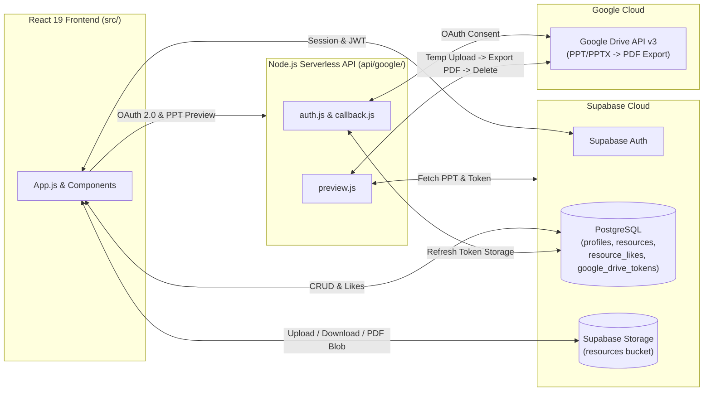

# 📚 ResourceHub

[](https://react.dev/)
[](https://supabase.com/)
[](https://developers.google.com/drive)
[](https://vercel.com/docs/functions)

**ResourceHub** is a full-stack academic resource library built for **Facilitators (Teachers)** and **Students** to share, discover, bookmark, download, and preview study materials (`PDF`, `PPT`, `PPTX`) directly in the browser.

---

## ✨ Key Features

- **🔐 Role-Based Access Control (RBAC)**
  - **Facilitators:** Upload study materials (up to 20 MB), tag resources by subject and file type, and connect Google Drive via OAuth 2.0 to power live presentation previews.
  - **Students:** Browse, search, filter, like/bookmark, preview, and download academic resources.
- **📄 In-Browser Document & Presentation Previews**
  - **Native PDF Rendering:** Streams PDFs directly from Supabase Storage into an interactive modal viewer.
  - **Serverless PPT/PPTX-to-PDF Pipeline:** Automatically converts PowerPoint decks on the fly using Google Drive API v3, streams the rendered PDF to the browser, and immediately cleans up temporary cloud files inside a `finally` block.
- **🔎 Instant Search, Filtering & Sorting**
  - Filter by **Subject** (dynamically derived from uploaded resources) and **File Type** (`PDF`, `PPT`, `PPTX`).
  - Sort by **Newest First** or **Most Liked**.
- **🛡️ Hardened OAuth 2.0 Flow**
  - Uses HMAC-SHA256 signed `HttpOnly` CSRF state cookies and server-side Supabase Service Role verification for Google Drive authorization.

---

## 📖 Interactive Codebase Walkthrough (`codexplanation.html`)

This repository includes a complete, self-contained interactive code reference: **[`codexplanation.html`](./codexplanation.html)**.

- **19 Source & Config Files** documented line-by-line (2,255+ lines covered)
- **60-Second Project Summary & System Workflows** for academic presentations and code reviews
- **Viva / Q&A Panels** explaining architectural decisions for every module
- **Built-in Live Search, Dark/Light Theme Toggle, and Print Stylesheet**

> **How to view:** Clone the repository and open `codexplanation.html` directly in any web browser.

---

## 🏗️ System Architecture



---

## 📂 Project Structure

```text
ResourceHub/
├── api/
│   └── google/
│       ├── auth.js                  # Initiates HMAC-signed Google OAuth 2.0 flow for facilitators
│       ├── callback.js              # Verifies CSRF cookie & stores encrypted refresh token
│       └── preview.js               # Converts PPT/PPTX to PDF via Google Drive API v3 & cleans up
├── public/
│   ├── index.html                   # HTML shell & viewport configuration
│   └── manifest.json                # Web app manifest
├── src/
│   ├── components/
│   │   ├── AuthForm.js              # Sign-in / Sign-up authentication interface
│   │   ├── GoogleDriveConnect.js    # Facilitator Google Drive OAuth connection card
│   │   ├── ResourceRow.js           # Resource card, like button, download & modal previewer
│   │   ├── Sidebar.js               # Dynamic subject navigation sidebar
│   │   ├── TopBar.js                # Top application header bar
│   │   └── UploadForm.js            # Facilitator resource upload form (PDF/PPT/PPTX <= 20 MB)
│   ├── App.css                      # Grounded editorial UI stylesheet & responsive layout
│   ├── App.js                       # Core state container, filtering, sorting & Supabase queries
│   ├── index.js                     # React 19 root mount point
│   └── supabaseClient.js            # Supabase client singleton initialization
├── codexplanation.html              # Interactive line-by-line codebase walkthrough & reference
└── package.json                     # Dependencies and npm scripts
```

---

## 🗄️ Supabase Database & Storage Setup

Create the following tables in your Supabase PostgreSQL database and enable Row Level Security (RLS):

| Table / Bucket | Purpose | Key Columns |
| :--- | :--- | :--- |
| **`profiles`** | Stores user metadata and role | `id` (UUID, PK), `display_name`, `designation`, `role` (`'student'` \| `'facilitator'`) |
| **`resources`** | Stores uploaded resource metadata | `id` (UUID, PK), `title`, `subject`, `file_type`, `file_name`, `file_path`, `owner_id`, `created_at` |
| **`resource_likes`** | Tracks user likes per resource | `resource_id` (UUID, FK), `user_id` (UUID, FK) |
| **`google_drive_tokens`** | Stores facilitator OAuth tokens | `user_id` (UUID, PK), `refresh_token`, `updated_at` |
| **`resources` (Bucket)** | Supabase Storage bucket for files | Stores uploaded `.pdf`, `.ppt`, and `.pptx` binaries |

---

## 🚀 Getting Started

### 1. Clone the Repository

```bash
git clone https://github.com/Piyush6618/ResourceHub.git
cd ResourceHub
```

### 2. Install Dependencies

```bash
npm install
```

### 3. Configure Environment Variables

Create a `.env` file in the root directory with your Supabase and Google Cloud OAuth credentials:

```env
# Frontend (Create React App)
REACT_APP_SUPABASE_URL=https://your-project-id.supabase.co
REACT_APP_SUPABASE_KEY=your-supabase-anon-public-key

# Backend Serverless Functions (/api/google/*)
SUPABASE_URL=https://your-project-id.supabase.co
SUPABASE_SERVICE_ROLE_KEY=your-supabase-service-role-secret-key
GOOGLE_CLIENT_ID=your-google-oauth-client-id.apps.googleusercontent.com
GOOGLE_CLIENT_SECRET=your-google-oauth-client-secret
GOOGLE_REDIRECT_URI=http://localhost:3000/api/google/callback
```

### 4. Run the Development Server

```bash
npm start
```

Open [http://localhost:3000](http://localhost:3000) in your browser.

---

## 📜 Available Scripts

| Command | Description |
| :--- | :--- |
| `npm start` | Runs the app in development mode at `http://localhost:3000` with hot reloading. |
| `npm test` | Launches the interactive Jest / React Testing Library test runner. |
| `npm run build` | Builds and minifies the production bundle into the `build/` directory. |

---

## 📄 License

This project is built for academic and educational use.
