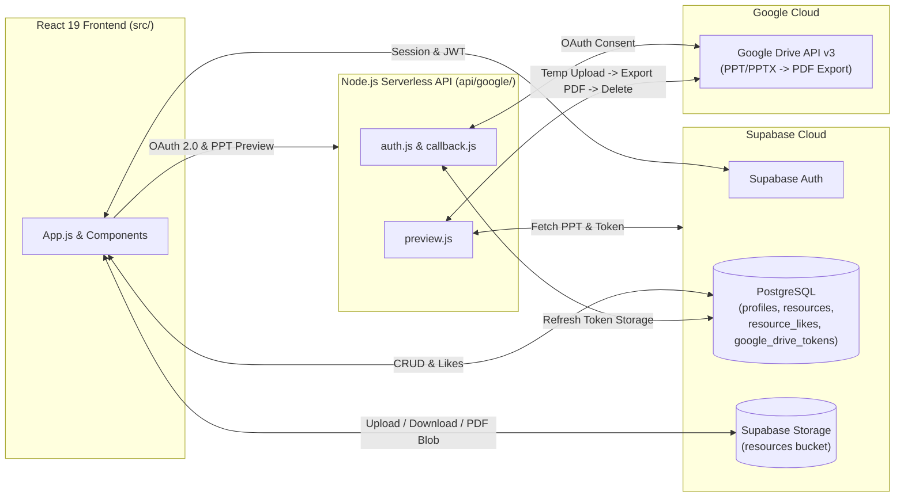

# 📚 ResourceHub

[](https://react.dev/)
[](https://supabase.com/)
[](https://developers.google.com/drive)
[](https://vercel.com/docs/functions)

**ResourceHub** is a full-stack academic resource library built with **React 19**, **Supabase** (Auth, PostgreSQL, Storage), and **Node.js Serverless Functions** (`Google Drive API v3`). It enables **Facilitators (Teachers)** and **Students** to share, discover, filter, like, download, and preview study materials (`PDF`, `PPT`, `PPTX`) directly inside the browser.

> 💡 **Want a line-by-line interactive code walkthrough?** Open **[`codexplanation.html`](./codexplanation.html)** in your browser for a complete 2,255-line interactive guide with live search, dark/light themes, and Viva Q&A panels.

---

## 📋 Table of Contents

1. [Project Summary](#-project-summary)
2. [Key Features](#-key-features)
3. [System Architecture & Workflows](#-system-architecture--workflows)
4. [Complete Codebase Explanation (File-by-File)](#-complete-codebase-explanation-file-by-file)
5. [Core Concepts Glossary](#-core-concepts-glossary)
6. [Project Directory Structure](#-project-directory-structure)
7. [Supabase Database & Storage Schema](#-supabase-database--storage-schema)
8. [Getting Started & Local Setup](#-getting-started--local-setup)

---

## 🎯 Project Summary

> **60-Second Executive / Presentation Summary:**
>
> **ResourceHub** is a full-stack academic resource management platform designed around two user roles: **Facilitators (Teachers)** and **Students**.
>
> 1. **Authentication & Role Resolution:** When a user signs in via **Supabase Auth**, the React frontend queries the PostgreSQL `profiles` table to verify their role (`facilitator` or `student`) and dynamically adapts the UI.
> 2. **Facilitator Capabilities:** Facilitators can upload `PDF`, `PPT`, and `PPTX` study materials (validated up to **20 MB**) to a private **Supabase Storage** bucket and link their Google Drive account via a hardened **OAuth 2.0** flow.
> 3. **Student Capabilities:** Students can search resources in real time, filter by dynamically generated **Subjects** or **File Types**, sort by **Newest** or **Most Liked**, bookmark/like materials, download files, and preview documents directly in the browser.
> 4. **On-the-Fly PPT/PPTX-to-PDF Conversion Engine:** Because web browsers cannot natively render PowerPoint files (`.ppt` / `.pptx`), our serverless backend (`/api/google/preview.js`) securely downloads the presentation from Supabase Storage, temporarily imports and converts it into Google Slides using the uploader's stored OAuth 2.0 refresh token, exports it as a `PDF` stream back to the browser modal, and **immediately deletes the temporary file from Google Drive inside a `finally` block**.

---

## ✨ Key Features

- **🔐 Role-Based Access Control (RBAC):** Conditional UI and backend authorization separating Facilitator upload/OAuth tools from Student browsing tools.
- **📄 In-Browser Document & Presentation Previews:**
  - **PDFs:** Downloaded directly from Supabase Storage into a browser `Blob` URL and rendered inside an interactive modal `<iframe>` with automatic memory cleanup (`URL.revokeObjectURL`).
  - **PPT / PPTX:** Converted serverlessly to PDF on the fly via Google Drive API v3 and streamed into the same preview modal.
- **🔎 Instant Search, Filtering & Sorting:** Combine text search, dynamic subject sidebar filters, file-type dropdowns (`PDF`, `PPT`, `PPTX`), and sorting (`Newest`, `Most Liked`).
- **❤️ Optimistic Likes / Bookmarks:** Real-time like toggling persisted in PostgreSQL (`resource_likes`) with per-user state tracking.
- **🛡️ Cryptographically Hardened OAuth 2.0:** Uses HMAC-SHA256 signed `HttpOnly` CSRF state cookies (`google_oauth_state`) and timing-safe signature verification (`crypto.timingSafeEqual`).

---

## 🏗️ System Architecture & Workflows



### Core End-to-End Workflows

1. **Authentication & Role Verification (`AuthForm.js` → `App.js`)**
   - `AuthForm.js` authenticates users via `supabase.auth.signInWithPassword` or `supabase.auth.signUp`.
   - `App.js` listens to session changes via `onAuthStateChange`, fetches the user's `role`, `display_name`, and `designation` from the `profiles` table, and conditionally renders facilitator components when `userRole === "facilitator"`.
2. **Facilitator Resource Upload (`UploadForm.js` → `App.js`)**
   - `UploadForm.js` validates that the selected file is a `.pdf`, `.ppt`, or `.pptx` and is `≤ 20 MB`.
   - `addResource()` in `App.js` sanitizes the filename, uploads the binary to the `resources` bucket in Supabase Storage under `<user_id>/<timestamp>-<filename>`, and inserts a metadata record into the `resources` table. If the database insert fails, it automatically rolls back and deletes the uploaded file from storage.
3. **Google Drive OAuth 2.0 Authorization (`GoogleDriveConnect.js` → `api/google/auth.js` → `api/google/callback.js`)**
   - A facilitator clicks **Connect Google Drive**, sending their Supabase JWT to `/api/google/auth`.
   - `auth.js` verifies the JWT and facilitator role, generates a random 32-byte nonce, signs `{ userId, nonce }` with HMAC-SHA256, sets an `HttpOnly` cookie, and redirects the user to Google's consent screen.
   - Upon approval, Google redirects to `/api/google/callback`, which validates the HMAC signature and nonce, exchanges the authorization code for an offline `refresh_token`, and upserts it into `google_drive_tokens`.
4. **In-Browser Document Rendering (`ResourceRow.js` → `api/google/preview.js`)**
   - **For PDFs:** `ResourceRow.js` downloads the file directly from Supabase Storage and creates a local `Blob` URL (`URL.createObjectURL(data)`).
   - **For PPT/PPTX:** `ResourceRow.js` calls `/api/google/preview?id=<resource_id>` with the student's Bearer token. `preview.js` fetches the uploader's refresh token (falling back to any connected facilitator token), downloads the PPT/PPTX from Supabase Storage, imports it to Google Drive as a Google Slides deck, exports it as `application/pdf`, returns the PDF bytes to the client, and deletes the temporary Google Drive file in a `finally` block.

---

## 🧩 Complete Codebase Explanation (File-by-File)

Every file in the repository is organized into five logical layers:

### 1. Frontend Core (`src/`)

| File | Role | Detailed Explanation |
| :--- | :--- | :--- |
| **`src/index.js`** | React Entry Point *(18 lines)* | The first JavaScript file executed by the browser. It locates `<div id="root">` in `public/index.html` and mounts `<App />` wrapped in `<React.StrictMode>` to catch potential lifecycle issues during development. |
| **`src/supabaseClient.js`** | Cloud Database Bridge *(10 lines)* | Initializes a single shared Supabase client instance using `REACT_APP_SUPABASE_URL` and `REACT_APP_SUPABASE_KEY` so all components can interact with Supabase Auth, PostgreSQL, and Storage without duplicating connections. |
| **`src/App.js`** | Central State & Controller *(468 lines)* | The brain of the frontend. Manages session state, user profile/role, resource list, search query, subject filter, file-type filter, and sort order. Handles data fetching (`loadResources` joining `resources`, `profiles`, and `resource_likes`), optimistic like toggling (`likeResource`), atomic file upload + DB insertion with storage rollback (`addResource`), and sign-out (`handleSignOut`). |

### 2. UI Components (`src/components/`)

| Component | Role | Detailed Explanation |
| :--- | :--- | :--- |
| **`TopBar.js`** | Application Header *(11 lines)* | Stateless presentational component rendering the top navigation header with the **ResourceHub** brand identity and **Student Workspace** label. |
| **`Sidebar.js`** | Dynamic Subject Navigation *(24 lines)* | Renders the left-hand sidebar listing `"All Subjects"` plus every unique subject dynamically extracted from the loaded resources (`new Set(...)`). Clicking a subject updates the active filter in `App.js`. |
| **`AuthForm.js`** | Sign In & Sign Up Screen *(102 lines)* | Displayed whenever `!session`. Uses a single boolean state (`isLogin`) to toggle between **Sign In** and **Create Account** modes, calling `supabase.auth.signInWithPassword` or `supabase.auth.signUp`. |
| **`UploadForm.js`** | Facilitator Upload & Validator *(88 lines)* | Rendered exclusively for users with `userRole === "facilitator"`. Collects resource title, subject, and file input, enforcing strict client-side validation for allowed extensions (`PDF`, `PPT`, `PPTX`) and maximum file size (`20 MB`) before invoking `addResource()`. |
| **`GoogleDriveConnect.js`** | Facilitator OAuth Trigger *(56 lines)* | Allows facilitators to link their Google Drive account. Sends the active Supabase access token in an `Authorization: Bearer` header to `/api/google/auth` and redirects the browser to Google's OAuth 2.0 consent page. |
| **`ResourceRow.js`** | Resource Card & Live Preview Modal *(212 lines)* | Renders each study material card (file type badge, title, subject, uploader name & designation, upload date, Like button, Preview button, and Download button). Also manages the full-screen preview modal, routing PDFs directly from Supabase Storage and PPT/PPTX files through `/api/google/preview`, while revoking `Blob` URLs on unmount to prevent memory leaks. |

### 3. Backend Serverless APIs (`api/google/`)

| Endpoint | Role | Detailed Explanation |
| :--- | :--- | :--- |
| **`api/google/auth.js`** | OAuth 2.0 Step 1 & CSRF Protection *(108 lines)* | Node.js Serverless Function (`GET /api/google/auth`). Authenticates the caller's Supabase Bearer token, verifies their role is `facilitator` in PostgreSQL, generates a 32-byte cryptographic nonce, signs `{ userId, nonce }` with HMAC-SHA256 into an `HttpOnly; Secure; SameSite=Lax` cookie (`google_oauth_state`), and returns the Google OAuth 2.0 authorization URL requesting `drive.file` scope with `access_type: "offline"`. |
| **`api/google/callback.js`** | OAuth 2.0 Step 2 & Token Storage *(138 lines)* | Handles Google's redirect (`GET /api/google/callback`). Clears the temporary state cookie, verifies the HMAC-SHA256 signature using `crypto.timingSafeEqual` to prevent timing attacks, confirms the `state` nonce matches, exchanges the authorization `code` for an OAuth `refresh_token`, saves it into `google_drive_tokens` via Supabase REST API, and redirects the facilitator back to `/?google_drive=connected`. |
| **`api/google/preview.js`** | PPT/PPTX-to-PDF Conversion Pipeline *(200 lines)* | Powers in-browser PowerPoint previews (`GET /api/google/preview?id=...`). Verifies the student's session, fetches the resource metadata and a valid facilitator Google Drive `refresh_token`, downloads the `.ppt`/`.pptx` binary from Supabase Storage, uploads it to Google Drive with target `mimeType: "application/vnd.google-apps.presentation"` (converting it to Google Slides), exports the presentation as `application/pdf`, streams the PDF buffer back to the client, and guarantees deletion of the temporary Google Drive file inside a `finally` block. |

### 4. Styling & Polish (`src/`)

| File | Role | Detailed Explanation |
| :--- | :--- | :--- |
| **`src/index.css`** | Global CSS Reset *(7 lines)* | Resets browser default body margins and applies `box-sizing: border-box` across all elements. |
| **`src/App.css`** | Complete Application Stylesheet *(692 lines)* | Implements a clean, grounded editorial academic interface: sticky top bar, 2-column Flexbox workspace (Sidebar + Main Content), search/filter toolbar, interactive resource cards, facilitator upload & OAuth cards, authentication screen, full-screen preview modal overlay, and responsive `@media` breakpoints for mobile/tablet screens. |

### 5. Configuration & Testing (`public/`, `package.json`, `src/`)

| File | Role | Detailed Explanation |
| :--- | :--- | :--- |
| **`package.json`** | Project Manifest & Dependencies *(42 lines)* | Declares project dependencies (`react`, `react-dom`, `@supabase/supabase-js`, `googleapis`) and build/dev scripts (`start`, `build`, `test`, `eject`). |
| **`public/index.html`** | Single-Page Application (SPA) Shell *(44 lines)* | The single HTML document served to the browser containing `<div id="root"></div>` where React dynamically mounts the UI. |
| **`src/reportWebVitals.js`**, **`src/App.test.js`**, **`src/setupTests.js`** | Telemetry & Unit Test Suite *(29 lines total)* | Standard Create React App helpers for measuring Core Web Vitals performance metrics and running automated Jest + React Testing Library DOM tests. |

---

## 🧠 Core Concepts Glossary

| Concept | How It Is Used in ResourceHub |
| :--- | :--- |
| **Component & JSX** | Reusable JavaScript functions (`Sidebar`, `ResourceRow`, `UploadForm`) that return declarative HTML-like markup. |
| **Props** | Read-only data and callback functions passed from `App.js` down to child components (e.g., passing `likeResource` and `item` to `ResourceRow`). |
| **`useState()`** | React Hook that preserves component state across renders and automatically updates the DOM when setter functions (`setSearch`, `setResourceList`) are called. |
| **`useEffect()`** | React Hook used to synchronize components with external systems: checking Supabase Auth sessions, loading database records, and revoking temporary `Blob` URLs on cleanup. |
| **`Blob` & Object URLs** | Raw binary file data downloaded into browser memory and converted via `URL.createObjectURL(blob)` into a temporary local URL that an `<iframe>` or `<a>` tag can render or download. |
| **OAuth 2.0 Refresh Token** | A long-lived credential stored securely in `google_drive_tokens` that allows `/api/google/preview.js` to mint fresh short-lived Google Drive access tokens even when the teacher is offline. |

---

## 📂 Project Directory Structure

```text
ResourceHub/
├── api/
│   └── google/
│       ├── auth.js                  # Initiates HMAC-signed Google OAuth 2.0 flow for facilitators
│       ├── callback.js              # Verifies CSRF cookie & stores refresh token in Supabase
│       └── preview.js               # Converts PPT/PPTX to PDF via Google Drive API v3 & cleans up
├── public/
│   ├── index.html                   # SPA HTML shell & viewport configuration
│   └── manifest.json                # Web app manifest
├── src/
│   ├── components/
│   │   ├── AuthForm.js              # Sign-in / Sign-up authentication interface
│   │   ├── GoogleDriveConnect.js    # Facilitator Google Drive OAuth connection card
│   │   ├── ResourceRow.js           # Resource card, like button, download & modal previewer
│   │   ├── Sidebar.js               # Dynamic subject navigation sidebar
│   │   ├── TopBar.js                # Top application header bar
│   │   └── UploadForm.js            # Facilitator resource upload form (PDF/PPT/PPTX <= 20 MB)
│   ├── App.css                      # Complete layout, component & responsive CSS stylesheet
│   ├── App.js                       # Core state container, filtering, sorting & Supabase queries
│   ├── index.css                    # Global CSS reset
│   ├── index.js                     # React 19 root mount point
│   └── supabaseClient.js            # Supabase client singleton initialization
├── codexplanation.html              # Interactive line-by-line codebase walkthrough & reference
├── package.json                     # Dependencies and npm scripts
└── README.md                        # Project overview, architecture & documentation
```

---

## 🗄️ Supabase Database & Storage Schema

Create the following tables in your Supabase PostgreSQL database and enable Row Level Security (RLS):

| Table / Bucket | Purpose | Key Columns |
| :--- | :--- | :--- |
| **`profiles`** | Stores user metadata and role | `id` (UUID, PK), `display_name`, `designation`, `role` (`'student'` \| `'facilitator'`) |
| **`resources`** | Stores uploaded resource metadata | `id` (UUID, PK), `title`, `subject`, `file_type`, `file_name`, `file_path`, `owner_id`, `created_at` |
| **`resource_likes`** | Tracks user likes per resource | `resource_id` (UUID, FK), `user_id` (UUID, FK) |
| **`google_drive_tokens`** | Stores facilitator OAuth tokens | `user_id` (UUID, PK), `refresh_token`, `updated_at` |
| **`resources` (Bucket)** | Supabase Storage bucket for files | Stores uploaded `.pdf`, `.ppt`, and `.pptx` binaries |

---

## 🚀 Getting Started & Local Setup

### 1. Clone the Repository

```bash
git clone https://github.com/Piyush6618/ResourceHub.git
cd ResourceHub
```

### 2. Install Dependencies

```bash
npm install
```

### 3. Configure Environment Variables

Create a `.env` file in the root directory with your Supabase and Google Cloud OAuth credentials:

```env
# Frontend (Create React App)
REACT_APP_SUPABASE_URL=https://your-project-id.supabase.co
REACT_APP_SUPABASE_KEY=your-supabase-anon-public-key

# Backend Serverless Functions (/api/google/*)
SUPABASE_URL=https://your-project-id.supabase.co
SUPABASE_SERVICE_ROLE_KEY=your-supabase-service-role-secret-key
GOOGLE_CLIENT_ID=your-google-oauth-client-id.apps.googleusercontent.com
GOOGLE_CLIENT_SECRET=your-google-oauth-client-secret
GOOGLE_REDIRECT_URI=http://localhost:3000/api/google/callback
```

### 4. Run the Development Server

```bash
npm start
```

Open [http://localhost:3000](http://localhost:3000) in your browser.

---

## 📜 Available Scripts

| Command | Description |
| :--- | :--- |
| `npm start` | Runs the app in development mode at `http://localhost:3000` with hot reloading. |
| `npm test` | Launches the interactive Jest / React Testing Library test runner. |
| `npm run build` | Builds and minifies the production bundle into the `build/` directory. |

---

## 📄 License

This project is built for academic and educational use.
